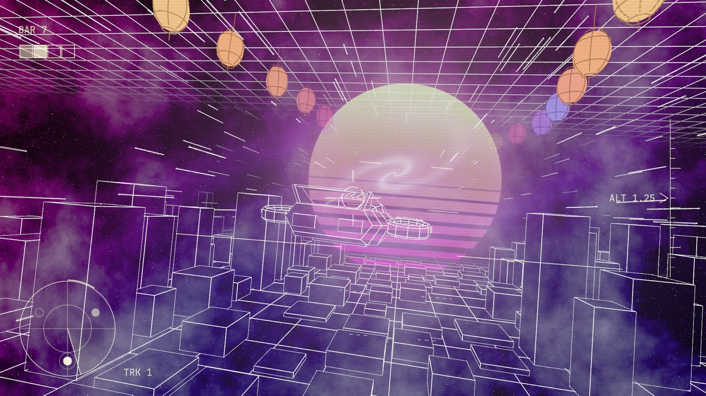
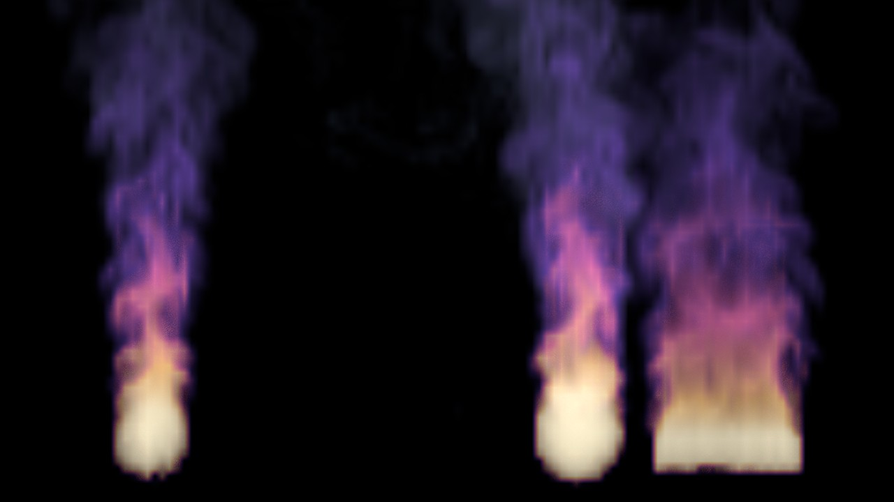
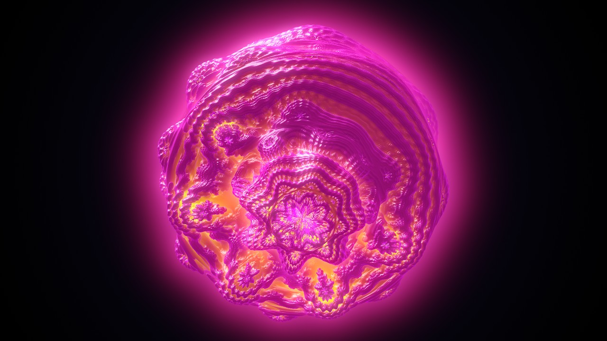

# penumbra

penumbra is a node-based tool for projection mapping, camera tracking and installations driven
by sound, DMX or OSC. It is written in Rust on egui and wgpu. It covers part of what
TouchDesigner is used for. It is not compatible with TouchDesigner: no `.toe`/`.tox` files, no
TouchDesigner Python API, its own node names.

- **Projection onto real objects.** Point the projectors and a camera at the scene and scan.
  penumbra finds the faces and objects, lines the projectors up, blends them and puts content
  on each surface ([below](#projection-onto-objects-and-walls)).
- **Live.** Pictures, 3D, sound, camera, DMX and OSC in one network that keeps running while
  it is edited. Beat tracking from the sound alone, blob tracking from a camera.
- **Everything is a command.** Every action in the app is also a command on a local JSON
  control channel. A script, or Claude Code, can build, change, run and photograph a network
  without anyone clicking. `penumbra-cli mcp` serves the same commands to MCP clients.
- **Plain files.** A project is a folder of text files that can be diffed and edited by hand.
- **Free and open source** (MIT or Apache-2.0).


**Status:** work in progress, used for its author's installations. There will be breaking
changes before 1.0 ([scope](#scope)). The current version is on
the [releases page](https://github.com/alexanderalber/penumbra/releases/latest). Windows 10
and 11 only so far; Linux is planned but untested, macOS is not planned.

## Features

About 160 node types in ten data kinds: `tex` pictures, `chan` channels of numbers, `audio`
sound, `table` text tables, `geo`, `mat`, `light` and `view` for 3D, `vol` volumes, `bodies`
groups of rigid bodies. The
[node reference](docs/reference/nodes.md) lists every one.

- **Pictures:** noise, ramps, text, shapes, images, PSD layers, video (a channel can scrub it
  like tape). Level, HSV, blur, edge, displace, lookup, threshold, chroma key, matte, composite.
  Feedback loops, frame cache, per-pixel time machine, 2D fluid. Shaders in WGSL. Named
  [palettes and colormaps](docs/concepts.md#palettes). Image files read as data (maps, positions,
  normals).
- **Volumes:** 3D smoke with burning fuel in a box (`vol.smoke`), up to 64 emitters, drawn by
  `tex.render_volume` ([smoke](examples/smoke/README.md) example).
- **Rigid bodies:** boxes, balls and hulls of any model fall, pile up and come to rest
  (`physics.rigid_bodies`). A table or a tracker moves bodies that push the others aside.
  Obstacles that move, fields that pull, blow or whirl the bodies, kicks on a trigger, springs
  that pull the bodies into a figure ([rigid-bodies](examples/rigid-bodies/README.md) example).
- **3D:** OBJ, STL, glTF, FBX. Primitives, solid 3D text, texture projection (planar, cylinder,
  sphere, box). Instancing from a table or a texture, tens of thousands on the GPU. Phong, PBR,
  wireframe, occluder materials. Ambient, directional, point, spot, environment lights. Shadows,
  transparency, ambient occlusion. Perspective, orthographic, calibrated cameras. A projector
  light on a 3D model of the room, to try a mapping before going on site.
- **Projectors:** one output per display or part of a display (4K splitters), found again after
  a replug. Corner pin, mesh warp, soft edges, drawn masks
  ([mapping without a camera](docs/mapping-without-camera.md)). Test patterns on all projectors
  at once. Output also in a desktop window. Colour and brightness matched from camera
  measurements ([projector-wall](examples/projector-wall/README.md) example).
- **Model mapping:** a projector fitted to a 3D model without a camera. Choose corners on the
  model, move a crosshair onto the real ones
  ([how](docs/mapping-without-camera.md#a-3d-model-of-the-object-model-mapping)).
- **Scanned objects:** structured light from each projector, filmed by a camera
  ([scanning](docs/scanning.md)). Lines the projectors up (side by side or stacked), blends them,
  finds faces and objects, groups faces into regions editable by clicking. A relief panel becomes
  a height map.
- **Content library:** over 70 ready-made components on shelves in the add dialog: effects for
  any scanned scene, worlds and elements for music ([library](library/README.md)).
- **Shapes:** pulses, chases, ripples per drawn shape, each with its own colour and phase. Shapes
  traced from any mask or label picture, then edited by hand.
- **Camera:** webcams and capture cards, denoising, optical flow, blob tracking with stable ids.
- **Sound:** any audio device or sound file. Loudness, bands, onsets, spectrum (also as a
  texture). Live beat tracker; for sound files a beat and bar grid ahead of time, sections and a
  written arrangement ([below](#beat-tracking)). Instruments and drones played by channels,
  filter, room reverb. Limiter on the output. Records to WAV or into a video.
- **Channels:** LFO, noise, math, filter, envelope, integrator, derivative, trail, merge, select.
  Buttons and sliders on their node. Mouse, keyboard, 3D mouse. A web page on a phone
  ([control-page](examples/control-page/README.md) example). Any param bound to a channel by
  dragging a wire onto it. OSC and MIDI learn.
- **Shows:** a list of steps (`chan.sequence`): which piece, how long, which transition. Hold
  until GO from a key, a button or OSC. `tex.sequence` blends and cooks only what is shown
  ([show](examples/show/README.md) example).
- **Python:** script node (CPython 3.12 or later). Channels and tables in, channels and a table
  out, state kept between frames.
- **Components:** networks inside a node, with chosen params exposed, kept in a library.
- **Editor:** automatic layout ([below](#arranging-a-network)), undo with a change log, copy and
  paste, replacing a node's kind with its wires kept, notes on the canvas. The add dialog also
  finds TouchDesigner names and file extensions. A `?` on every node opens its help in a
  [single-page manual](docs/penumbra.html).
- **Running a show:** a failing node shows an error, the rest keeps running. Feedback loops and
  caches survive a restart. Idle nodes give their video memory back. Check for Windows settings
  that disturb a show (Game Bar, banners, Duplicate displays), fixed and restored afterwards.
  Meters for GPU load, memory, temperature and per node; `cook.profile` shows where a frame's
  time goes. Recovery after a lost GPU device. Show mode locks the project. After a crash the
  app restarts and the show goes on at its cue.
- **Files out:** recording with sound (`out.video`), tables as CSV or TSV (`out.table`), geometry
  as OBJ, STL or GLB (`out.mesh`).
- **Automation:** headless runs execute a script of commands and save pictures of any node or
  the window. Every rendered picture in this README was made that way
  (`python tools/gallery.py`).

## Inputs and outputs

| | in | out | notes |
|---|---|---|---|
| Displays, projectors | | yes | fullscreen per display, or a viewport of one |
| Camera, capture card | yes | | Media Foundation (UVC webcams, Elgato Cam Link and similar) |
| Video files | yes | yes | in: MP4, MOV, MKV, WebM, MXF, MPEG with H.264, HEVC, ProRes, DNxHR, VP9, AV1, HAP; GIF. Out: H.264 (MP4, CPU or NVIDIA card), ProRes 422, 422 HQ, 4444 (MOV) |
| Image files | yes | snapshots | PNG, JPEG, TIFF, EXR, HDR, WebP and more; PSD/PSB layers. Any node can be saved as PNG |
| 3D files | yes | yes | in: OBJ (with MTL), STL, glTF/GLB, FBX (7.x binary and ASCII, animated, skinned). Out: OBJ, STL, GLB |
| Text tables | yes | yes | in: CSV, TSV, plain lines. Out: CSV, TSV |
| Audio | yes | yes | any device (WASAPI, shared mode). Files: WAV, FLAC, MP3, Ogg, AAC, in step with video files. Output always through a limiter at -1 dBFS. Records to WAV |
| Spout | yes | yes | textures shared with other programs on the same machine |
| NDI® | video and audio | video and audio | needs the NDI runtime installed |
| Screen, windows | yes | | a monitor or one window by its title (Windows.Graphics.Capture) |
| DMX over USB | | yes | Enttec Open DMX USB, one universe |
| Art-Net | yes | yes | |
| sACN (E1.31) | yes | yes | |
| DDP | | yes | pixel controllers such as WLED |
| OSC | yes | yes | UDP; learn binds a param to the next address that arrives |
| HTTP, WebSocket | yes | | JSON from a browser or another program; serves the project's control page, or a built-in one |
| Mouse, keyboard | yes | | the pointer anywhere on the desktop; keys while a penumbra window has the focus |
| 3D mouse | yes | | 3Dconnexion SpaceNavigator, also steers the 3D viewer; without the vendor driver |
| Control channel | yes | yes | JSON lines over TCP on localhost, every command of the app |
| MIDI | yes | yes | controllers by name, every control a channel; learn binds a param to the next control moved; MIDI clock as a tempo. An unplugged device comes back by itself |
| Depth cameras | | | not built (no Kinect, RealSense, ZED) |

## Compared with TouchDesigner

The node kinds map roughly onto TouchDesigner's families: `tex` onto TOPs, `chan` onto CHOPs,
`table` onto DATs, `geo` onto SOPs, `mat` onto MATs, `comp` onto COMPs. penumbra was built for
one person's installations and has far fewer nodes in each family.

A TouchDesigner project does not open in penumbra; it is rebuilt. The
[Claude Code skill](.claude/skills/port-from-touchdesigner/SKILL.md) for that walks a session
through it. It dumps the `.toe` as text with TouchDesigner's own `toeexpand`. It maps the
operators, GLSL shaders and Python to penumbra nodes, and it compares the port with a
screenshot of the original.

Not in penumbra, as of now. Some of this is planned, some stays out, see [Scope](#scope):

- Timecode (LTC, MTC), VST plugins.
- Depth cameras and other tracking hardware (Kinect, RealSense, ZED, Leap Motion).
- Python expressions on parameters. Parameters are driven by binding them to channels. Python
  runs only in script nodes.
- Custom control panels (TouchDesigner's Panel COMPs): buttons and sliders sit on their nodes
  and, flagged `show`, on the locked show screen. A web page in the project's `www` folder
  steers channels from a phone. Keyframe animation and a timeline: a show
  runs as a list of steps instead (`chan.sequence`).
- Geometry modelling beyond primitives, 3D text, transforms, merging and instancing.
- Particle systems have no dedicated nodes. Particles can be done in shaders, as in the
  curl-noise example. Rigid bodies have no joints.
- Network I/O beyond OSC, Art-Net, sACN, DDP, NDI and incoming HTTP and WebSocket: no raw TCP,
  UDP or serial nodes, no outgoing web requests, no streaming (RTMP, SRT, WebRTC).
- GLSL (shaders are WGSL), a C++ plugin API, macOS and Syphon.

Different by design:

- A project is a folder of plain text files (RON). It can be diffed and edited by hand, and
  the app reloads it when it changes on disk.
- Everything is reachable over the control channel, including clicks, screenshots and the
  layout of the editor.
- Projection onto objects from a camera scan is built in, down to the content.
- Free and open source (MIT or Apache-2.0), no licence tiers or resolution limits.

## Scope

penumbra is built with Claude Code, and new scenes are meant to be built the same way: you
describe the scene, Claude Code builds the network. Because of that, some things from
TouchDesigner are missing on purpose. For example there are few logic nodes. A short Python
script in a script node does the same job, and Claude Code writes that script faster than
anyone wires the nodes.

Not every planned feature is there yet. More will come over the first months. The feature list
of TouchDesigner is not the goal. Hardware the author does not own, like depth cameras, stays
out until someone who owns it contributes. Things that would make penumbra hard to maintain
for one person stay out on purpose.

There will be breaking changes before 1.0. A project is plain text and Claude Code can read
it. So when an update breaks a project, Claude Code can usually fix the files. Release notes
list every rename.

The goal is that a show runs more stably and faster in penumbra than in TouchDesigner. And
that penumbra does some things TouchDesigner does not, like structured light scanning.

The author used TouchDesigner for almost six years. Since penumbra 0.2 the author works only
in penumbra. The plan is to maintain penumbra for a long time.

## Projection onto objects and walls

Each projector shows stripe patterns, the camera films them, and from the films penumbra
knows where every projector pixel lands. You draw the content once, in the camera's picture;
each projector shows its share, in place. On objects, `scan.scene` finds the faces and
`scan.regions` groups them. A Halloween show on crates and a pumpkin, two projectors (click
for the film):

[](https://www.youtube.com/watch?v=KsELIfs2M8Y)

On a wall, three projectors become one picture: blend weights from the scan, colours matched
by the camera, brightness evened out by a flat field.

[Scanning](docs/scanning.md) has the whole chain; the examples
[projection-onto-objects](examples/projection-onto-objects/README.md) and
[projector-wall](examples/projector-wall/README.md) ship real scans, and a
[Claude Code skill](.claude/skills/projection-mapping/SKILL.md) walks a session through it.

## Gallery

Each picture comes from a project that ships with penumbra.

The [curl-noise](examples/curl-noise/README.md) example: 65 536 sticks moved through a
curl-noise flow field, simulated in shaders and drawn instanced, coloured through the `magma`
colormap. The screenshot at the top of this page shows its network. Inspired by the video
["TouchDesigner _03 Curl Noise"](https://www.youtube.com/watch?v=DkSwEY-m9GA) by threedashes.


The [music-synthwave](examples/music-synthwave/README.md) example: a whole show on one song. The
glider's world of wireframe blocks, lamps and a sun moves with the beats, and one command writes
the arrangement from the beats and sections found in the file.



The [projection-room](examples/projection-room/README.md) example: a 3D room lit by a projector,
two spot lights and an environment light, with a stained-glass panel, a cube and a chrome ball.


The [fluid](examples/fluid/README.md) example: a 2D fluid pushed by optical flow and tracked
blobs, here from wandering spots that stand in for a camera.


The [smoke](examples/smoke/README.md) example: smoke simulated in a box in space from three
emitters. Hot smoke glows in colours of its own.



The [raymarch](examples/raymarch/README.md) example: three raymarched looks that follow music, a
tunnel, melting shapes and a fractal.



The demo the app opens on its first start: a reaction-diffusion growing around a title.


## Beat tracking

`chan.beat_analysis` finds the tempo, the beat and the bar from the sound alone. No tap tempo,
no clock from another program. It locks on within a few seconds, follows tempo changes and
keeps the beat running through breakdowns. Its outputs are channels to bind params to. `beat`
and `bar` rise from 0 to 1 between beats and bars. `tick` is 1 on each beat. `bar_beat` counts
the beat within the bar. Also `bpm`, `confidence`, `level`, `low`, `mid`, `high`, `onset`,
`kick` and a spectrum. The `offset` param moves beat and bar ahead to make up for a projector's
delay.

The analysis draws meters for a sound check, in the viewer and as a texture that can be
projected or laid over the show. The method is described in [Audio](docs/audio.md).

For a sound file, `chan.beat_grid` finds every beat and bar before they play, with the
[Beat This!](https://github.com/CPJKU/beat_this) model on the CPU. Its channels have no lag
and hold their bars on DJ mixes. The [beat-grid](examples/beat-grid/README.md) example
runs it beside the live tracker on the same music.

`chan.beat_grid` also finds the tracks and sections of the file. `beats.cues` makes a step of a
`chan.sequence` from each section. `beats.arrange` writes what a music stage shows in each
section into a table, one row per section. The [library](library/README.md) has stages for it (a
synthwave world, a tunnel, a valley at night) and elements to swap in and out. The
[music-synthwave](examples/music-synthwave/README.md) example is a whole song arranged that way.

## Arranging a network

Press L over the node editor to lay the network out. Columns follow the data flow. Within a
column, nodes are ordered so that wires cross as little as possible. Wires are routed around
nodes and kept apart from each other. With two or more nodes selected, only the selection
moves. Ctrl+Z undoes the layout.


## Download (Windows)

You need Windows 10 or 11 (64-bit) and a graphics card with DirectX 12 or Vulkan.

1. Download the zip from the [latest release](https://github.com/alexanderalber/penumbra/releases/latest)
   (under "Assets", `penumbra-...-windows-x64.zip`).
2. Unpack it anywhere and double-click `penumbra.exe`. The first start opens a demo project,
   later starts open the project you had open last.

The program is not signed. Windows may show "Windows protected your PC": click "More info",
then "Run anyway". The zip also holds the [examples](examples/README.md), the content library
and the documentation.

Two features need something installed. The script node needs Python 3.12 or newer, and
numpy for pictures and meshes ([scripts](docs/scripts.md)). The two NDI nodes need the NDI runtime ([NDI](docs/ndi.md)).
Everything else runs without them.

## Building from source

```
cargo run -p penumbra
```

With no arguments the app opens the project that was open last, on the first start the demo
project.

What a build needs:

- Rust 1.95 or newer (`rust-version` in `Cargo.toml`).
- Network on the first build: some dependencies (`photocraft`, `filmcraft`, `effectcraft`) are
  git dependencies pinned to a revision, not crates.io releases.
- On Windows, the Visual Studio Build Tools for Rust's MSVC toolchain. `rustup` offers to
  install them.
- No Python or NDI SDK at build time.

`cargo xtask ci` is the gate before a commit: `fmt`, `clippy`, `test`, `clippy` for Linux,
the layer check (`core` and `graph` must not depend on wgpu or egui, nothing below `ui` on
egui) and the third-party notices. `cargo xtask slow` runs the tests of `chan.beat_grid` that
need the beat network; they take minutes, so only a release needs them. `cargo xtask docs`
regenerates the reference from the node types and commands, `cargo xtask bless` rewrites the
golden images after an intended change of a render, `cargo xtask dist` builds the release zip.
Linux is only checked by clippy so far.

## How this is built

Most of the code is written by Claude Code. The author directs it, reviews what it wrote and
tests the result on the projectors, the camera and real shows. Tooling enforces the rules: the
workspace denies `unwrap`, `expect`, `panic`, `unreachable`, indexing that can panic and
`unsafe` outside small delimited modules. A layer check runs on every dependency set. Renders
are compared with golden images. File, network and hardware input is tested with hostile data.

All code in this repository is Rust, and a Windows build compiles no C or C++. Foreign code is
reached only at the edges, through those small modules: Windows and the graphics driver, and
the NDI runtime and Python, which load at run time and are optional.

The history on GitHub begins with the split into a public repository in October 2026; the work
before that is in a private archive. How the code is put together is in
[ARCHITECTURE.md](ARCHITECTURE.md).

## Documentation

The [documentation](docs/README.md) starts with [getting started](docs/getting-started.md) and
a [glossary](docs/glossary.md), and has a reference of every [node](docs/reference/nodes.md) and
[command](docs/reference/commands.md).
All of it is also one page, [docs/penumbra.html](docs/penumbra.html), which the `?` on every node
opens.

## Acknowledgements

penumbra owes a lot to the [storytold](https://github.com/storytold) apps (photocraft,
effectcraft, filmcraft and their siblings). Its former name, lumencraft, followed their "-craft"
naming, and many of its engineering conventions are borrowed from them: everything is a command,
a JSON control channel, headless snapshots, the no-panic rule, `cargo xtask ci` as the commit
gate. It also builds directly on several of their crates: `photocraft-codecs` and
`photocraft-psd` for image files and PSD layers, `effectcraft-text` for text, and the
`filmcraft-*` crates for video.
The FBX reader follows the format knowledge of [ufbx](https://github.com/ufbx/ufbx) (Samuli
Raivio) and [fbxcel](https://github.com/lo48576/fbxcel) (YOSHIOKA Takuma), and ufbx's test
files check it.
`chan.beat_grid` finds beats and downbeats with [Beat This!](https://github.com/CPJKU/beat_this)
by Francesco Foscarin, Jan Schlüter and Gerhard Widmer (Institute of Computational Perception,
JKU Linz; "Beat This! Accurate Beat Tracking Without DBN Postprocessing", ISMIR 2024). penumbra
runs its published weights (MIT) in its own inference code; `assets/models/` holds them with
their licence.
penumbra is an independent project and not affiliated with the storytold team.

## Contributing

Issues and pull requests are welcome. The best fit: support for hardware the author cannot
test, from someone who uses it. For example "I have a Kinect and want to use it in penumbra,
here is a PR." For anything bigger than a fix, open an issue first, so we can agree on the
scope before the work is done. Contributions are licensed as below.

## License

Licensed under either of [Apache License, Version 2.0](LICENSE-APACHE) or
[MIT license](LICENSE-MIT) at your option. Unless you explicitly state otherwise, any
contribution intentionally submitted for inclusion in penumbra, as defined in the Apache-2.0
license, shall be dual licensed as above, without any additional terms or conditions.

One exception: the song in `examples/music-synthwave/song.mp3` is by Krzna, used with the producer's
permission, and not under these licenses. See
[its license note](examples/music-synthwave/MUSIC-LICENSE.md).

## Disclaimer

penumbra is an independent project, not affiliated with, endorsed by or connected to
Derivative Inc. TouchDesigner is a trademark of Derivative Inc. Mentions of TouchDesigner in
this repository only describe where an idea came from or how penumbra differs. NDI® is a
registered trademark of Vizrt NDI AB.
