# penumbra

penumbra is a node-based tool for projection mapping, camera tracking and installations driven
by sound, DMX or OSC. It is written in Rust on egui and wgpu. It covers part of what
TouchDesigner is used for. It is not compatible with TouchDesigner: no `.toe`/`.tox` files, no
TouchDesigner Python API, its own node names.

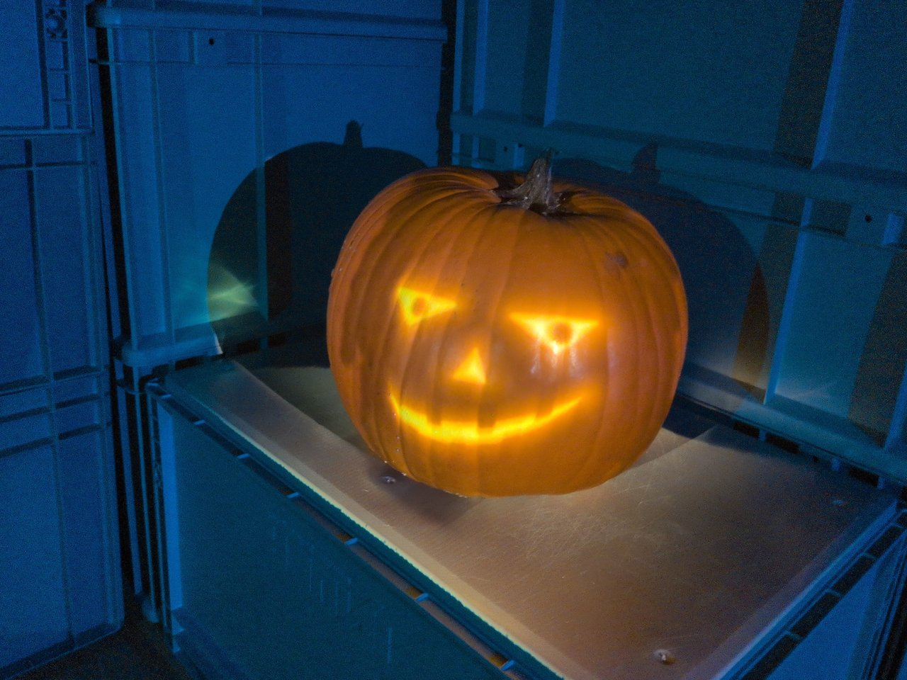

- **Projection onto real objects.** Point the projectors and a camera at the scene and scan.
  penumbra finds the faces and objects, lines the projectors up, blends them and puts content
  on each surface ([below](#projection-onto-objects)).
- **Live.** Pictures, 3D, sound, camera, DMX and OSC in one network that keeps running while
  it is edited. Beat tracking from the sound alone, blob tracking from a camera.
- **Everything is a command.** Every action in the app is also a command on a local JSON
  control channel. A script, or Claude Code, can build, change, run and photograph a network
  without anyone clicking. `penumbra-cli mcp` serves the same commands to MCP clients.
- **Plain files.** A project is a folder of text files that can be diffed and edited by hand.
- **Free and open source** (MIT or Apache-2.0).


**Status:** work in progress, used for its author's installations. The current version is on
the [releases page](https://github.com/alexanderalber/penumbra/releases/latest). Windows 10
and 11 only so far; Linux is planned but untested, macOS is not planned.

## Features

About 110 node types in seven data kinds: `tex` pictures, `chan` channels of numbers, `table`
text tables, `geo`, `mat`, `light` and `view` for 3D. The [node reference](docs/reference/nodes.md)
lists every one.

- **Pictures:** sources are noise, ramps, text, shapes, images, PSD layers and video. Filters
  include level, HSV, blur, edge, displace, lookup, threshold, chroma key, matte and composite.
  Also feedback loops, a per-pixel time machine, a frame cache, a 2D fluid pushed by motion or
  blobs, and a shader node in WGSL whose params come from the shader file.
- **Palettes and colormaps** as a kind of param: pick a set of colours by name, paste hex
  colours or a coolors or colorhunt link, or let a channel switch between them
  ([below](#palettes)).
- **3D:** meshes from OBJ, STL and glTF, primitives, instancing from a table or from a texture
  (tens of thousands of instances on the GPU). Phong, PBR, wireframe and occluder materials.
  Ambient, directional, point, spot and environment lights, shadows, transparency, ambient
  occlusion. Perspective, orthographic and calibrated cameras. A projector light throws a
  picture onto a 3D model of the room, to try a mapping before going on site.
- **Projectors:** one output per display or per part of a display (for 4K splitters), found
  again after a replug by model and serial number (or connector). Corner pin, mesh warp,
  soft-edge blending, drawn masks, all by eye when there is no camera
  ([mapping without a camera](docs/mapping-without-camera.md)). Test patterns on every projector at once (alignment, focus,
  frame drops, dead pixels). Projectors of different models matched in colour and brightness
  from camera measurements, and evened out across each picture.
- **Scanned objects:** structured light from each projector, filmed by a camera
  ([scanning](docs/scanning.md)). The scan lines the projectors up (side by side or stacked),
  blends them, finds the flat faces and the objects of a scene (crates, a floor, a pumpkin) and
  groups the faces into regions that can be edited by clicking. A relief panel becomes a height
  map. A [content library](library/README.md) of 15 effects fits any scanned scene. Projector and
  camera calibration (where a projector or camera stands and how it sees, solved from point
  pairs) exists as commands; the interactive calibration UI does not exist yet.
- **Shapes:** content per drawn shape: pulses, chases along outlines, ripples, each shape with
  its own colour and phase. Shapes can be traced from any mask or label picture (a
  background-removed photo, a threshold, a scan's regions), then simplified and edited by hand.
- **Camera:** live input from webcams and capture cards, denoising, optical flow, blob tracking
  with ids that stay with a blob.
- **Sound:** input from any audio device, loudness, bands, onsets, a spectrum (also as a texture) and a beat tracker
  (see [below](#beat-tracking)).
- **Channels:** LFO, noise, math, filter, integrator, derivative, trail, merge, select. Mouse, keyboard and 3D
  mouse as inputs. Any parameter can be bound to a channel by dragging a wire onto it. OSC
  addresses can be learned.
- **Shows:** a show as a list of steps (`chan.sequence`): which piece, how long, which
  transition. `tex.sequence` blends between the pieces and cooks only what is shown; a
  `chan.clock` per piece starts it from its beginning.
- **Python:** a script node (CPython 3.12 or later). It turns channels and tables into channels
  and a table, and keeps its state between frames.
- **Components:** networks inside a node, with chosen params exposed, kept in a library.
- **Editor:** automatic layout ([below](#arranging-a-network)), undo with a change log, copy
  and paste, replacing a node by another kind with its wires kept. A `?` on every node opens
  its help in a [single-page manual](docs/penumbra.html).
- **For running a show:** a failing node shows an error and the rest keeps running (no panics
  by design). Feedback loops and caches survive a restart. Nodes that sit idle give their video
  memory back. The app checks for Windows settings that interfere with a show (Game Bar,
  notification banners), fixes them and restores them afterwards. A cook-time meter shows GPU
  load, memory and temperature. The app recovers after the GPU device is lost. Show mode locks
  the project against edits during a performance and starts the app again after a crash.
- **Files out:** a recording of the show (`out.video`), any table as CSV or TSV (`out.table`),
  any geometry as OBJ, STL or GLB with its transforms and instances baked in (`out.mesh`); each
  writes when its input changes or on command, into the project's `export/` folder by default.
- **Automation:** headless runs execute a script of commands and save pictures of any node or
  of the whole window. Every rendered picture in this README was made that way
  (`python tools/gallery.py`); the photos are of a real setup.

## Inputs and outputs

| | in | out | nodes | notes |
|---|---|---|---|---|
| Displays, projectors | | yes | `out.projector` | fullscreen per display, or a viewport of one |
| Camera, capture card | yes | | `tex.video_in` | Media Foundation (UVC webcams, Elgato Cam Link and similar) |
| Video files | yes | yes | `tex.video_file`, `out.video` | in: MP4, MOV, MKV, WebM, MXF, MPEG with H.264, HEVC, ProRes, DNxHR, VP9, AV1, HAP; GIF. Out: H.264 (MP4), ProRes 422, 422 HQ, 4444 (MOV) |
| Image files | yes | snapshots | `tex.image_file`, `tex.layer` | PNG, JPEG, TIFF, EXR, HDR, WebP and more; PSD/PSB layers. `node.snapshot` saves any node as PNG |
| 3D files | yes | yes | `geo.file`, `out.mesh` | in: OBJ (with MTL), STL, glTF/GLB. Out: OBJ, STL, GLB |
| Text tables | yes | yes | `table.file`, `out.table` | in: CSV, TSV, plain lines. Out: CSV, TSV |
| Audio | yes | yes | `audio.device_in`, `out.audio`, `chan.audio_envelope`, `chan.audio_spectrum`, `chan.audio_analysis`, `audio.instrument`, `audio.ambience`, `audio.filter` | any device (WASAPI, shared mode). Loudness per channel, a spectrum as numbers or a spectrogram texture, beat and tempo. Output always through a limiter at -1 dBFS; `audio.mute` silences everything. Ready-made instruments and drones in a key and scale, played by channels. A filter for any sound. No audio files yet |
| Spout | yes | yes | `tex.spout_in`, `out.spout` | textures shared with other programs on the same machine |
| NDI® | video and audio | video | `tex.ndi_in`, `out.ndi` | needs the NDI runtime installed |
| DMX over USB | | yes | `out.dmx` | Enttec Open DMX USB, one universe |
| Art-Net | yes | yes | `chan.dmx_in`, `out.dmx` | |
| sACN (E1.31) | yes | yes | `chan.dmx_in`, `out.dmx` | |
| DDP | | yes | `out.dmx` | pixel controllers such as WLED |
| OSC | yes | yes | `chan.osc_in`, `chan.osc_out` | UDP; learn binds a param to the next address that arrives |
| Mouse, keyboard | yes | | `chan.mouse_in`, `chan.keyboard_in` | the pointer anywhere on the desktop; keys while a penumbra window has the focus |
| 3D mouse | yes | | `chan.spacemouse_in` | 3Dconnexion SpaceNavigator, also steers the 3D viewer; without the vendor driver |
| Control channel | yes | yes | | JSON lines over TCP on localhost, every command of the app |
| MIDI | | | | not built |
| Depth cameras | | | | not built (no Kinect, RealSense, ZED) |

## Compared with TouchDesigner

The node kinds map roughly onto TouchDesigner's families: `tex` onto TOPs, `chan` onto CHOPs,
`table` onto DATs, `geo` onto SOPs, `mat` onto MATs, `comp` onto COMPs. penumbra was built for
one person's installations and has far fewer nodes in each family.

Not in penumbra, as of now:

- MIDI, timecode (LTC, MTC), audio output, audio files, VST plugins.
- Depth cameras and other tracking hardware (Kinect, RealSense, ZED, Leap Motion).
- Python expressions on parameters. Parameters are driven by binding them to channels. Python
  runs only in script nodes.
- Custom control panels (TouchDesigner's Panel COMPs), keyframe animation and a timeline. A
  show runs as a list of steps instead (`chan.sequence`).
- Geometry modelling beyond primitives, transforms, merging and instancing. Particle systems
  and physics have no dedicated nodes; both can be done in shaders, as in the curl-noise
  example.
- Network I/O beyond OSC, Art-Net, sACN, DDP and NDI: no TCP, UDP, WebSocket, HTTP or serial
  nodes, no streaming (RTMP, SRT, WebRTC).
- GLSL (shaders are WGSL), a C++ plugin API, macOS and Syphon.

Different by design:

- A project is a folder of plain text files (RON). It can be diffed and edited by hand, and
  the app reloads it when it changes on disk.
- Everything is reachable over the control channel, including clicks, screenshots and the
  layout of the editor.
- Projection onto objects from a camera scan is built in, down to the content.
- Free and open source (MIT or Apache-2.0), no licence tiers or resolution limits.

## Projection onto objects

You draw the content once, in the camera's picture. Each projector shows its share of it, in
place on the objects. The scan behind that: each projector shows stripe patterns, the camera
films them, and from the films penumbra knows which camera pixel each projector pixel lands
on. During the show that costs one lookup and one multiply per projector.

A relief panel needs one scan per projector. `scan.relief` turns it into a height map and a
blend weight for each projector. The [projection-onto-objects](examples/projection-onto-objects/README.md)
example lights a 3D-printed mountain range this way, from a real scan that ships with it:

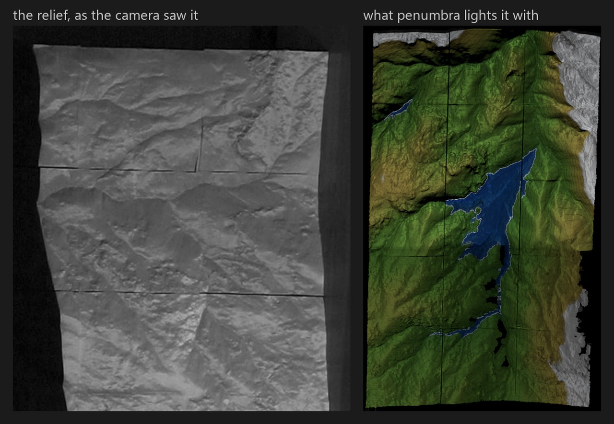

A scene of boxes and things on them works the same way. `scan.scene` finds every flat face and
every object, with straight borders where the faces have them. `scan.regions` groups the faces
into regions, one per crate front, side or lid, and switches the floor off. Here a corner of
crates with a pumpkin, lit by two projectors:

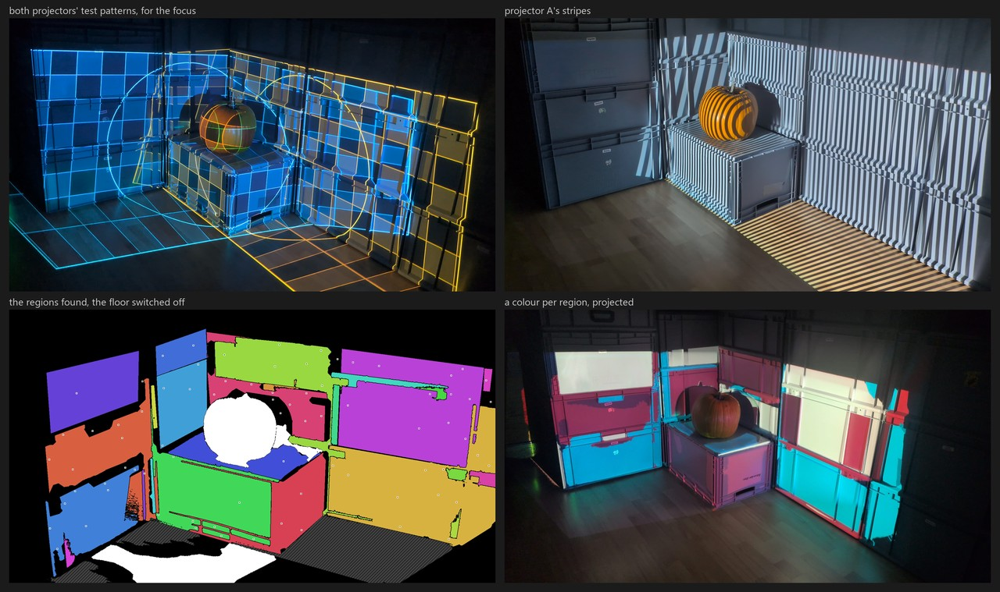

Without projectors, `scan.synthetic` ray casts a made-up scene of the same kind, for trying
the chain at the desk.

The [content library](library/README.md) has effects that fit any scanned scene: colours per
region, outlines, light from inside an object, a carved face, water. Each has a preview on the
same crates and pumpkin.

What a show on such a scan looks like in the room:

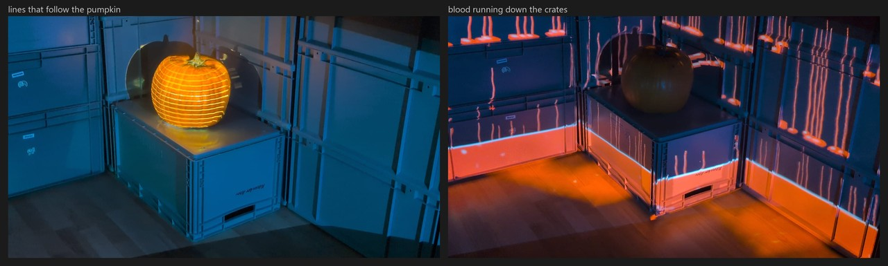

The whole chain is in [Scanning](docs/scanning.md). The repository also holds a
[Claude Code skill](.claude/skills/projection-mapping/SKILL.md) that walks a session through
it: check the hardware, scan, find the faces, blend, put content on and look at the result.

## Gallery

Each picture comes from a project that ships with penumbra.

The [curl-noise](examples/curl-noise/README.md) example: 65 536 sticks moved through a
curl-noise flow field, simulated in shaders and drawn instanced, coloured through the `magma`
colormap. The screenshot at the top of this page shows its network.

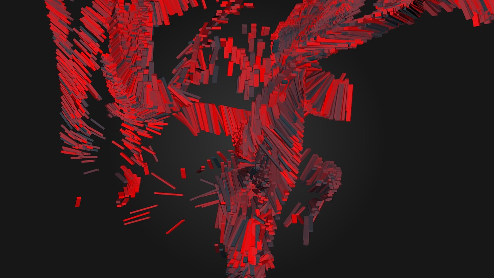

The [synthwave](examples/synthwave/README.md) example: a glider flying over a wireframe city
between two grids, through a nebula. Everything is made in the network: no pictures, no meshes
from files.

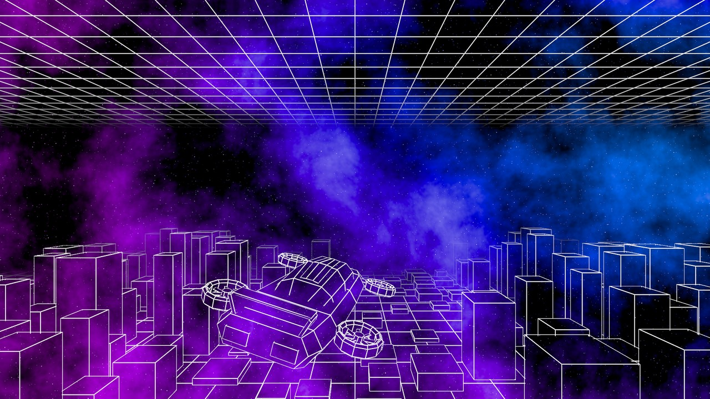

The [projection-room](examples/projection-room/README.md) example: a 3D room lit by a projector,
two spot lights and an environment light, with a stained-glass panel, a cube and a chrome ball.

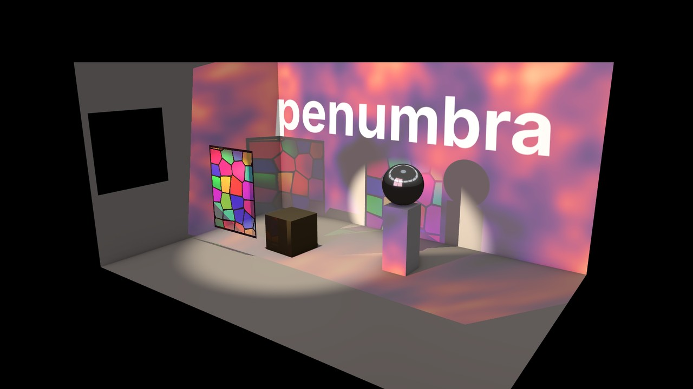

The [fluid](examples/fluid/README.md) example: a 2D fluid pushed by optical flow and tracked
blobs, here from wandering spots that stand in for a camera.

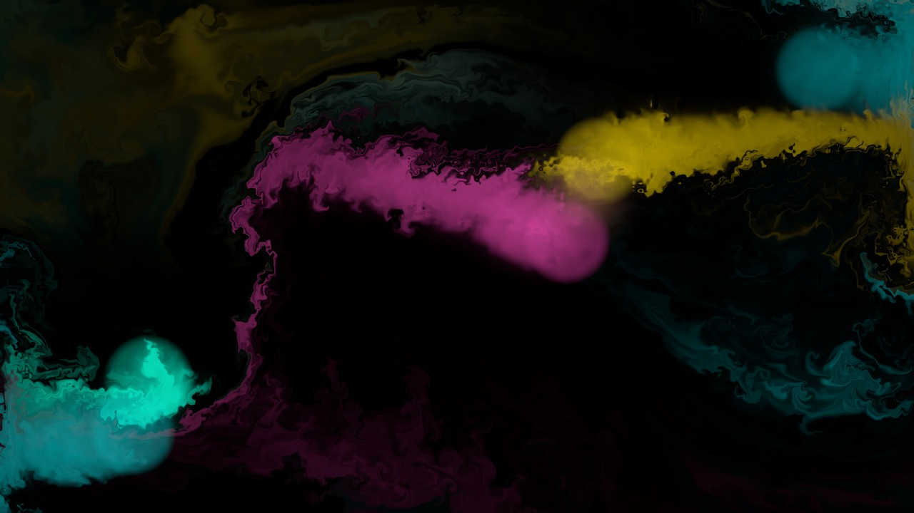

The [feedback](examples/feedback/README.md) example: each frame fed back into the next, zoomed,
turned, softened, dimmed and shifted in hue.

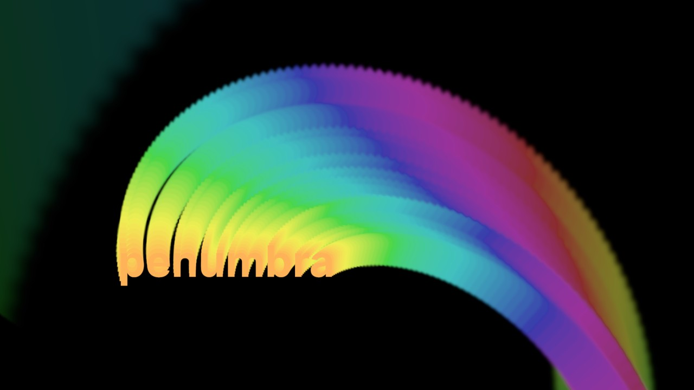

The demo the app opens on its first start: a reaction-diffusion growing around a title.

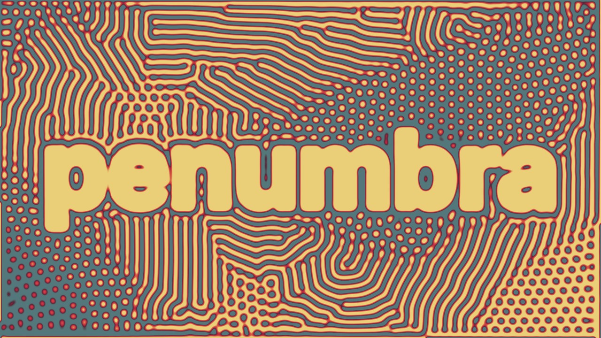

## Beat tracking

`chan.audio_analysis` finds the tempo, the beat and the bar from the sound alone. No tap tempo,
no clock from another program. It locks on within a few seconds, follows tempo changes and
keeps the beat running through breakdowns. Its outputs are channels to bind params to. `beat`
and `bar` rise from 0 to 1 between beats and bars. `tick` is 1 on each beat. `bar_beat` counts
the beat within the bar. Also `bpm`, `confidence`, `level`, `low`, `mid`, `high`, `onset`,
`kick` and a spectrum. The `offset` param moves beat and bar ahead to make up for a projector's
delay.

The analysis draws meters for a sound check, in the viewer and as a texture that can be
projected or laid over the show:

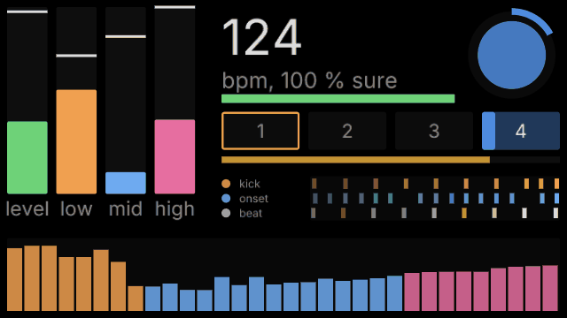

Here a Python script node plays a 124 BPM pattern into the analysis. The method is described
in [Audio](docs/audio.md).

## Palettes

A palette param names a set of colours. `tex.ramp`, `tex.lookup`, shaders and several library
effects take one. To try another look, switch the name. Ten palettes and nine colormaps are
built in (below). A project adds its own in `palettes.txt`, as hex colours or a coolors or
colorhunt link. Bound to a channel, the param picks a palette by its place in the list. See
[Concepts](docs/concepts.md#palettes).

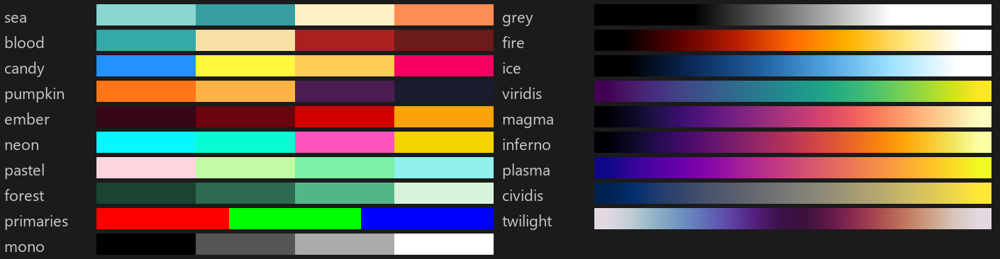

## Arranging a network

Press L over the node editor to lay the network out. Columns follow the data flow. Within a
column, nodes are ordered so that wires cross as little as possible. Wires are routed around
nodes and kept apart from each other. With two or more nodes selected, only the selection
moves. Ctrl+Z undoes the layout.

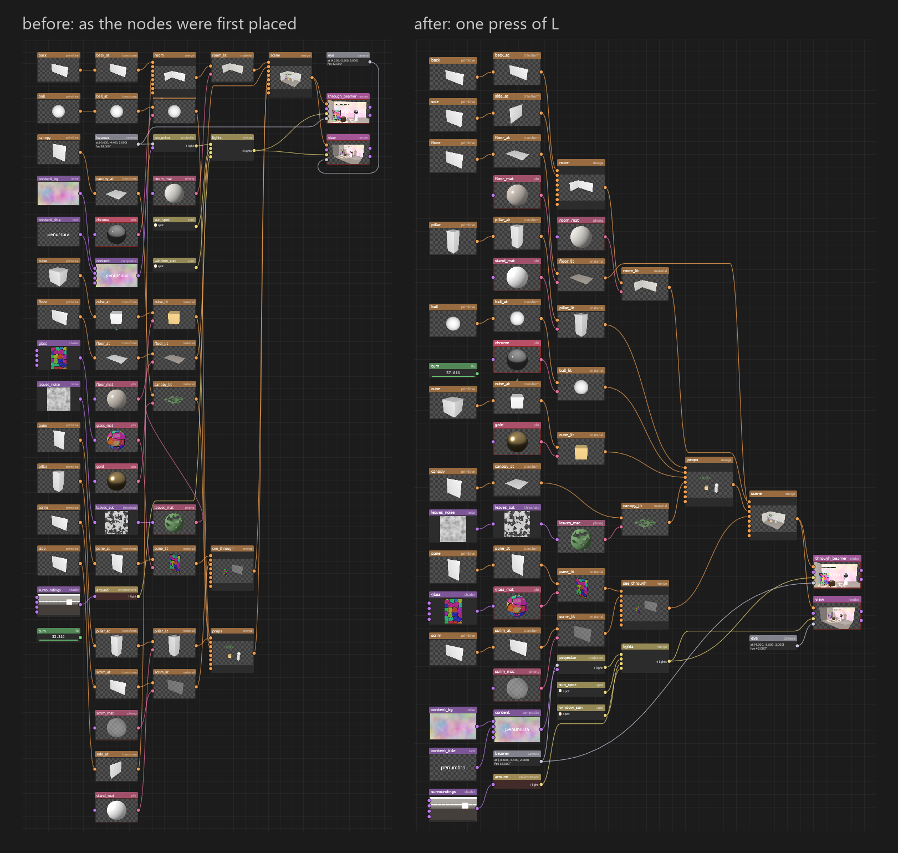

## Download (Windows)

You need Windows 10 or 11 (64-bit) and a graphics card with DirectX 12 or Vulkan.

1. Download the zip from the [latest release](https://github.com/alexanderalber/penumbra/releases/latest)
   (under "Assets", `penumbra-...-windows-x64.zip`).
2. Unpack it anywhere and double-click `penumbra.exe`. The first start opens a demo project,
   later starts open the project you had open last.

The program is not signed. Windows may show "Windows protected your PC": click "More info",
then "Run anyway". The zip also holds the [examples](examples/README.md), the content library
and the documentation.

## Building from source

```
cargo run -p penumbra
```

With no arguments the app opens the project that was open last, on the first start the demo
project.

What a build needs:

- Rust 1.95 or newer (`rust-version` in `Cargo.toml`).
- Network on the first build: some dependencies (`photocraft`, `filmcraft`, `effectcraft`) are
  git dependencies pinned to a revision, not crates.io releases.
- Nothing else at build time. At run time the script node needs a Python 3.12 or newer
  ([scripts](docs/scripts.md)) and the two NDI nodes the NDI runtime ([NDI](docs/ndi.md));
  everything else runs without them.

`cargo xtask ci` is the gate before a commit: `fmt`, `clippy`, `test`, `clippy` for Linux,
the layer check (`core` and `graph` must not depend on wgpu or egui, nothing below `ui` on
egui) and the third-party notices. `cargo xtask docs` regenerates the reference from the node
types and commands, `cargo xtask bless` rewrites the golden images after an intended change
of a render, `cargo xtask dist` builds the release zip. Linux is only checked by clippy so far.

## How this is built

Most of the code is written by Claude Code; the author directs it, reviews what it wrote and
tests the result on the projectors, the camera and the shows the tool is built for. What keeps
that honest is enforced, not promised: the workspace denies `unwrap`, `expect`, `panic`,
`unreachable`, indexing that can panic and `unsafe` outside delimited FFI modules; the layer
check runs on every dependency set; renders are compared with golden images; file, network and
hardware input is tested with hostile data. The history on GitHub begins with the split into a
public repository in October 2026; the work before that is in a private archive. How the
code is put together is in [ARCHITECTURE.md](ARCHITECTURE.md).

## Documentation

The [documentation](docs/README.md) starts with [getting started](docs/getting-started.md) and
a [glossary](docs/glossary.md), and has a reference of every [node](docs/reference/nodes.md) and
[command](docs/reference/commands.md).
All of it is also one page, [docs/penumbra.html](docs/penumbra.html), which the `?` on every node
opens.

## Acknowledgements

penumbra owes a lot to the [storytold](https://github.com/storytold) apps (photocraft,
effectcraft, filmcraft and their siblings). Its former name, lumencraft, followed their "-craft"
naming, and many of its engineering conventions are borrowed from them: everything is a command,
a JSON control channel, headless snapshots, the no-panic rule, `cargo xtask ci` as the commit
gate. It also builds directly on several of their crates: `photocraft-codecs` and
`photocraft-psd` for image files and PSD layers, `effectcraft-text` for text, and the
`filmcraft-*` crates for video.
penumbra is an independent project and not affiliated with the storytold team.

## License

Licensed under either of [Apache License, Version 2.0](LICENSE-APACHE) or
[MIT license](LICENSE-MIT) at your option. Unless you explicitly state otherwise, any
contribution intentionally submitted for inclusion in penumbra, as defined in the Apache-2.0
license, shall be dual licensed as above, without any additional terms or conditions.

## Disclaimer

penumbra is an independent project, not affiliated with, endorsed by or connected to
Derivative Inc. TouchDesigner is a trademark of Derivative Inc. Mentions of TouchDesigner in
this repository only describe where an idea came from or how penumbra differs. NDI® is a
registered trademark of Vizrt NDI AB.
