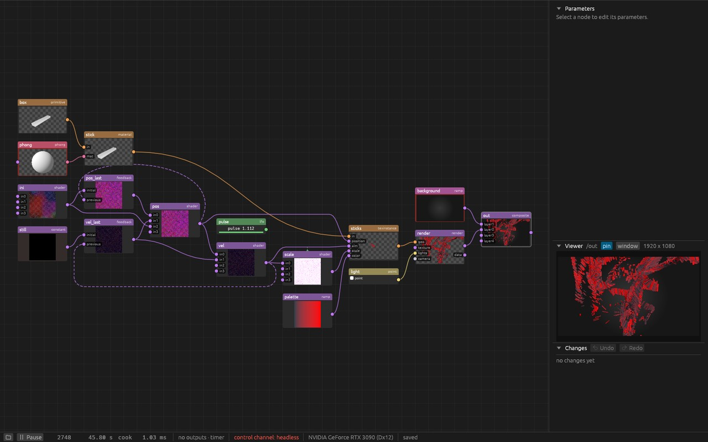

# penumbra

A node-based tool for projection mapping, camera blob tracking and audio- or DMX-driven
installations, written in Rust (egui + wgpu). Inspired by TouchDesigner, but deliberately not
compatible with it: no `.toe`/`.tox` files, no TouchDesigner Python API (script nodes are plain
Python), its own node families and names.

Built to be driven by Claude Code as much as by hand: every action is a command, reachable over
a local JSON control channel.


**Status:** personal project, work in progress.

## What it makes

65 536 sticks drifting through a curl-noise flow, simulated on the GPU and drawn instanced
([example](examples/curl-noise/README.md)); beside it the network that does it, seventeen nodes:




More pictures, each from a project that ships with penumbra: the default demo, a reaction-diffusion
that grows around a title, and the [projection-room](examples/projection-room/README.md) example,
a 3D room lit by a projector, lamps and its surroundings.


`python tools/gallery.py` makes these pictures again (Python with Pillow, and a release build).

## Arranging a network

Press L over the node editor and penumbra lays the network out by itself: columns follow the
flow of data, a chain of sources sits beside the node it feeds, the order within each column
keeps wires from crossing, nodes line up so wires run straight and the whole stays compact, and
long wires get a free lane instead of running through other nodes. Wires that share a gap or
run into neighbouring inputs keep apart rather than on top of each other. With two or more nodes selected, only
the selection moves. Ctrl+Z puts everything back. Parameter bindings stay quiet until you point
at a node, so one channel driving many parameters does not cover the network in lines.


## Download (Windows)

No command line needed:

1. Download the zip from the [latest release](https://github.com/alexanderalber/penumbra/releases/latest)
   (under "Assets", `penumbra-...-windows-x64.zip`).
2. Unpack it anywhere and double-click `penumbra.exe`. The first time it opens a demo project,
   later the project you had open last.

Windows may warn "Windows protected your PC", because the program is not signed: click
"More info", then "Run anyway". You need Windows 10 or 11 (64-bit) and a graphics card with
DirectX 12 or Vulkan. The zip also holds the [examples](examples/README.md) and the
documentation.

## Building from source

```
cargo run -p penumbra
```

With no arguments the app opens the project that was open last, the first time a demo project;
more are in [examples](examples/README.md).
The [documentation](docs/README.md) starts with [getting started](docs/getting-started.md) and
has a reference of every [node](docs/reference/nodes.md) and [command](docs/reference/commands.md).

## Acknowledgements

penumbra owes a lot to the [storytold](https://github.com/storytold) apps (photocraft,
effectcraft, filmcraft and their siblings). Its former name, lumencraft, followed their "-craft"
naming, and many of its engineering conventions are borrowed from them: everything is a command,
a JSON control channel, headless snapshots, the no-panic rule, `cargo xtask ci` as the commit
gate. It also builds directly on several of their crates: `photocraft-codecs` and
`photocraft-psd` for image files and PSD layers, `effectcraft-text` for text, and the
`filmcraft-*` crates for video.
penumbra is an independent project and not affiliated with the storytold team.

## License

Licensed under either of [Apache License, Version 2.0](LICENSE-APACHE) or
[MIT license](LICENSE-MIT) at your option. Unless you explicitly state otherwise, any
contribution intentionally submitted for inclusion in penumbra, as defined in the Apache-2.0
license, shall be dual licensed as above, without any additional terms or conditions.

## Disclaimer

penumbra is an independent project, not affiliated with, endorsed by or connected to
Derivative Inc. TouchDesigner is a trademark of Derivative Inc. Mentions of TouchDesigner in
this repository only describe where an idea came from.
