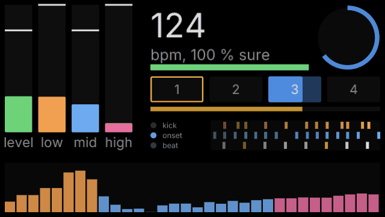

# penumbra

penumbra is a node-based tool for projection mapping, camera tracking and installations driven
by sound, DMX or OSC. It is written in Rust on egui and wgpu. It covers part of what
TouchDesigner is used for. It is not compatible with TouchDesigner: no `.toe`/`.tox` files, no
TouchDesigner Python API, its own node names.

Every action in the app is also a command on a local JSON control channel. A script, or Claude
Code, can build, change, run and photograph a network without anyone clicking.


**Status:** personal project, work in progress, version 0.2. Windows 10 and 11 only so far;
Linux is planned but untested, macOS is not planned.

## Features

About 100 node types in seven data kinds: `tex` pictures, `chan` channels of numbers, `table`
text tables, `geo`, `mat`, `light` and `view` for 3D. The [node reference](docs/reference/nodes.md)
lists every one.

- **Pictures:** sources are noise, ramps, text, shapes, images, PSD layers and video. Filters
  include level, HSV, blur, edge, displace, lookup, threshold, chroma key, matte and composite.
  Also feedback loops, a per-pixel time machine, a frame cache, a 2D fluid pushed by motion or
  blobs, and a shader node in WGSL. The shader node reads its params from the shader file and
  reloads on save.
- **3D:** meshes from OBJ, STL and glTF, primitives, instancing from a table or from a texture
  (tens of thousands of instances on the GPU). Phong, PBR, wireframe and occluder materials.
  Ambient, directional, point, spot and environment lights, shadows, transparency, ambient
  occlusion. Perspective, orthographic and calibrated cameras.
- **Projection mapping:** one output per display or per part of a display (for 4K splitters),
  corner pin, mesh warp, soft-edge blending between projectors, a test pattern per projector,
  drawn masks. Content per drawn shape: pulses, chases along outlines, ripples, each shape with
  its own colour and phase. Shapes can be traced from any mask or label picture (a
  background-removed photo, a threshold), then simplified and edited by hand. Structured light
  ([scanning](docs/scanning.md)): `scan.capture` scans the projectors with a live camera (or
  `scan.decode` from photos of `tex.scan_pattern`'s Gray-code stripes) into maps for
  `tex.remap`, plus a picture of the scene as the projector sees it, for drawing masks in
  projector pixels. `scan.align` lines projectors up side by side. A projector light throws a
  picture onto a 3D model of the room, to try a mapping before going on site. Projector and
  camera calibration (DLT, Levenberg-Marquardt) exists as commands; the interactive calibration
  UI does not exist yet.
- **Camera:** live input from webcams and capture cards, denoising, optical flow, blob tracking
  with ids that stay with a blob.
- **Sound:** input from any audio device, levels, bands, onsets, a spectrum and a beat tracker
  (see [below](#beat-tracking)).
- **Channels:** LFO, noise, math, filter, speed, trail, merge, select. Any parameter can be
  bound to a channel by dragging a wire onto it. OSC addresses can be learned.
- **Python:** a script node (CPython 3.12 or later). It turns channels and tables into channels
  and a table, and keeps its state between frames.
- **Components:** networks inside a node, with chosen params exposed, kept in a library.
- **Editor:** automatic layout ([below](#arranging-a-network)), undo with a change log, copy
  and paste, replacing a node by another kind with its wires kept.
- **For running a show:** a failing node shows an error and the rest keeps running (no panics
  by design). Feedback loops and caches survive a restart. The app checks for Windows settings
  that interfere with a show (Game Bar, notification banners), fixes them and restores them
  afterwards. A cook-time meter shows GPU load, memory and temperature. The app recovers after
  the GPU device is lost.
- **Automation:** headless runs execute a script of commands and save pictures of any node or
  of the whole window. Every picture in this README was made that way
  (`python tools/gallery.py`).

## Inputs and outputs

| | in | out | nodes | notes |
|---|---|---|---|---|
| Displays, projectors | | yes | `out.projector` | fullscreen per display, or a viewport of one |
| Camera, capture card | yes | | `tex.video_in` | Media Foundation (UVC webcams, Elgato Cam Link and similar) |
| Video files | yes | yes | `tex.video`, `out.video` | in: MP4, MOV, MKV, WebM, MXF, MPEG with H.264, HEVC, ProRes, DNxHR, VP9, AV1, HAP; GIF. Out: H.264 (MP4), ProRes 422, 422 HQ, 4444 (MOV) |
| Image files | yes | snapshots | `tex.image`, `tex.layer` | PNG, JPEG, TIFF, EXR, HDR, WebP and more; PSD/PSB layers. `node.snapshot` saves any node as PNG |
| 3D files | yes | | `geo.file` | OBJ (with MTL), STL, glTF/GLB |
| Text tables | yes | | `table.file` | CSV, TSV, plain lines |
| Audio | yes | | `chan.audio_in` | any input device (WASAPI, shared mode). No audio output, no audio files |
| Spout | yes | yes | `tex.spout_in`, `out.spout` | textures shared with other programs on the same machine |
| NDI® | video and audio | video | `tex.ndi_in`, `out.ndi` | needs the NDI runtime installed |
| DMX over USB | | yes | `out.dmx` | Enttec Open DMX USB, one universe |
| Art-Net | yes | yes | `chan.dmx_in`, `out.dmx` | |
| sACN (E1.31) | yes | yes | `chan.dmx_in`, `out.dmx` | |
| DDP | | yes | `out.dmx` | pixel controllers such as WLED |
| OSC | yes | yes | `chan.osc_in`, `chan.osc_out` | UDP; learn binds a param to the next address that arrives |
| 3D mouse | yes | | | 3Dconnexion SpaceNavigator for the 3D viewer, without the vendor driver |
| Control channel | yes | yes | | JSON lines over TCP on localhost, every command of the app |
| MIDI | | | | not built |
| Depth cameras | | | | not built (no Kinect, RealSense, ZED) |

## Compared with TouchDesigner

The node kinds map roughly onto TouchDesigner's families: `tex` onto TOPs, `chan` onto CHOPs,
`table` onto DATs, `geo` onto SOPs, `mat` onto MATs, `comp` onto COMPs. penumbra was built for
one person's installations and has far fewer nodes in each family.

Not in penumbra, as of now:

- MIDI, audio output, audio files, VST plugins.
- Depth cameras and other tracking hardware (Kinect, RealSense, ZED, Leap Motion).
- Python expressions on parameters. Parameters are driven by binding them to channels. Python
  runs only in script nodes.
- Custom control panels (TouchDesigner's Panel COMPs), a timeline and keyframe animation.
- Geometry modelling beyond primitives, transforms, merging and instancing. Particle systems
  and physics have no dedicated nodes; both can be done in shaders, as in the curl-noise
  example.
- Network I/O beyond OSC, Art-Net, sACN, DDP and NDI: no TCP, UDP, WebSocket, HTTP or serial
  nodes, no streaming (RTMP, SRT, WebRTC).
- GLSL (shaders are WGSL), a C++ plugin API, macOS and Syphon.

Different by design:

- A project is a folder of plain text files (RON). It can be diffed and edited by hand, and
  the app reloads it when it changes on disk.
- Everything is reachable over the control channel, including clicks, screenshots and the
  layout of the editor.
- Free and open source (MIT or Apache-2.0), no licence tiers or resolution limits.

## Gallery

Each picture comes from a project that ships with penumbra.

The curl-noise example: 65 536 sticks moved through a curl-noise flow field, simulated in
shaders and drawn instanced ([example](examples/curl-noise/README.md)). Its network is the one
in the window above.


The demo the app opens on its first start: a reaction-diffusion growing around a title.


The [projection-room](examples/projection-room/README.md) example: a 3D room lit by a projector,
two spot lights and an environment light, with a stained-glass panel, a cube and a chrome ball.


## Beat tracking

`chan.audio_analysis` finds the tempo, the beat and the bar from the sound alone. No tap tempo,
no clock from another program. It locks on within a few seconds, follows tempo changes and
keeps the beat running through breakdowns. Its outputs are channels to bind params to: `beat`
and `bar` rise from 0 to 1 between beats and bars, `tick` is 1 on each beat, `bar_beat` counts
the beat within the bar, plus `bpm`, `confidence`, `level`, `low`, `mid`, `high`, `onset`,
`kick` and a spectrum. The `offset` param moves beat and bar ahead to make up for a projector's
delay.

The analysis draws meters for a sound check, in the viewer and as a texture that can be
projected or laid over the show:



Here a Python script node plays a 124 BPM pattern into the analysis. The method is described
in [Audio](docs/audio.md).

## Arranging a network

Press L over the node editor to lay the network out. Columns follow the data flow. Within a
column, nodes are ordered so that wires cross as little as possible. Wires are routed around
nodes and kept apart from each other. With two or more nodes selected, only the selection
moves. Ctrl+Z undoes the layout.


## Download (Windows)

You need Windows 10 or 11 (64-bit) and a graphics card with DirectX 12 or Vulkan.

1. Download the zip from the [latest release](https://github.com/alexanderalber/penumbra/releases/latest)
   (under "Assets", `penumbra-...-windows-x64.zip`).
2. Unpack it anywhere and double-click `penumbra.exe`. The first start opens a demo project,
   later starts open the project you had open last.

The program is not signed. Windows may show "Windows protected your PC": click "More info",
then "Run anyway". The zip also holds the [examples](examples/README.md) and the documentation.

## Building from source

```
cargo run -p penumbra
```

With no arguments the app opens the project that was open last, on the first start the demo
project.

## Documentation

The [documentation](docs/README.md) starts with [getting started](docs/getting-started.md) and
has a reference of every [node](docs/reference/nodes.md) and [command](docs/reference/commands.md).

## Acknowledgements

penumbra owes a lot to the [storytold](https://github.com/storytold) apps (photocraft,
effectcraft, filmcraft and their siblings). Its former name, lumencraft, followed their "-craft"
naming, and many of its engineering conventions are borrowed from them: everything is a command,
a JSON control channel, headless snapshots, the no-panic rule, `cargo xtask ci` as the commit
gate. It also builds directly on several of their crates: `photocraft-codecs` and
`photocraft-psd` for image files and PSD layers, `effectcraft-text` for text, and the
`filmcraft-*` crates for video.
penumbra is an independent project and not affiliated with the storytold team.

## License

Licensed under either of [Apache License, Version 2.0](LICENSE-APACHE) or
[MIT license](LICENSE-MIT) at your option. Unless you explicitly state otherwise, any
contribution intentionally submitted for inclusion in penumbra, as defined in the Apache-2.0
license, shall be dual licensed as above, without any additional terms or conditions.

## Disclaimer

penumbra is an independent project, not affiliated with, endorsed by or connected to
Derivative Inc. TouchDesigner is a trademark of Derivative Inc. Mentions of TouchDesigner in
this repository only describe where an idea came from or how penumbra differs. NDI® is a
registered trademark of Vizrt NDI AB.
