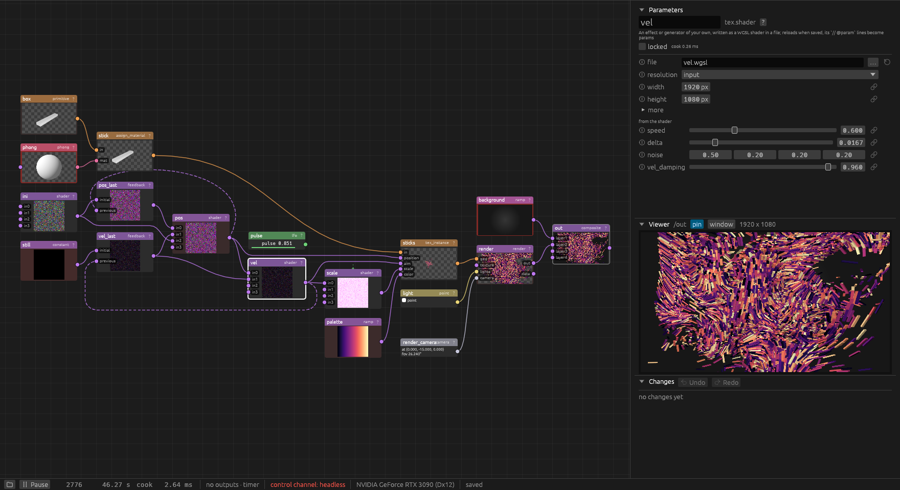

# Getting started

## Running

On Windows, download the zip from the
[latest release](https://github.com/alexanderalber/penumbra/releases/latest), unpack it and
double-click `penumbra.exe`. Or build it from source with a current stable Rust:

```
cargo run -p penumbra
```

With no arguments the app opens the project that was open last. The first time (or when that
project is gone or does not open) it opens a demo project, made in
`%LOCALAPPDATA%\penumbra\demo` on Windows (`$XDG_DATA_HOME/penumbra/demo` or
`~/.local/share/penumbra/demo` elsewhere); the project menu brings it back any time.
It grows reaction-diffusion patterns around the title: click `/show` to see them in the
viewer. `/sharpen` runs the shader `sharpen.wgsl` in the demo's folder; edit and save it and
the node reloads. `/palettes` `index` picks one of four colourings, `/title` `text` the word
the pattern keeps clear of.

A project is a directory with a `project.ron`. The folder button at the left end of the status
bar opens the project menu: **New project** (pick or make an empty folder), **Open project**,
**Save copy as** (copy the project into a new or empty folder and go on there), the recently
opened projects, the demo, the examples that come with penumbra, and the project's folder in the
file manager. The project that was open is written first; the window and the outputs stay. The
same from the [control channel](control.md): `project.new`, `project.open`, `project.save_as`,
`project.demo`, `project.examples`, `project.example`, `project.recent`.

The demo and the examples start fresh on every open, also when the app starts with one of them
as the last project: changes, saved node state and node positions from before are gone. Within
a run they are saved as usual. The status bar says `until reopened` while one of them is open;
**Save copy as** makes a project of your own that keeps them. A copy takes every file of the
project folder along and, of the `state/` folder, the latest snapshot.

A project can also be given at the start (a missing directory is created):

```
cargo run -p penumbra -- --project D:\shows\foyer
```

Other arguments:

| argument | |
|---|---|
| `--project DIR` | the project directory (default: the project open last, else the demo) |
| `--port N` | the control channel's port (default `PENUMBRA_PORT`, else 9880) |
| `--fresh` | start without what feedback loops, caches and similar nodes kept from the last run (see [persistent state](helpers.md#state)) |
| `--headless SCRIPT` | run without a window, driven by a script (see [Control](control.md#headless-runs)) |

The script node needs a Python 3.12 or newer installed (see [Scripts](scripts.md)); everything
else runs without it.

## The window



- **The node editor** (left) shows the network: nodes with live thumbnails, wired output to
  input. The colour of a node's header is its family, the colour of a wire the kind of data it
  carries (see [Concepts](concepts.md)). A channel node shows its values (with a bar, when the
  editor's "channel bars" are on); one whose channels hold many samples (`chan.trail`,
  `chan.audio_in`, a spectrum) shows them as a small plot instead, the newest at the right and
  the first channel's value at the top left. `chan.trail` and `chan.audio_in` get a taller body
  for it, as tall as a picture's.
- **Parameters** (top right): the selected node's name, kind, a one-line summary, the lock, its
  cook time, and its params. Params that belong together sit in folded sections, the rarely
  used ones under "more". The `?` beside the kind opens the node's documentation in the
  browser, as the `?` at the right end of every node's header in the editor does (see
  [the documentation page](#the-documentation-page)).
- **Viewer** (middle right): the selected node's output, or the node pinned with `pin`;
  `window` shows it in a window of its own. Channels are drawn as curves, geometry and renders
  can be looked around in, and some nodes are edited right here (a mapper's corners, shapes,
  a scan's regions). Details in [The viewer](#the-viewer).
- **Changes** (bottom right): every edit, newest first, with who made it (you, Claude, the
  project file). Hover an entry to outline the nodes it touched, click it to select them.
  Undo and Redo sit in its header.
- **The status bar**: the project menu (the folder), play and pause of the show clock, the
  frame and the time, how long the last cook pass took (click it for the last seconds as a
  plot, the CPU and GPU load and, on NVIDIA GPUs, power draw, temperature, clock and what
  holds the clock back), the outputs (hover for details), the control channel's port, the GPU,
  and whether `project.ron` is written yet.

Each section of the right column folds by its header; the open state is kept with the project.
The column keeps its share of the window's width when the window is resized; drag its edge to
change the share (also kept with the project).

The window opens where it was last time, with its size, maximised or not (kept in
`%LOCALAPPDATA%\penumbra\window.json`), so a setup that shares the screen with other windows,
a terminal beside it, say, stays arranged across restarts. The first time, or when that spot is
no longer on any display (one was unplugged), it opens maximised. `ui.window` reads and moves
it.

## A first network

1. **Add a node:** press Tab, or double-click on empty canvas. The add dialog has a tab per
   family (Tab cycles them); type to narrow the list, Enter takes the first match, a click
   takes any. Try `tex` > `noise`.
2. **Add a second one fed from the first:** with exactly one node selected, a new node is
   wired to it and placed to its right. Select the noise, add `tex` > `level`.
3. **Wire by hand:** drag from an output (right edge of a node) to an input (left edge). Drag
   a connected input away to pick its wire up; drop it on nothing to disconnect.
4. **Change params:** select the level node and drag `contrast`, or type a number into the
   field beside the slider. One drag is one undo step. A param away from its default gets a
   reset button. The circled "i" before a param's name explains it.
5. **Make it move:** add `chan` > `lfo`, then drag a wire from its output onto the level's
   `brightness` row. The param is now bound: it follows the channel and shows the live value
   (see [bindings](concepts.md#bindings)).
6. **Show it on a projector:** add `out` > `projector`, wire the level into it and pick a
   `display` (the [Helpers window](helpers.md#outputs) lists them). With `active` on, a
   fullscreen window opens on that display. For projection mapping, put a `tex.mapper`
   between the content and the projector: its corners and mesh are dragged in the viewer.

Everything is written to the project directory a second after each change; there is no save
command. Close the app (or open another project) and come back to it, and the network is back.

## The documentation page

`docs/penumbra.html` (in the release zip beside `penumbra.exe`) holds all of this documentation
in one page for the browser, offline: these guides, every node kind with its inputs, outputs and
params, and every command, each folded until opened. The filter box at the top narrows the
entries to those holding all the words typed (Enter jumps to the first, Escape clears); an entry
lists the places in the guides that mention it.

Click the `?` in a node's header, or the one beside the kind in the parameters, and the page
opens in the default browser at that node's entry. `help.open {kind}` does the same from the
control channel (`kind` may also be a command or a guide such as `scanning`) and answers with
the page's file and URL; with `open: false`, and in headless runs, it opens nothing. A link to
an entry is the page's address with `#` and the kind or command: `penumbra.html#tex.shapes`.

## Moving around

| | |
|---|---|
| left-drag a node | move it (with the rest of the selection) |
| click a node | select it; Shift or Ctrl toggles it in the selection |
| left-drag on empty canvas | select by box; Shift or Ctrl adds to the selection |
| right- or middle-drag | pan |
| mouse wheel | zoom around the pointer |
| right-click a node | its menu: view (pin), pause thumbnail, lock, replace (another kind under the same name, keeping the params, wires and bindings that fit), delete, cut, copy, group |
| right-click a wire | delete the connection; on a binding line, remove the binding |
| point at a port | its name, data kind and what it holds |
| right-click empty canvas | the editor's options: arrange, channel bars, the viewer as background, all binding lines, thumbnails and their rate, Helpers |
| Tab, double-click on canvas | add a node |
| Delete or Backspace | delete the selection |
| F | frame all nodes |
| L | arrange the nodes (the selection when two or more are selected) |
| R | reset the selected nodes (feedback loops, caches, time machines, trackers start over), or every stateful node of this level when nothing is selected |
| Ctrl+A | select all |
| Ctrl+C, Ctrl+X, Ctrl+V | copy, cut, paste (the nodes travel as text on the system clipboard) |
| Ctrl+G | group the selection into a component |
| I, double-click a component | go into the component |
| U | up one level |
| Ctrl+Z, Ctrl+Shift+Z or Ctrl+Y | undo, redo |

Keys go to the pane under the pointer, so F over the viewer does not frame the editor. Undo and
redo work everywhere except while a text field has the focus, and over the region editor's
picture, where they step through its own changes (the grouping is a file next to the scan, not
part of the project). Moving nodes is an edit too: a
drag is one step in the same history.

## The viewer

The viewer shows the selected node's output, or the node pinned with `pin`. `window` shows it
in a window of its own (on a second monitor, say). Its picture area stays
16:9 as the column grows and shrinks; drag its top edge for another shape, which is kept with
the project, and double-click the edge to go back to 16:9 (`ui.options {viewer_aspect}`).
When the window is too low, the viewer gets shorter so the parameters keep some room. A
node with several outputs gets a button per output. For geometry and renders it can also look
around in the scene ([Looking around in 3D](navigation.md)).

Channels are drawn as curves with a value axis
and, along the bottom, seconds before now (the last 240 frames of a channel with one value,
all samples of one with many; a spectrum or a picture's row is counted by sample instead). A
`chan.trail` that is still filling spans its full `length` and grows in from the right. The
`scale` button switches between one shared scale for all channels, a lane per channel with
its own scale, and auto, which takes lanes when a channel that moves would be flat on the
shared scale (`bpm` next to levels of 0 to 1). The choice is kept with the project
(`ui.options {chan_scale}`). A `chan.audio_analysis` shows its meters instead (see
[Audio](audio.md#the-meters-in-the-viewer)); `view: meters` in the header switches to the
plot and back, kept with the project as well (`ui.options {audio_view}`).

Some nodes are edited right in the viewer: a mapper's corners and mesh, a `tex.shapes`' shapes,
and a `tex.image_file` showing a scanned scene's `regions_camera.png`, whose faces are grouped
into regions there ([Scanning](scanning.md#51-regions-scanregions)).

## When the GPU gives up

penumbra stops creating GPU memory at 90 % of what Windows grants it, so a node asking for too
much gets an error (or, for `tex.time_machine`, fewer frames and a warning) instead of taking
the driver down. Should the GPU device still be lost (a driver reset, another program filling
the GPU), penumbra saves the project file but no state, shows a message and exits with code 3.
The next start opens the project with the show clock stopped and says why in the status bar;
press play once the cause is fixed. The record of that lives in
`%LOCALAPPDATA%\penumbra\gpu-lost.json` until the next start reads it.
