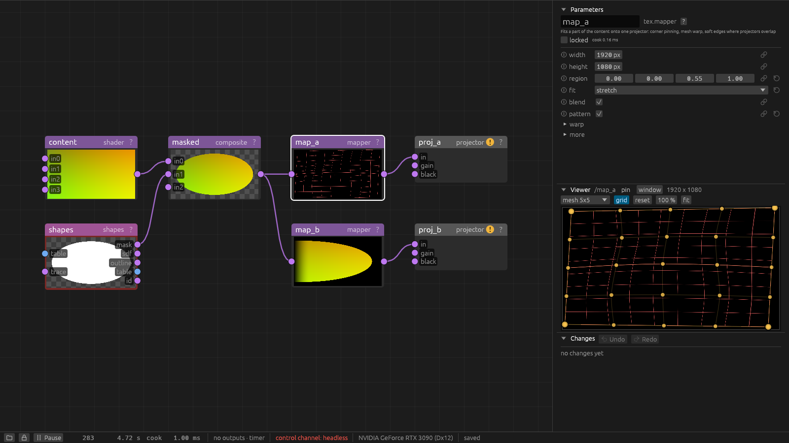

# Mapping without a camera

With projectors and no camera, you place the picture by eye. You drag corners and mesh points in
the viewer while you watch the wall, and the projector follows every move at once. `tex.mapper`
does the work. [Scanning](scanning.md) does the same from a camera's pictures, per pixel and
without dragging; this page is for everything before that, or instead of it.

## Before you start

- **The projector.** Turn on its test pattern: `test` on the `out.projector`, or **Align** in
  the [Helpers window](helpers.md#test-patterns). Set focus and zoom on the projector first, and
  aim it with its lens shift as far as that goes. Each correction in the mapper resamples
  the picture and softens it a little.
- **The network.** Content into a `tex.mapper`, the mapper into the `out.projector`. The
  mapper's `width` and `height` are the projector's resolution. **Optimize** in the Helpers
  window's [Resolution](helpers.md#resolution) section sets them for you.

## Corners: a flat surface

1. Select the mapper. The viewer shows its picture, as the projector shows it, with a handle on
   each corner.
2. Turn on **grid** in the viewer's header (the `pattern` param). The projector then shows an
   alignment grid of the content's area instead of the content.
3. Drag each corner handle until that corner of the grid sits on the corner of the surface.
   Shift while dragging moves a tenth as far. A click selects a handle; the arrow keys then move
   it by one pixel, with Shift by ten.
4. Turn **grid** off.

The mouse wheel zooms the viewer, the right or middle button pans it. So a corner dragged
past the edge of the picture stays in reach. **reset** puts the corners back and flattens the
mesh. Every drag is one undo step.

The corners are params (`corner_tl`, `corner_tr`, `corner_br`, `corner_bl`, under *warp*), in
picture sizes: 0.1 moves a corner by a tenth of the projector's width or height. `region` picks
the part of the content this projector shows, `fit` how that part sits in the picture before
the corners move.

## Mesh warp: a surface that bends

A column, a curved screen or a wall that is not quite flat needs more than four corners. The
menu in the viewer's header (**no mesh**, **mesh 3x3** up to **mesh 17x17**) lays a grid of
points over the picture. Drag a point and the picture bends smoothly through it and its
neighbours.

- **Start coarse.** Get the corners right, then a 3 x 3 mesh, then a finer one. Picking a finer
  size keeps the bends you made, resampled onto the new points.
- **Corners first.** The mesh moves the picture after the corners. A changed corner moves the
  whole mesh with it.
- **The text.** The mesh is stored in `warp`: one line per row of points, `dx,dy` per point, in
  picture sizes. Typed in, it may have up to 33 points per side.

## Two projectors side by side: the soft edge

Two mappers fed from the same node show one surface between them. Give each its part with
`region` (x, y, width, height, in shares of the content) and let the parts overlap:

| mapper | `region` |
|---|---|
| left projector | `0, 0, 0.55, 1` |
| right projector | `0.45, 0, 0.55, 1` |

Where the regions overlap, each mapper fades out towards its region's edge, and the two add up
to full brightness. The fade is on by default (`blend`). A wider overlap hides small errors
better and costs width.

1. Turn on **grid** on both mappers. Each draws its grid in its own colour: red and cyan for the
   first two, so lines that meet add up to white.
2. Map the first projector by its corners. Then drag the second one's corners until its grid
   lines lie on the first one's in the overlap.
3. Turn **grid** off and look at the overlap. A band brighter than the rest: raise
   `blend_gamma` (under *more*) a little. Darker: lower it.

**Brightness.** One projector is usually brighter. Lower its `gain` on the `out.projector`
(section *colour*) until the two halves match by eye. `projector.match` does this from a camera
and also matches colour.

**Black.** In the overlap two projectors add their black, so on a dark picture the overlap shows
as a grey band. Without a camera this stays. With one, `projector.flatfield` lifts the black
around the overlap to match ([Helpers](helpers.md#even-light-across-a-projector-and-black-in-overlaps)).

**Stacked projectors** on the same area, for twice the light: give both the full `region` and
turn `blend` off.

## Masks: light only part of the surface

`tex.shapes` draws masks: rectangles, ellipses and polygons. Select it, and its tools are in the
viewer's header: **rect** and **ellipse** (drag a box), **poly** (click the points; a double
click, Enter or a click on the first point closes it), **select** (move a shape, drag its
handles). Each shape has a tag, and `tag` picks which tags make up the mask.

The mask goes into a `tex.composite` with `op` multiply: the content as `in0`, the shapes'
`mask` as `in1`. Black around the shapes stays dark on the wall. Where the mask goes decides
what it follows:

- **Before the mapper:** the mask lies on the content and moves with the corners and the mesh.
  Draw it once, and it stays on the windows of a facade while you correct the mapping. The
  shapes' `width` and `height` are the content's size.
- **After the mapper:** the mask stays put in the projector's pixels, whatever the mapping does.
  For a fixed spot to keep dark: a stage edge, a door, a row of seats. The shapes' `width` and
  `height` are the projector's resolution.

Shape coordinates are shares of the picture, 0 to 1 from the top left. A `tex.blur` on the mask
softens its edge. `tex.shape_content` fills, pulses, chases or ripples each shape on its own
(the shapes' `id` output into its `id` input).

## From the control channel

The handles only set params, so the same works with `node.set`:

    penumbra-cli ctl node.set '{"path": "/map_a", "params": {"region": [0, 0, 0.55, 1], "corner_tl": [0.02, -0.01]}}'

`projector.test {on, pattern}` switches the test pattern of every projector, `res.optimize` sets
the sizes. A camera added later can line the mappers up for you: name each mapper in its
`tex.scan` ([Scanning](scanning.md#the-scan-button-texscan)). A mesh made by hand stays and
moves the aligned picture.
