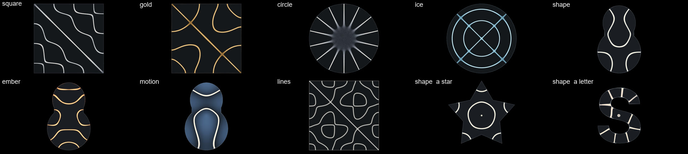
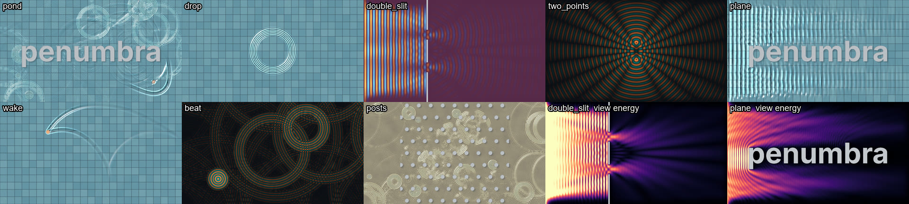
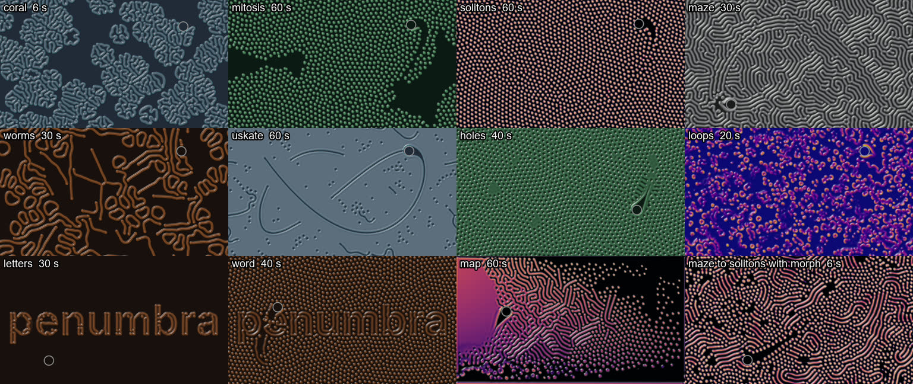
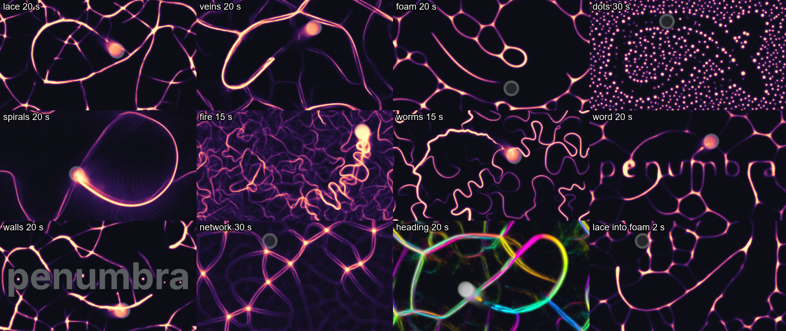
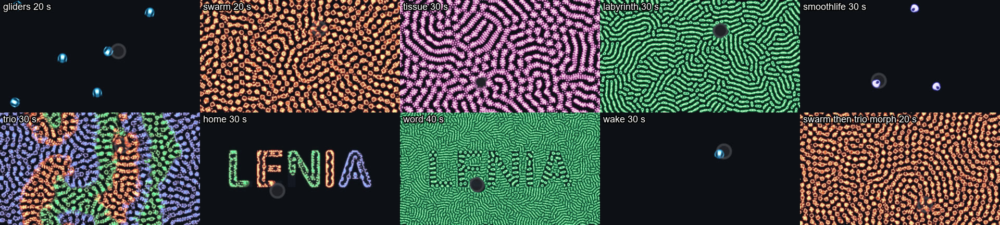

# Simulations

A simulation is a picture that grows from its own last frame: sand that piles up, waves that
spread. Each one ships as a component in penumbra's library and sits in the add dialog's
`simulations` tab. Its inputs are pictures from the room, such as a scan mask of an object or
the tracked people. Its output is a picture for the projectors, plus a few channels.

## How to use one

- **Add it** from the `simulations` tab, or by command: `comp.load {"file": "sand"}`. Adding
  copies its shaders and other files into the project's `library/<name>/`.
- **Choose a setup** with its main choice param (`scene` in sand and waves, `preset` in growth,
  chladni, reaction-diffusion, physarum and lenia). Choosing an entry writes that entry's values
  into the params below it, as one undo step. Then the values are yours: tune any slider, and
  the project saves the tuned value. A line under the choice names the params that differ from
  the entry, with a "back" button. The mechanism is the component's presets:
  [comp.base, Presets](nodes/comp.base.md#presets).
- **Start over:** a new entry starts the simulation over by itself. In physarum it carries on
  from what is there unless `fresh` is on, and in reaction-diffusion and lenia it does so while
  `morph` is on. Bind the component's `reset` to a key for a restart by hand. Held, `reset`
  keeps the simulation at its start.
- **Size:** `width` and `height` on the component are the simulation's size in cells (some
  sections say texels, the pixels of the simulation's own picture). The inputs can have any
  size; the component samples them.
- **Params no entry writes** stay as you set them, such as `seed`, `pause`, `width` and
  `height`. `node.info` lists the params the entries write under `component.presets`, `owns`.

## sand

Falling sand: grains pour, fall, slide down slopes and pile up on walls. A grain never vanishes
or doubles on its way. Only a pour, a drain, an open edge and `in_wall` `delete` change the
count. The [sand example](../examples/sand/README.md) feeds it a word as walls and two moving
dots as sources.

**Scenes.** `scene` picks one. Each writes the walls, the start, where sand comes from, the
edges and the palette.

| scene | what you see |
|---|---|
| `steady` | Rain on the wall input. The floor is open, so as much sand falls out as comes in. |
| `letters` | Rain on the wall input over a closed floor. Heaps grow on every shape and the floor fills up. |
| `blob` | Sand pours from the bright parts of the source input, onto the wall input. |
| `gravity` | A band of layered sand on the wall input, nothing pours. Turn `gravity`. |
| `hourglass` | Layered sand runs through a narrow neck. |
| `cups` | Rain into three bowls that overflow. |
| `pegs` | A heavy, narrow stream through a board of pins. |
| `ramps` | A narrow rain on a zigzag of shelves. |
| `drain` | Rain over bowls and a floor of sand. The drain input swallows sand. |
| `mover` | A bar moves through a pile of layered sand. |

**Inputs.** `wall`: white where sand cannot go, while `object` is on. Grains under a wall that
appears move out on top of it (`in_wall`). `source`: sand pours where it is bright, with
strength `blobs`, in its colour when `colors` is `source`. `drain`: sand vanishes where it is
bright, at the rate `drain`.

**Outputs.** `out` is the picture, 1920 x 1080 (`out_width`, `out_height`). `grains` is the
number of grains, as a channel.

**Params that matter most.** `amount` scales the pour of every scene: bind it to a sound level
to pour with the music. `gravity` is the direction of the fall in degrees, 0 down and 90 right;
bind it to tilt the world. `steps` is sand steps per frame (48): fewer is slower sand and costs
less. The setup a scene writes can be mixed: `shape` puts a built-in wall (`hourglass`, `cups`,
`ramps`, `pegs`, `bar`) under any scene, `rain` with `rain_from` and `rain_to` is the rain line
along the top, `pour` the chance per step that a bright source cell makes a grain, `edges`
closed, open or wrapping. The `grains` group sets how grains move (`fall`, `slide`, `roll`,
`sticky`). The `look` group sets the palette, the light on the piles and how visible the walls
are. For projection onto a real object, set `wall_fill` and `outline` to 0.

**In an installation.** Feed a scan mask of the object into `wall`, so sand piles on the real
object. Feed `tex.blob_track`'s picture of the people into `source` and choose scene `blob`, so
sand pours where people stand. A drain can be any mask: a hole in the floor, a hand.

**Cost.** About 3 ms per frame for the whole example: 640 x 360 cells, 48 steps, picture
1920 x 1080, on an RTX 3090 at a 280 W power limit. The cost grows with `width` times
`height` times `steps`.

**Limits.** Slopes carry little sand; with `amount` above about 2 on a narrow stream, piles grow
steeper than 45 degrees. The `mover` bar and the colour over time (`colors` `time`) follow the
show clock, so a restart does not restart them.

## growth

Slow growth of three kinds: frost crystals that grow over glass and melt where people stand,
branching trees like coral and lightning (diffusion-limited aggregation, DLA), and colonies of
lichen, mould and rust that spread and die. Growth starts on the edges of a mask, at bright
points or by itself. The [growth example](../examples/growth/README.md) feeds it a word as the
mask, a soft moving blob as a person and seven dots.

**Presets.** `preset` picks one. Each writes what grows (`model`), where it may grow (`area`),
what is there at the start, the steps per frame, whether it starts over when full, every setting
of its model, how visible the inputs are and the colours.

| preset | what you see |
|---|---|
| `window` | Window frost. Crystals start on the mask's edges and here and there and cover the glass in about 20 s. A warm spell every 60 s melts it all, then it grows again. People melt paths, which freeze again with fingers growing in from their edges. |
| `snowflake` | One six-armed crystal from the centre in still, cold air. It stops at about half the picture, stays 20 s and starts over. People do not melt it. |
| `fern` | Four-armed, strongly aligned frost from the mask's edges only, with warm spells. |
| `edges` | Frost from the mask's edges only. It covers everything in about 20 s and starts over. People do not melt it. |
| `dots` | One crystal from each bright point of the dots input. |
| `trail` | Window frost without warm spells. What people melt is the only change. When the glass is full, it starts over. |
| `coral` | Ragged coral trees from the mask's edges and the bottom, around the mask and not into it. |
| `lightning` | One thin tree from the centre, a Lichtenberg figure. It starts over at 5 % of the picture, after about 20 s. |
| `lichen` | 14 colonies spread with growth rings and stop where they meet. After about a minute they die from their centres and are grown over. People do not harm them. |
| `mould` | Pale colonies inside the mask only. People wipe them away. |
| `rust` | Rust patches spread from the mask's edges. People wipe them away. |

**Inputs.** `mask`: the object, white where it is. Growth starts on its edges, and with `area`
`inside` or `outside` it grows only on one side of them. `heat`: people. Frost melts and
branches and colonies die where it is bright, at the strength `heat`. `dots`: bright points.
With `dot_seeds` on, a crystal starts at each. The inputs can have any size. An unwired input
counts as black.

**Outputs.** `out` is the picture, 1920 x 1080 (`out_width`, `out_height`). `coverage` is the
share of the area that is covered, from 0 to 1, as a channel. The area is where growth may
happen: outside the mask for `coral`, inside it for `mould`.

**Params that matter most.** `speed` scales the steps per frame of the preset (`steps`): 2 grows
twice as fast and costs twice as much. `heat` is how strongly people melt or wipe away, 0 for
not at all. `afterglow` is the warmth a person leaves behind: at 0 a melted path freezes again
within seconds, at 2 it stays open for many seconds. `auto_restart` starts over by itself once
the share `full` has been covered for `hold` seconds; key 0 on `reset` starts over by hand. The
setup a preset writes can be mixed: `model` with `area`, `pattern`, `count` and `radius`, and
`edge_seeds`, `dot_seeds` and `spawn` for where new growth starts. The `frost` group shapes the
crystals (`arms`, `aniso`, `latent`, the cooling, the warm spells). The `branch and lichen`
group shapes trees and colonies (`eta` from dense blobs to thin lightning, `grow`, `supply`,
`lifespan`, `spread`). The `look` group sets the colours and the light on the ice. For
projection onto a real object, set `through` and `warm` to 0, so neither the mask nor the
people show in the picture.

**In an installation.** Feed a scan mask of the object into `mask`, so frost starts on the
object's edges or coral grows around it. Feed `tex.blob_track`'s picture of the people into
`heat`, so frost melts where people stand and grows back behind them.

**Cost.** About 1.5 ms per frame for the example with `window` (12 steps) and about 2.3 ms
with `snowflake` or `lightning` (32 steps): 960 x 540 texels, picture 1920 x 1080, on an RTX
3090 at a 280 W power limit. About 0.5 ms of it is the `coverage` measure, which waits for the
GPU's answer. The cost grows with `width` times `height` times the steps per frame.

**Limits.** The full mark of `coral` and `lightning` depends on the mask: another shape may
need another `full`. `snowflake` stops at half the picture; that is the physics of a closed box.
The covered phase of `window` changes little between about 20 s and the warm spell. A
regrown path reads as a comb of parallel fingers, coarser than the first growth. Covered ice
shows a few lighter rectangles with straight edges.

## chladni

Chladni figures (cymatics): sand lies on a vibrating plate, jumps away from the parts that move
and gathers on the lines that stand still. Every tone gives another figure. The plate is a
square or a round one, or any shape from a picture. The
[chladni example](../examples/chladni/README.md) plays a melody to it and gives it a guitar
outline as the shape.

**Presets.** `preset` picks one. Each writes the plate (`plate`, `membrane_steps`, `size`,
`turn`) and the whole look: the view, the colours, how visible the plate is.

| preset | what you see |
|---|---|
| `square` | Light sand on a dark square plate. |
| `gold` | Gold sand on the square plate. |
| `circle` | Light sand on a round plate: rings and spokes. |
| `ice` | Pale blue sand on the round plate. |
| `shape` | Light sand on a plate cut to the input `shape`: lines that follow its outline. |
| `ember` | Orange sand on the plate cut to the input `shape`. |
| `motion` | The shaped plate's motion in blue under the sand. |
| `lines` | The nodal lines of the square plate, drawn crisp, with no sand. |

**Inputs.** `tone`: a channel named `note`, a note number (60 is middle C). `chan.audio_pitch`
gives it from a microphone; any channel named `note` works. Figure 0 is the note `lowest` (48,
C3), and each semitone up is the next figure, 20 figures in all. Notes outside are held at
figure 0 or 19. A new tone never starts over: the sand is tossed up for `toss_time` (0.25 s)
and the new lines are whole again after about 0.75 s. `shape`: the plate's outline for `plate`
`shape`, white on the plate. Any size; keep its sides at 16:9 or the outline is stretched. An
unwired `shape` is black, so the shaped plate shows nothing.

**Outputs.** `out` is the picture, 1920 x 1080 (`width`, `height`). `motion` is how far a grain
moved per step lately, in pixels, as a channel. It is about 0.2 when the sand lies on its lines,
0.4 on the shaped plate, and about 9 while the sand is tossed at a new figure.

**Params that matter most.** `source` `figure` makes the figure follow the param `figure` (0 to
19) instead of the tone. `morph` blends two neighbouring figures by the fraction of a semitone.
`level` is how hard the plate is played: bind it to the music's loudness, 0 lets the sand rest.
`kick` throws every grain up: bind it to an envelope of the beat. `speed` scales the grain
steps per frame (4 at 1): 2 gathers twice as fast. `detune` multiplies the shaped plate's pitch:
sweep it to find the tones where a shape gives clean lines. The `grains` group sets how sand
jumps and slides, the `membrane` group the shaped plate's damping and where it is driven. For
projection onto a real object, set `outline` to 0, so only the sand shows.

**The shaped plate is a membrane.** penumbra simulates a stretched membrane with the wave
equation. A metal plate bends instead, which this simulation does not model. So its figures are
of the same kind as a metal plate's, and their exact lines differ from those of a metal plate of
that outline. The square and round plates use the formulas of a membrane with free edges, which
are exact for a membrane too. `membrane_steps` is the
membrane's steps per frame. The shaped presets write 64, so a figure settles within about a
second. The other presets write 1, since square and round plates do not use the membrane.

**In an installation.** Feed a microphone through `chan.audio_pitch` into `tone`, and sing,
whistle or play one note at a time. Chords and loud drums confuse the pitch tracker. Feed a scan
mask of an object into `shape` and choose preset `shape`, so the figures follow the object's
outline.

**Cost.** About 1.6 ms per frame for the example with preset `square`, and about 4.3 ms with a
shaped plate (64 membrane steps), with 262 144 grains at 1920 x 1080, on an RTX 3090 at a 280 W
power limit. The membrane's steps are most of the difference. A million grains (`grains` 1024)
cost about 2.8 ms on the square plate.

**Limits.** Figures 2 and 3 of the shaped plate are the same. Figure 0 of the shaped plate is a
ring around the driving point, since its tone lies below the membrane's lowest one. Dense lines
show a fine lattice of holes, more at `speed` 2. High figures on the round plate keep a grey
haze in the calm middle. With nothing wired into `tone`, the inner `pick` node warns, also when
`source` is `figure`; the figure is still right.

## waves

Ripples on water (the wave equation): drops fall as rain, on a beat or by themselves, steady
sources make straight or round waves, and the waves reflect off walls, bend around objects and
interfere. A moving person pushes the water. The level of the water stays where it is: a drop
lifts as much water as it pushes down. The [waves example](../examples/waves/README.md) feeds it
a word as the mask, a moving blob as the people and a metronome as the beat.

**Scenes.** `scene` picks one. Each writes the walls, the wave sources, the drops, the start,
the edges, what people do and the look.

| scene | what you see |
|---|---|
| `pond` | Rain on a tiled pool. The mask input stands in the water and the rings bounce off it. People push the water. |
| `drop` | One drop in the middle, a train of rings. Once the water has been calm for 1.5 s, the next drop falls at a random place. |
| `double_slit` | A straight wave from the left runs through two slits. Two fans of waves interfere behind the wall. |
| `two_points` | Two bobbing points: the textbook picture of interference. |
| `plane` | A straight wave rolls past the mask input. It reflects in front and bends into the shadow behind. |
| `wake` | People moving faster than the waves leave a V on open water. A drop falls after 4 s of calm water. |
| `beat` | One big drop on each beat of the beat input. |
| `posts` | Rain among round posts over a sandy floor. |

**Inputs.** `mask`: white where an object stands in the water, while `use_mask` is on. Waves
reflect off it and bend around it. `people`: bright where someone is. With `push` `move` the
water is pushed where the picture changes, so a moving shape leaves a wake. With `push` `press`
the water is held down under the bright part, as under a person standing in it. `beat`: a
channel named `beat`; each rise above 0.5 drops a drop while `rain` is `beat`. The pictures can
have any size; an unwired one counts as black.

**Outputs.** `out` is the picture, 1920 x 1080 (`out_width`, `out_height`). With `cutout` on,
the walls are black and transparent. `ripple` is how much the water moves, as a channel: 0 when
still, about 0.04 in `pond`, 0.03 in `two_points`, under 0.02 in `drop`. It needs a multiply
before it drives a light.

**Params that matter most.** `speed` scales the water steps per frame (8 at 1): 2 runs the water
twice as fast and costs more. Damping counts per step, so at a higher speed rings also fade
sooner. `push_strength` is how hard people push. `damping` is how fast rings fade. The setup a
scene writes can be mixed: `shape` puts a drawn wall (`slit`, `double_slit`, `grating`,
`pillars`, `box`) under any scene, `source` a steady wave maker (`plane`, `point`, `two`),
`rain` drops at random or on the beat, `start` the water at the start, `edges` a rim that
reflects, open water that absorbs, or edges that wrap. `calm_drop` drops a drop after `idle`
seconds of calm water, so a quiet scene never stays dead. The `look` group picks the view: the
lit `water` over a floor, the `height` in colours, the `energy` (where the water moves on
average, which shows interference best) or a grey `relief`. The `surface` group sets the light
of the water view.

**In an installation.** Feed a scan mask of the object into `mask`, so the waves bounce off the
real object, and turn on `cutout`, so nothing is projected onto it. Set `marker` to 0 so the
people are not drawn. Feed `tex.blob_track`'s picture of the people into `people`, so they leave
a wake. Feed an envelope of the music's beat into `beat` and choose scene `beat`.

**Cost.** About 1.4 ms per frame for the example in scene `pond`, and about 2.9 ms at `speed` 4
(32 steps), with a simulation of 1280 x 720 and a picture of 1920 x 1080, on an RTX 3090 at a
280 W power limit. The cost grows with `width` times `height` times the steps.

**Limits.** The wave equation has no dispersion. Real water has it: a drop leaves a widening
train of rings, a slow boat a wake of its own shape. Here a dent travels as one ring of fixed
shape. So a drop starts as a train of rings already, and a person slower than the waves leaves
only a dimple travelling with them. Wave speed and drop sizes count in texels, so on a larger
`width` and `height` the same waves look smaller and slower. The water view is a stylised pool:
refraction only shifts the floor, and the caustics are a trick of the curvature. `drop` repeats
itself: the next drop comes about 4 s after the last, always of the same shape. A shape that
presses lowers the mean level while it stands there. `pause` still runs the step's passes,
which leave the water as it is.

## reaction-diffusion

Reaction-diffusion after Gray and Scott: two chemicals react and spread over a surface, and
Turing patterns grow out of a few spots. Two rates decide the pattern: `feed`, how fast the
first chemical is fed in, and `kill`, how fast the second is removed. The picture becomes
branching coral, a labyrinth, dividing spots (mitosis), worms or a field of still dots. A mask
can give the object one pattern and its surroundings another. The component is
`reaction_diffusion`. The [reaction-diffusion example](../examples/reaction-diffusion/README.md)
feeds it a word as the mask and a moving blob as the people.

**Presets.** `preset` picks one. Each writes the rates, the steps per frame, the start, what
people do, the guards' marks, the colours and what grows outside the mask.

| preset | what you see |
|---|---|
| `coral` | Branching coral grows from random blobs and fills the surface in about 15 s. Then it creeps on as a slow labyrinth that gets a few holes every 20 s. |
| `mitosis` | Spots that divide until they fill the surface, in about a minute. |
| `solitons` | A packed field of still dots. People leave a dark trail that closes again. |
| `maze` | A labyrinth of stripes within 5 s. A person's path fills with stripes again. |
| `worms` | Loose worms, rings and forks on dark ground. |
| `uskate` | Thin lines and gliding specks on a filled ground. |
| `holes` | Dark specks in a filled field. |
| `loops` | Busy blobs and loops that never settle. |
| `letters` | Glossy coral tubes only where the mask is bright. |
| `word` | A labyrinth where the mask is bright, still dots around it. |
| `map` | Feed rises from bottom to top and kill from left to right: stripes, spots and chaos side by side. |

**Outside the mask.** `outside` is a second choice with values of its own. It says what grows
where the mask input is dark: `off` ignores the mask, `dead` lets nothing grow there, so the
pattern lives on the object only, and a pattern's name grows that pattern there. Choosing one
writes `use_mask`, `outside_feed`, `outside_kill` and `coverage_in`. A preset writes `outside`
too (`letters` chooses `dead`, `word` chooses `solitons`, the others `off`). So to put any
preset on the object only, choose the preset first, then `outside` `dead`.

**From one preset to the next.** A new preset starts the pattern over from its own start. With
`morph` on, it grows out of the pattern that is there instead. Feed and kill then glide to the
new values, 95 % of the way after `glide` seconds (6), and a hand-dragged `feed` or `kill`
glides the same way. Maze to solitons and coral to mitosis turn stripes into spots. Some pairs
flood the surface with one colour (maze to worms); the guard counts that as dead and starts over
3 s later.

**Inputs.** `mask`: the object, white where it is. With `use_mask` on, the preset's rates hold
where it is bright and the outside rates where it is dark. Pattern `mask` seeds only there.
`people`: bright where someone is. `touch` says what they do: `wipe` clears the pattern and it
grows back behind them, `seed` ignites new pattern, `kill` lets it die away under them. The
pictures can have any size; an unwired one counts as black. The mask's edge is softened by
`mask_blur`.

**Outputs.** `out` is the picture, 1920 x 1080 (`out_width`, `out_height`). `coverage` is the
share of the surface with pattern, from 0 to 1, as a channel; with `coverage_in` `mask` it
counts only where the mask is bright. `activity` is how much the pattern still changes: about
0.1 while it grows, below 0.03 once it settles, 0.8 in `loops`.

**Params that matter most.** `speed` scales the steps per frame of the preset (`steps`): 2
grows twice as fast and costs twice as much. `feed` and `kill` are the pattern itself; small
steps of 0.002 change it. `map` spreads both over the picture instead. `seed`, `pattern`, `size`
and `density` set the start, and a change of any of them starts over. The `guards` group keeps
the picture alive: with `revive` on, a pattern that has died (nothing left, or one flat colour
everywhere) starts over after `revive_after` seconds; with `stir` on, a pattern that has stood
still (`activity` below `still`) for `stir_after` seconds gets `stir_count` holes that grow back.
The `look` group sets the palette (`colors`, the last colour lights the rims), the relief and
the light. For projection onto a real object, set `through` and `marker` to 0, so neither the
mask nor the people show in the picture.

**In an installation.** Feed a scan mask of the object into `mask` and choose `letters`, or any
preset with `outside` `dead`, so the pattern grows on the object only. Feed `tex.blob_track`'s
picture of the people into `people`, so they wipe paths that grow back. Bind `preset` to a key
or a `chan.dropdown` with `morph` on, so one pattern grows into the next.

**Cost.** About 1.3 ms per frame for the example with `coral` (8 steps), 1.5 ms with `uskate`
(16 steps) and 3.9 ms with `uskate` at `speed` 4 (64 steps): 960 x 540 texels, picture
1920 x 1080, on an RTX 3090 at a 280 W power limit. The cost grows with `width` times
`height` times the steps per frame; 64 steps is the most.

**Limits.** `map` has a flat area at the left with soft colour bands, and a thin line at the top
and bottom edge, where the wrapping edges meet different rates. `holes` is the weakest preset.
A stir in `coral` and `maze` is hard to see: the holes close within a second or two. Only feed
and kill glide; the colours and the rest of a preset change at once. With `letters` and no mask
wired, nothing can grow, and the pattern starts over every 3 s. `pause` still runs the step's
passes, which leave the pattern as it is.

## physarum

Physarum, the slime mould: many agents follow a trail and lay one. Each agent smells the trail
at three points ahead and turns towards the strongest. The trail spreads and fades. The agents
agree on paths, and the paths become a network of glowing veins. Depending on a few numbers the
network is fine lace, smooth veins, soap foam, a field of dots, spirals, restless fire or
wriggling worms. With points as food it links them with veins, the classic slime mould picture.
The component is `physarum`. The [physarum example](../examples/physarum/README.md) feeds it a
word as the mask, a moving blob as the people and twelve dots as the food.

**Presets.** `preset` picks one. Each writes the organism (the sensors, the turn, the step and
the trail), how agents die and are born, the start, what the mask and the people do, the food
rate, the brightness and which inputs show.

| preset | what you see |
|---|---|
| `lace` | Fine polygon lace with bright knots. It moves slowly. |
| `veins` | Long, smooth, branching veins with faint side veins. |
| `foam` | Round cells like soap foam. People push it away. |
| `dots` | A dense field of glowing dots. People push them away. Over minutes the dots grow fewer and larger. |
| `spirals` | A few knots with rays, and long winding veins. |
| `fire` | A restless field of filaments. It never settles. |
| `worms` | Wriggling closed worms that keep changing shape. |
| `word` | Foam that writes the mask's shape in single strokes and links it to the cells around it. |
| `walls` | Lace that flows around the mask. The mask shows as a grey ground. |
| `network` | Veins link the food input's bright points. Agents are born on the food, and 2 % of them die each step. |
| `heading` | Veins coloured by the direction the agents travel. |

**From one preset to the next.** A new preset carries on from the network that is there: the
agents change their ways, and the network reshapes within a second or two. With `fresh` on, a
new preset starts over from its own start instead. Key 0 on `reset` starts over in either case.

**Inputs.** `mask`: the object, white where it is. `mask_mode` says what it does: `attract`
(the agents follow its shape), `outline` (they follow its edge), `wall` (they flow around it),
`inside` (they live only on it) or `food` (it feeds the trail). `people`: bright where someone
is. `people_mode` says what they do: `attract` (a vein reaches for them), `repel` (the network
keeps away and leaves a dark hole), `wall` (the agents flow around them) or `feed` (they feed
the trail); `strength` says how strongly. `food`: bright points that feed the trail by
`food_rate` per step. With `born` `food` new agents appear only there. The pictures can have
any size; an unwired one counts as black.

**Outputs.** `out` is the picture, 1920 x 1080 (`out_width`, `out_height`). `coverage` is the
share of the area with visible trail, from 0 to 1, as a channel: about 0.1 to 0.2 once a network
stands. `mark` sets how bright a trail must be to count. `alive` is the number of agents alive:
all of them in every preset except `network`, where about half of them wait to be born again on
a food point.

**Params that matter most.** The `organism` group is the network's character:
`sensor_angle` and `sensor_distance` (where an agent smells), `turn_angle` (how far it turns
per step), `step_length`, `jitter`, and the trail's `deposit`, `decay` and `diffusion`. Small
changes give a different organism. `speed` multiplies the step length: below 1 the network grows
slower and finer, above 1 faster and coarser. It changes the character, so worms at 2 look like
fire, and it costs nothing. `agents` is the number of agents in units of 1024 (256 is 262 144).
The trail is equally bright at any agent count. `seed`, `start`, `radius`, `agents`, `width` and
`height` start over. The `look` group sets the palette (`colors`, dark to bright), `heading`
(colours by direction instead), `gain`, `contrast` and the glow. For projection onto a real
object, turn `show_inputs` off: no walls, people markers or food dots in the picture, whatever
the preset says.

**In an installation.** Feed a scan mask of the object into `mask` and choose `word` (the
network writes the object's shape), `walls` (it flows around the object), or any preset with
`mask_mode` `inside`, so the mould lives on the object only. Feed `tex.blob_track`'s picture of
the people into `people`, so a vein follows them or the network parts around them. Feed a
picture of things to link into `food` and choose `network`: objects on a table, cities on a map.

**Cost.** About 1.3 ms per frame for the example with `lace` (262 144 agents), 1.2 ms with
`network` and 1.5 ms with a million agents (`agents` 1024): 960 x 540 cells, picture
1920 x 1080, with `coverage` and `alive` in use, on an RTX 3090 at a 280 W power limit. The two
outputs cost about 0.5 ms of that, and only while something uses them.

**Limits.** One agent step per frame: `speed` lengthens the step and so changes the look; a
truly faster network would need several steps per frame. lace, foam and dots are nearly still
after 20 s; only fire, worms and spirals keep moving, and people stir the rest. With `people_mode`
`attract`, a person draws one bright vein like a leash, which dominates foam, spirals and fire.
`dots` coarsens over minutes, and a repelling person's path stays an empty band for a while.
`network` keeps a faint haze and web of side veins between the main veins, and in the first
seconds the points shine as stars before veins link them; without a food input it is a dim web. `word`
misses parts of some letters (the bowls of b and a). With `walls`, agents caught in a closed
letter shape show as small bright dots there.

## lenia

Lenia, a continuous cellular automaton, a smooth relative of Conway's Game of Life. Every point
of the world holds a level of life from 0 to 1. Each step, a point takes the mean level in a
ring around it (the kernel). Life grows where that mean is near a sweet spot and shrinks
everywhere else. Depending on a few numbers, the world holds soft gliders, a jiggling swarm,
spiky tissue, a labyrinth of worms, SmoothLife rings or three kinds that invade each other. The
component is `lenia`. The [lenia example](../examples/lenia/README.md) feeds it a word as the
mask and a moving blob as the people.

The presets were found by a parameter search in penumbra's own runs, and the two creatures that
start and drop in (a glider and a ring) were taken from those runs. No published Lenia species
or creature pattern is included.

**Presets.** `preset` picks one. Each writes the rules (the kernel, the growth, the steps per
frame), the start and its creature, what the mask and the people do, the guards' marks and the
look.

| preset | what you see |
|---|---|
| `gliders` | Crescent gliders cross the field in about 8 s, meet and die. New ones are dropped in when few are left, and where people walk. |
| `swarm` | A dense field of small cells that jiggle and shuffle. People push a channel through it. |
| `tissue` | Spiky filaments fill the field within 3 s, then reorganise slowly. People kill. |
| `labyrinth` | Worms fill the field as a labyrinth. People carve a path that closes behind them. Holes are punched in when it stands still. |
| `smoothlife` | Ring creatures glide (the SmoothLife rule). New ones, dropped in and under people, start colonies that spread and break up again. |
| `trio` | Red, green and blue kinds invade each other in round fronts. People push. |
| `home` | The three kinds of trio live only where the mask is bright. They are refilled when less than 30 % of the mask is alive. People kill. |
| `word` | Coarse worms where the mask is bright, fine worms around it, so the mask reads by texture alone. |
| `wake` | An empty field until someone walks. Gliders appear behind them and swim off. |

**From one preset to the next.** A new preset starts the world over from its own start. With
`morph` on, the new rules act on the world that is there instead. Lenia's creatures rarely
survive a change of rules: within seconds they die or turn into the new preset's texture (swarm
to trio becomes trio in one colour). Key 0 on `reset` starts over in either case.

**Inputs.** `mask`: the object, white where it is. `mask_mode` says what it does: `home` (life
only where it is bright), `wall` (nothing lives where it is bright) or `rules` (other-sized
creatures where it is dark, `outside_size` times the radius). Start `mask` puts the first life
only where it is bright. `people`: bright where someone is. `people_mode` says what they do:
`spawn` (new creatures appear where they are), `feed` (life grows there), `kill` (life dies
there) or `push` (life drifts out of their way, by `push`); `strength` says how strongly. The
pictures can have any size; an unwired one counts as black.

**Outputs.** `out` is the picture, 1920 x 1080 (`out_width`, `out_height`). `coverage` is the
share of the area that is alive, from 0 to 1, as a channel: about 0.002 per glider, 0.22 to 0.37
in the dense presets. Where `mask_mode` lets nothing live, the area does not count. `mark` sets
the level of life that counts. `activity` is how much the world still changes: about 0.03 for
one glider, 4 in `trio`.

**Params that matter most.** The `rules` group is the creature itself. `rule` picks the family:
`lenia` (one kind), `smoothlife` (Rafler's SmoothLife; `rings`, `core`, `mu` and `sigma` do not
act there) or `three` (three kinds). `radius` is how far a point looks, in texels of a simulation
288 texels high, so a creature keeps its share of the picture at any `width` and `height`.
`rings` and `core` shape the kernel, `mu` and `sigma` set where and how narrowly life grows, `dt`
the time per step. Small changes of `sigma` (0.002) give a different world or kill it. `speed`
scales the steps per frame of the preset (`steps`): 2 runs twice as fast and costs twice as
much, and the creatures stay the same. `scale` makes the creatures larger or smaller; the cost
grows with its square. `seed`, `rule`, `radius`, `scale`, the `start` group, `width` and
`height` start over. The `guards` group keeps the world alive: with `revive` on, a world below
`dead` coverage starts over after `revive_after` seconds; with `auto_restart` on, a world above
`full` starts over after `hold` seconds (two gliders that meet can light up the whole field);
below `few` coverage, creatures are dropped in at `refill` per second, and `spawn` drops them at
any time; with `stir` on, a world that has stood still (`activity` below `still`) for
`stir_after` seconds gets `stir_count` holes. A drop lands only where life may live and nothing
lives yet. The `look` group sets the palette (`colors`, faint to full), `gain`, the halo and the
relief; `tint_g` and `tint_b` colour the second and third kind. For projection onto a real
object, turn `show_inputs` off: neither the mask nor the people show in the picture.

**In an installation.** Feed a scan mask of the object into `mask` and choose `home`, so the
three kinds live on the object only, or `word`, so the object stands out by the size of its
worms. Feed `tex.blob_track`'s picture of the people into `people` and choose `wake` or
`gliders`, so creatures appear behind the visitors, or `swarm` or `trio`, so they push through
the world.

**Cost.** About 2.8 ms per frame for the example with `gliders` (2 steps) and 4.8 ms with
`tissue` (4 steps, a larger kernel): 512 x 288 texels, picture 1920 x 1080, with `coverage` and
`activity` in use, on an RTX 3090 at a 280 W power limit. One step costs more than in the other
simulations, because every point sums a whole disc of neighbours: the cost grows with the
square of `radius` times `scale`, and so with the fourth power of the simulation's height. Twice
the `width` and `height` give the same picture with finer edges at about ten times the cost
(gliders at 1024 x 576: about 20 ms).

**Limits.** Gliders that meet now and then light up the whole field; `auto_restart` catches it
after a second, which is a visible jump to a fresh start. A glider lives until it meets another,
so `gliders` needs a steady supply of drops. In `home`, thin strokes of the mask hold little
life. `swarm`, `tissue`, `labyrinth` and `word` are textures more than creatures, and `tissue`
and `labyrinth` stand nearly still once grown; a stir's holes heal within seconds. `push` is weak
in `labyrinth`: the worms close behind the person at once. `morph` shows little, since a change
of rules kills most creatures. `pause` still runs the step's passes, which leave the world as
it is.
