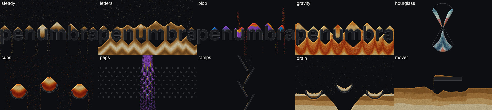
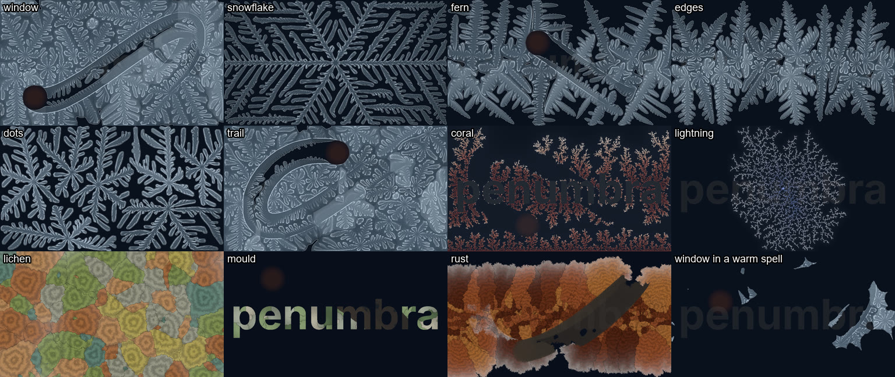

# Simulations

A simulation is a picture that grows from its own last frame: sand that piles up, waves that
spread. Each one ships as a component in penumbra's library and sits in the add dialog's
`simulations` tab. Its inputs are pictures from the room, such as a scan mask of an object or
the tracked people. Its output is a picture for the projectors, plus a few channels.

## How to use one

- **Add it** from the `simulations` tab, or by command: `comp.load {"file": "sand"}`. Adding
  copies its shaders into the project's `library/<name>/`.
- **Choose a setup** with its main choice param (`scene` in sand, `preset` in growth). Choosing an entry writes that
  entry's values into the params below it, as one undo step. Then the values are yours: tune
  any slider, and the project saves the tuned value. A line under the choice names the params
  that differ from the entry, with a "back" button. The mechanism is the component's presets:
  [comp.base, Presets](nodes/comp.base.md#presets).
- **Start over:** a new entry starts the simulation over by itself. Bind the component's `reset`
  to a key for a restart by hand. Held, `reset` keeps the simulation at its start.
- **Size:** `width` and `height` on the component are the simulation's size in cells. The
  inputs can have any size; the component samples them.
- **Params no entry writes** stay as you set them, such as `seed`, `pause`, `width` and
  `height`. `node.info` lists the params the entries write under `component.presets`, `owns`.

## sand

Falling sand: grains pour, fall, slide down slopes and pile up on walls. A grain never vanishes
or doubles on its way. Only a pour, a drain, an open edge and `in_wall` `delete` change the
count. The [sand example](../examples/sand/README.md) feeds it a word as walls and two moving
dots as sources.

**Scenes.** `scene` picks one. Each writes the walls, the start, where sand comes from, the
edges and the palette.

| scene | what you see |
|---|---|
| `steady` | Rain on the wall input. The floor is open, so as much sand falls out as comes in. |
| `letters` | Rain on the wall input over a closed floor. Heaps grow on every shape and the floor fills up. |
| `blob` | Sand pours from the bright parts of the source input, onto the wall input. |
| `gravity` | A band of layered sand on the wall input, nothing pours. Turn `gravity`. |
| `hourglass` | Layered sand runs through a narrow neck. |
| `cups` | Rain into three bowls that overflow. |
| `pegs` | A heavy, narrow stream through a board of pins. |
| `ramps` | A narrow rain on a zigzag of shelves. |
| `drain` | Rain over bowls and a floor of sand. The drain input swallows sand. |
| `mover` | A bar moves through a pile of layered sand. |

**Inputs.** `wall`: white where sand cannot go, while `object` is on. Grains under a wall that
appears move out on top of it (`in_wall`). `source`: sand pours where it is bright, with
strength `blobs`, in its colour when `colors` is `source`. `drain`: sand vanishes where it is
bright, at the rate `drain`.

**Outputs.** `out` is the picture, 1920 x 1080 (`out_width`, `out_height`). `grains` is the
number of grains, as a channel.

**Params that matter most.** `amount` scales the pour of every scene: bind it to a sound level
to pour with the music. `gravity` is the direction of the fall in degrees, 0 down and 90 right;
bind it to tilt the world. `steps` is sand steps per frame (48): fewer is slower sand and costs
less. The setup a scene writes can be mixed: `shape` puts a built-in wall (`hourglass`, `cups`,
`ramps`, `pegs`, `bar`) under any scene, `rain` with `rain_from` and `rain_to` is the rain line
along the top, `pour` the chance per step that a bright source cell makes a grain, `edges`
closed, open or wrapping. The `grains` group sets how grains move (`fall`, `slide`, `roll`,
`sticky`). The `look` group sets the palette, the light on the piles and how visible the walls
are. For projection onto a real object, set `wall_fill` and `outline` to 0.

**In an installation.** Feed a scan mask of the object into `wall`, so sand piles on the real
object. Feed `tex.blob_track`'s picture of the people into `source` and choose scene `blob`, so
sand pours where people stand. A drain can be any mask: a hole in the floor, a hand.

**Cost.** About 3 ms per frame for the whole example: 640 x 360 cells, 48 steps, picture
1920 x 1080, on an RTX 3090 at a 280 W power limit. The cost grows with `width` times
`height` times `steps`.

**Limits.** Slopes carry little sand; with `amount` above about 2 on a narrow stream, piles grow
steeper than 45 degrees. The `mover` bar and the colour over time (`colors` `time`) follow the
show clock, so a restart does not restart them.

## growth

Slow growth of three kinds: frost crystals that grow over glass and melt where people stand,
branching trees like coral and lightning (diffusion-limited aggregation, DLA), and colonies of
lichen, mould and rust that spread and die. Growth starts on the edges of a mask, at bright
points or by itself. The [growth example](../examples/growth/README.md) feeds it a word as the
mask, a soft moving blob as a person and seven dots.

**Presets.** `preset` picks one. Each writes what grows (`model`), where it may grow (`area`),
what is there at the start, the steps per frame, whether it starts over when full, every setting
of its model, how visible the inputs are and the colours.

| preset | what you see |
|---|---|
| `window` | Window frost. Crystals start on the mask's edges and here and there and cover the glass in about 20 s. A warm spell every 60 s melts it all, then it grows again. People melt paths, which freeze again with fingers growing in from their edges. |
| `snowflake` | One six-armed crystal from the centre in still, cold air. It stops at about half the picture, stays 20 s and starts over. People do not melt it. |
| `fern` | Four-armed, strongly aligned frost from the mask's edges only, with warm spells. |
| `edges` | Frost from the mask's edges only. It covers everything in about 20 s and starts over. People do not melt it. |
| `dots` | One crystal from each bright point of the dots input. |
| `trail` | Window frost without warm spells. What people melt is the only change. When the glass is full, it starts over. |
| `coral` | Ragged coral trees from the mask's edges and the bottom, around the mask and not into it. |
| `lightning` | One thin tree from the centre, a Lichtenberg figure. It starts over at 5 % of the picture, after about 20 s. |
| `lichen` | 14 colonies spread with growth rings and stop where they meet. After about a minute they die from their centres and are grown over. People do not harm them. |
| `mould` | Pale colonies inside the mask only. People wipe them away. |
| `rust` | Rust patches spread from the mask's edges. People wipe them away. |

**Inputs.** `mask`: the object, white where it is. Growth starts on its edges, and with `area`
`inside` or `outside` it grows only on one side of them. `heat`: people. Frost melts and
branches and colonies die where it is bright, at the strength `heat`. `dots`: bright points.
With `dot_seeds` on, a crystal starts at each. The inputs can have any size. An unwired input
counts as black.

**Outputs.** `out` is the picture, 1920 x 1080 (`out_width`, `out_height`). `coverage` is the
share of the area that is covered, from 0 to 1, as a channel. The area is where growth may
happen: outside the mask for `coral`, inside it for `mould`.

**Params that matter most.** `speed` scales the steps per frame of the preset (`steps`): 2 grows
twice as fast and costs twice as much. `heat` is how strongly people melt or wipe away, 0 for
not at all. `afterglow` is the warmth a person leaves behind: at 0 a melted path freezes again
within seconds, at 2 it stays open for many seconds. `auto_restart` starts over by itself once
the share `full` has been covered for `hold` seconds; key 0 on `reset` starts over by hand. The
setup a preset writes can be mixed: `model` with `area`, `pattern`, `count` and `radius`, and
`edge_seeds`, `dot_seeds` and `spawn` for where new growth starts. The `frost` group shapes the
crystals (`arms`, `aniso`, `latent`, the cooling, the warm spells). The `branch and lichen`
group shapes trees and colonies (`eta` from dense blobs to thin lightning, `grow`, `supply`,
`lifespan`, `spread`). The `look` group sets the colours and the light on the ice. For
projection onto a real object, set `through` and `warm` to 0, so neither the mask nor the
people show in the picture.

**In an installation.** Feed a scan mask of the object into `mask`, so frost starts on the
object's edges or coral grows around it. Feed `tex.blob_track`'s picture of the people into
`heat`, so frost melts where people stand and grows back behind them.

**Cost.** About 1.5 ms per frame for the example with `window` (12 steps) and about 2.3 ms
with `snowflake` or `lightning` (32 steps): 960 x 540 texels, picture 1920 x 1080, on an RTX
3090 at a 280 W power limit. About 0.5 ms of it is the `coverage` measure, which waits for the
GPU's answer. The cost grows with `width` times `height` times the steps per frame.

**Limits.** The full mark of `coral` and `lightning` depends on the mask: another shape may
need another `full`. `snowflake` stops at half the picture; that is the physics of a closed box.
The covered phase of `window` changes little between about 20 s and the warm spell. A
regrown path reads as a comb of parallel fingers, coarser than the first growth. Covered ice
shows a few lighter rectangles with straight edges.
