# The content library

Ready-made effects for content on scanned objects, one component each. They take what a scan
leaves behind (`scan.scene`'s and `scan.regions`' pictures, camera stills), never the face or
region numbers of one particular scene, so they fit any scanned scene. Each folder holds the
component (`<name>.comp.ron`), its shaders and pictures, and `preview.png`: the effect rendered
headless on a real scan of a few crates with a pumpkin on one of them, over a dim drawing of the
scan's regions.

## Using one

- **Add it:** the add dialog's `comp` tab lists them marked `penumbra`; over the control channel
  `comp.load {"file": "<name>"}`. Adding copies the component's own files (shaders, textures)
  into the project's `library/<name>/`, where its nodes look for them, so the project keeps
  working without penumbra's folder and can change its copies. A file the project already has is
  kept as it is (`comp.load` lists what it `copied` and what it `kept`); delete the copy to get
  penumbra's again.
- **Wire it:** its inputs are its `tex.in` nodes, named after what they want (below). Connect
  with `node.connect {"from": "/regions_image", "to": "/water", "input": "regions"}`.
- **Set it:** the component shows its effect's params (`node.set {"path": "/water", "params":
  {"level": 0.2}}`); they are the shader's own, so `node.info` on the inner node and the shader
  file's `// @param` lines say what each does.
- **Time:** the moving effects have a `clock` param: seconds since the effect started, below 0
  the show time. Bind it to a `chan.clock` (`seconds`) so the effect starts from its beginning
  when its piece comes on.
- **Into the projectors:** every effect draws in the scan camera's picture. Each projector
  takes its share as [Scanning, 7. The network](../docs/scanning.md#7-the-network) describes:
  `tex.remap` through the projector's `proj_to_cam_smooth_N.exr`, times its blend weight
  `weight_N.png`. `tiles` can also draw straight in a projector's pixels (see there).

### The pictures they take

| Input | What | From |
|---|---|---|
| `labels` | faces and objects in one picture: red the face k / 255, green the object k / 255, as plain numbers | `scan_labels`' `labels` |
| `sdf` | signed distance from the objects' silhouette (red, in widths of the picture, negative inside) | `scan_labels`' `sdf` |
| `regions` | region labels, 8 bit | `tex.image` of `regions_camera.png` (`scan.regions`) |
| `objects` | object labels, 8 bit | `tex.image` of `objects_camera.png` (`scan.scene`) |
| `height` | height over the support | `tex.image` of `height_camera.exr` (`scan.scene`) |
| `uv` | a rectified face's u, v (red, green) and where it is (blue) | `tex.image` of `uv_K_camera.exr` (`scan.scene` with `rectify`) |
| `fine`, `wide` | a camera still on the objects, softened lightly and blurred wide | `photo_detail` |
| `photo` | a camera still of the scene lit white by the projectors | the scan's `photo_*.png` (or the sum of them) |

Effects that read region labels (`water`, `glow_rim`, `lantern`) take the region by its number
as a param: look it up by name in `regions_reply.json` (`scan.regions`), which also has the
straight corners `water` wants.

## The building blocks

### scan_labels

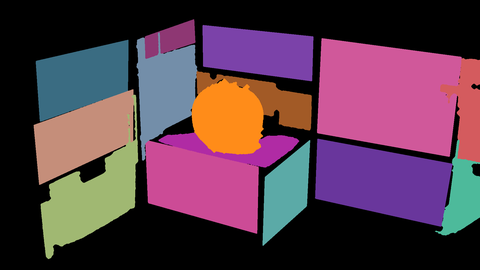

The scan's faces and objects in one picture, ragged borders smoothed (each pixel takes the label
most common around it), and the objects' silhouette as a signed distance. Nearly every effect
below starts from these two.

- In: `faces` (`regions_camera.png` or `planes_camera.png`), `objects` (`objects_camera.png`),
  `uv` (optional, see `fill`).
- Out: `labels`, `sdf`.
- Params: `keep` the one object kept (0: all; the others count as nothing), `radius` of the vote,
  `fill` a rectified face whose outline is filled where the scan left holes (a glossy top),
  with its `uv` wired; `tolerance`, `min_area` of the silhouette's trace; `width`, `height` the
  camera's size (1920 x 1080).

### photo_detail

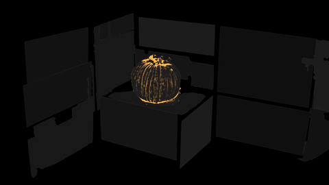

A camera still kept only on the objects, lightly softened (`fine`) and blurred wide (`wide`).
Their difference is the surface's fine relief: a pumpkin's furrows are a few millimetres deep,
far below a scan's noise, but each is a dark line in a photo. The preview shows how much darker
each pixel is than around it, not the photo.

- In: `photo`, `labels`. Out: `fine`, `wide`. Params: `fine_size` (3), `wide_size` (24) in pixels.

## Faces and regions

### edges

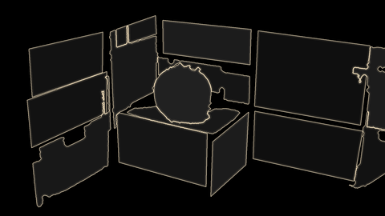

Thin glowing lines where two faces meet and round the objects.

- In: `labels`. Params: `line` width, `color`, `glow` (a soft halo), `objects` (lines round the
  objects too).

### pulse

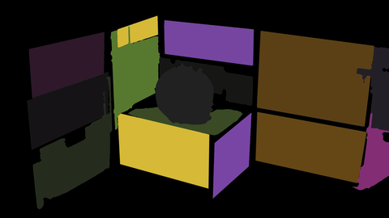

Every face lights up and fades, one after another, each in a colour of a small palette
(Halloween by default: orange, violet, poison green, amber, plum). The faces are traced into
shapes, `tex.shape_content` pulses them.

- In: `labels`, `gate` (optional: white where faces may light, e.g. only faces a projector
  reaches entirely). Params: `speed`, `stagger`, `scatter`, `depth` of the pulse; `count` and
  `c0` to `c4` the palette; `gain`; `brightness`.

### sweep

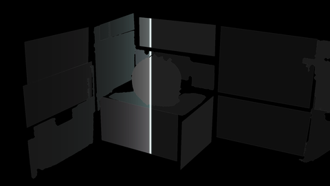

A scan line sweeping across everything the scan found, with a fading trail; the faces it passed
keep a faint tint of their own.

- In: `labels`. Params: `speed` (sweeps per second), `angle`, `line`, `trail`, `color`, `tint`,
  `pause`, `clock`.

### breathe

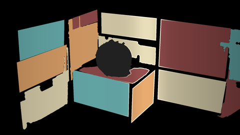

Regions each in one colour of a four-colour palette, breathing slowly one after another from
left to right; now and then a wipe crosses the picture and lights the regions' outlines.

- In: `regions`; optional `table` (a 256 x 1 picture: per label at x = k, red the colour slot
  k / 255, green its phase 0..1; without it slot k * 3 mod count and the phase from left to
  right across the picture) and `outlines` (white lines; without them they are found from the
  regions, `line` wide).
- Params: `count`, `c0` to `c3`, `edge` (outline colour), `gain`, `base`, `period`, `spread`,
  `fade`; the wipe's `first`, `every`, `wipe`, `breadth`, `angle`, `turn`, `lines`, `lift`;
  `clock`.

## On a round object

### relight

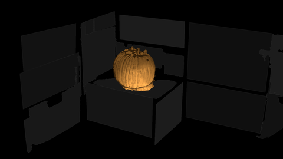

A lamp that is not there, going round the object. A scan's height cannot shade a body seen from
the front, so the body is taken as round (a dome on its silhouette) and the ribs come from the
photo.

- In: `labels`, `sdf`, `fine`, `wide`. Params: `radius` of the dome (about half the object's
  width), `ribs`, `speed` (turns per second), `elevation`, `ambient`, `color`, `rim`, `soften`
  (blur of the silhouette, so the dome has no crease), `clock`.

### furrows

Glow from the furrows, as if a candle burned inside: where the photo is darker than around it,
it glows and flickers.

- In: `labels`, `sdf`, `fine`, `wide`. Params: `gain`, `threshold`, `relative` (1 for a photo, 0
  with the height as `fine`/`wide`), `flicker`, `color`, `core`, `crest`, `rim` (no glow this close
  to the silhouette).

### contours

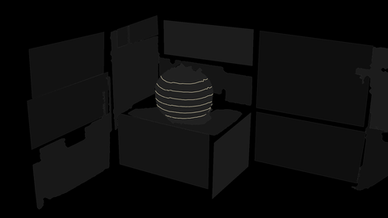

Contour lines of the object's height. Bind `offset` (0 to `interval`) to a clock to make them
climb.

- In: `height`, `labels`. Params: `interval`, `offset`, `thickness`, `smooth`, `color`, `mode`,
  `range`.

### glow

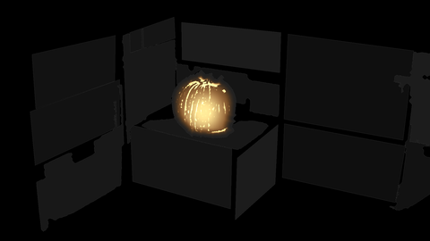

The object glowing from inside like a lantern: the skin brightest round a flame low in the
middle, the furrows hotter and yellower, all flickering as one flame that sputters up when it
starts. No light on the room (a projector's real shadows would give that away).

- In: `labels`, `sdf`, `fine`, `wide`. Params: `box` (the object's bounding box in the camera's
  pixels: left, top, right, bottom), `flame` (where in the box), `spread`, `skin`, `furrow`,
  `threshold`, `full`, `edge`, `flicker`, `sway`, `ignite`, `dim`, `hot`, `clock`.

### glow_rim

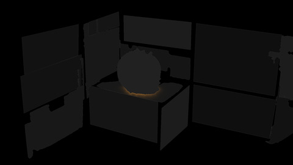

A faint warm rim on the face the object stands on, right round its foot, flickering with `glow`
(same flame).

- In: `regions`, `sdf`, `labels`. Params: `lid` (the region it stands on), `box` (as `glow`'s),
  `reach`, `below`, `gain`, `flicker`, `ignite`, `color`, `clock`.

### candle

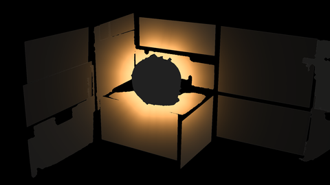

The object as the scene's light: warm, flickering light on the faces round it, falling off with
the distance from its silhouette.

- In: `labels`, `sdf`. Params: `radius`, `intensity`, `flicker`, `color`, `wobble`.

### lantern

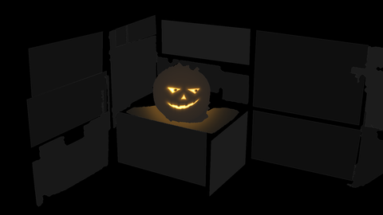

A carved jack-o'-lantern face on a round object, curving with its surface: it ignites, looks
around, blinks, turns from calm to sly to scary, laughs and blows out (one loop of `length`
seconds).

- In: `labels`, `regions` (for the spill round its foot), `photo` (optional: the still of the
  projector the face comes from, to even out its light).
- Params: the sphere it is drawn on, `center`, `size`, `stem` (camera pixels; take them from the
  object's bounding box); `object`, `lid`; `part` (0 skin and spill, 1 the face alone, 2 both: a
  blend seam through a face looks bad, so give the face to the one projector that sees it best,
  unweighted, and the skin to all); `mouth` (bind to an audio level); `yaw`, `drop`, `scale`,
  the eyes; the light's colours; `seek`, `length`, `clock`.

## On faces of a box

### water

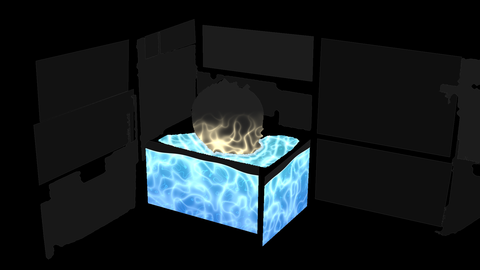

A box seen at a corner (front, side, top) as a tank of water: it fills once, then stays, waves
rolling along the front and round the corner, caustics below; a pond on the top with rings from
the object standing on it, whose lower half catches the water's light.

- In: `regions`, `labels`, `sdf`. Params: `front`, `side`, `lid` (regions), `front_top`,
  `front_bottom`, `side_top`, `side_bottom` (their straight corners from `regions_reply.json`,
  top left and top right, then bottom left and bottom right), `rows` (the object's top and
  bottom row), `size` (the box in centimetres), `fill`, `pond`, `level`, `wave`, `tile`,
  `caustic`, `gain`, the colours, `shimmer`, `texture` (a tiling water picture), `clock`.

### tiles

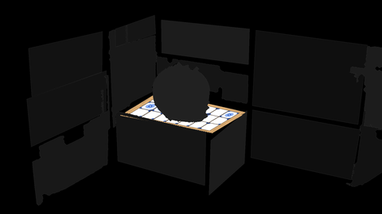

Glazed tiles with grout and a wooden rim on a rectified face, appearing one by one with
`reveal`.

- In: `uv` (`uv_K_camera.exr`), `objects` (`objects_camera.png`). For a projector's own pixels,
  load a second copy with `uv_K_N.exr` and `labels_N.png`: exact even where the camera measured
  nothing (a glossy top).
- Params: `object` (left out, e.g. what stands on the face), `reveal`, `aspect` (the face in
  centimetres, as given to `scan.scene`), `tile`, `grout`, `rim`, `decor` (share of decorated
  tiles), `grout_color`, `wood`, `gain`, `seed`, `atlas` (the decorated tile in the left half, a
  plain one in the right).
