# The content library

Ready-made effects, one component each. Most are content for scanned objects. They take what a
scan leaves behind (`scan.scene`'s and `scan.regions`' pictures, camera stills), never the face or
region numbers of one particular scene, so they fit any scanned scene. The last group is a stage
for music: a synthwave world that a `chan.beat_grid` drives, with elements to swap in and out.

Each folder holds the component (`<name>.comp.ron`), its shaders and pictures, and `preview.png`.
For a scan effect the preview is the effect rendered headless on a real scan of a few crates with
a pumpkin on one of them, over a dim drawing of the scan's regions. For the music stage it is the
stage at 20 s into `examples/beat-grid/music.wav`, with `warmth` at 1.

## Using one

- **Add it:** the add dialog's `library` tab lists them marked `penumbra`; over the control channel
  `comp.load {"file": "<name>"}`. Adding copies the component's own files (shaders, textures)
  into the project's `library/<name>/`, where its nodes look for them, so the project keeps
  working without penumbra's folder and can change its copies. A file the project already has is
  kept as it is (`comp.load` lists what it `copied` and what it `kept`); delete the copy to get
  penumbra's again.
- **Wire it:** its inputs are its `tex.in` nodes, named after what they want (below). Connect
  with `node.connect {"from": "/regions_image", "to": "/water", "input": "regions"}`.
- **Set it:** the component shows its effect's params (`node.set {"path": "/water", "params":
  {"level": 0.2}}`); they are the shader's own, so `node.info` on the inner node and the shader
  file's `// @param` lines say what each does.
- **Time:** the moving effects have a `clock` param: seconds since the effect started, below 0
  the show time. Bind it to a `chan.clock` (`seconds`) so the effect starts from its beginning
  when its piece comes on.
- **Into the projectors:** every effect draws in the scan camera's picture. Each projector
  takes its share as [Scanning, 7. The network](../docs/scanning.md#7-the-network) describes:
  `tex.remap` through the projector's `proj_to_cam_smooth_N.exr`, times its blend weight
  `weight_N.png`. `tiles` can also draw straight in a projector's pixels (see there).

### The pictures they take

| Input | What | From |
|---|---|---|
| `labels` | faces and objects in one picture: red the face k / 255, green the object k / 255, as plain numbers | `scan_labels`' `labels` |
| `sdf` | signed distance from the objects' silhouette (red, in widths of the picture, negative inside) | `scan_labels`' `sdf` |
| `regions` | region labels, 8 bit | `tex.image_file` of `regions_camera.png` (`scan.regions`) |
| `objects` | object labels, 8 bit | `tex.image_file` of `objects_camera.png` (`scan.scene`) |
| `height` | height over the support | `tex.image_file` of `height_camera.exr` (`scan.scene`) |
| `uv` | a rectified face's u, v (red, green) and where it is (blue) | `tex.image_file` of `uv_K_camera.exr` (`scan.scene` with `rectify`) |
| `fine`, `wide` | a camera still on the objects, softened lightly and blurred wide | `photo_detail` |
| `photo` | a camera still of the scene lit white by the projectors | the scan's `photo_*.png` (or the sum of them) |

Effects that read region labels (`water`, `glow_rim`, `lantern`) take the region by its number
as a param: look it up by name in `regions_reply.json` (`scan.regions`), which also has the
straight corners `water` wants.

## The building blocks

### scan_labels

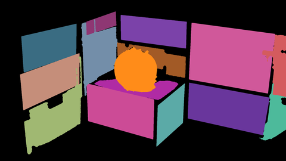

The scan's faces and objects in one picture, ragged borders smoothed (each pixel takes the label
most common around it), and the objects' silhouette as a signed distance. Nearly every effect
below starts from these two.

- In: `faces` (`regions_camera.png` or `planes_camera.png`), `objects` (`objects_camera.png`),
  `uv` (optional, see `fill`).
- Out: `labels`, `sdf`.
- Params: `keep` the one object kept (0: all; the others count as nothing), `radius` of the vote,
  `fill` a rectified face whose outline is filled where the scan left holes (a glossy top),
  with its `uv` wired; `tolerance`, `min_area` of the silhouette's trace; `width`, `height` the
  camera's size (1920 x 1080).

### photo_detail

A camera still kept only on the objects, lightly softened (`fine`) and blurred wide (`wide`).
Their difference is the surface's fine relief: a pumpkin's furrows are a few millimetres deep,
far below a scan's noise, but each is a dark line in a photo. The preview shows how much darker
each pixel is than around it, not the photo.

- In: `photo`, `labels`. Out: `fine`, `wide`. Params: `fine_size` (3), `wide_size` (24) in pixels.

## Faces and regions

### edges

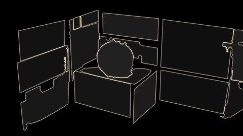

Thin glowing lines where two faces meet and round the objects.

- In: `labels`. Params: `line` width, `color`, `glow` (a soft halo), `objects` (lines round the
  objects too).

### pulse

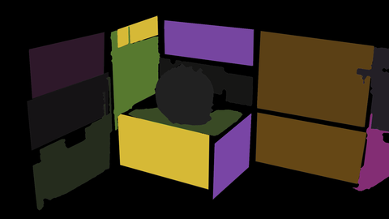

Every face lights up and fades, one after another, each in a colour of a small palette
(Halloween by default: orange, violet, poison green, amber, plum). The faces are traced into
shapes, `tex.shape_content` pulses them.

- In: `labels`, `gate` (optional: white where faces may light, e.g. only faces a projector
  reaches entirely). Params: `speed`, `stagger`, `scatter`, `depth` of the pulse; `count` and
  `c0` to `c4` the colours, or `palette` (a named palette such as `candy`, or hex colours: all
  of its colours, in place of the five); `gain`; `brightness`.

### sweep

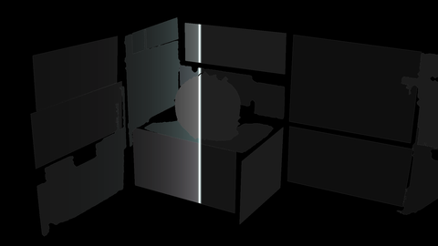

A scan line sweeping across everything the scan found, with a fading trail; the faces it passed
keep a faint tint of their own.

- In: `labels`. Params: `speed` (sweeps per second), `angle`, `line`, `trail`, `color`, `tint`,
  `pause`, `clock`.

### breathe

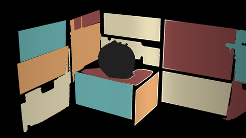

Regions each in one colour of a four-colour palette, breathing slowly one after another from
left to right; now and then a wipe crosses the picture and lights the regions' outlines.

- In: `regions`; optional `table` (a 256 x 1 picture: per label at x = k, red the colour slot
  k / 255, green its phase 0..1; without it slot k * 3 mod count and the phase from left to
  right across the picture) and `outlines` (white lines; without them they are found from the
  regions, `line` wide).
- Params: `count`, `c0` to `c3`, `edge` (outline colour), or `palette` (a named palette such as
  `blood`, or hex colours: all of its colours in place of the four, the brightest for the
  outlines), `gain`, `base`, `period`, `spread`, `fade`; the wipe's `first`, `every`, `wipe`, `breadth`, `angle`, `turn`, `lines`, `lift`;
  `clock`.

## On a round object

### relight

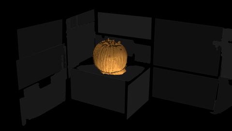

A lamp that is not there, going round the object. A scan's height cannot shade a body seen from
the front, so the body is taken as round (a dome on its silhouette) and the ribs come from the
photo.

- In: `labels`, `sdf`, `fine`, `wide`. Params: `radius` of the dome (about half the object's
  width), `ribs`, `speed` (turns per second), `elevation`, `ambient`, `color`, `rim`, `soften`
  (blur of the silhouette, so the dome has no crease), `clock`.

### furrows

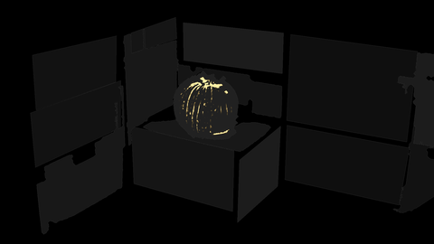

Glow from the furrows, as if a candle burned inside: where the photo is darker than around it,
it glows and flickers.

- In: `labels`, `sdf`, `fine`, `wide`. Params: `gain`, `threshold`, `relative` (1 for a photo, 0
  with the height as `fine`/`wide`), `flicker`, `color`, `core`, `crest`, `rim` (no glow this close
  to the silhouette).

### contours

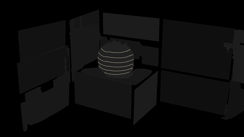

Contour lines of the object's height. Bind `offset` (0 to `interval`) to a clock to make them
climb.

- In: `height`, `labels`. Params: `interval`, `offset`, `thickness`, `smooth`, `color`, `mode`,
  `range`.

### glow

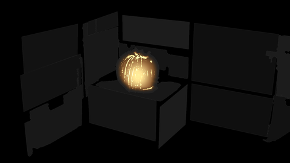

The object glowing from inside like a lantern: the skin brightest round a flame low in the
middle, the furrows hotter and yellower, all flickering as one flame that sputters up when it
starts. No light on the room (a projector's real shadows would give that away).

- In: `labels`, `sdf`, `fine`, `wide`. Params: `box` (the object's bounding box in the camera's
  pixels: left, top, right, bottom), `flame` (where in the box), `spread`, `skin`, `furrow`,
  `threshold`, `full`, `edge`, `flicker`, `sway`, `ignite`, `dim`, `hot`, `clock`.

### glow_rim

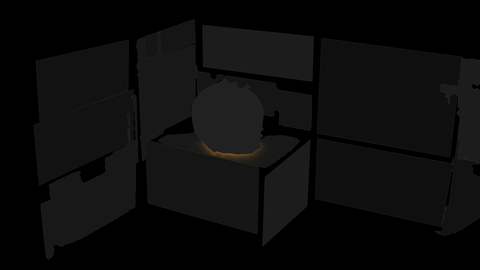

A faint warm rim on the face the object stands on, right round its foot, flickering with `glow`
(same flame).

- In: `regions`, `sdf`, `labels`. Params: `lid` (the region it stands on), `box` (as `glow`'s),
  `reach`, `below`, `gain`, `flicker`, `ignite`, `color`, `clock`.

### candle

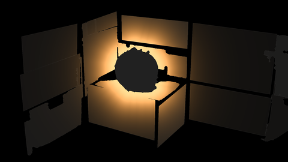

The object as the scene's light: warm, flickering light on the faces round it, falling off with
the distance from its silhouette.

- In: `labels`, `sdf`. Params: `radius`, `intensity`, `flicker`, `color`, `wobble`.

### lantern

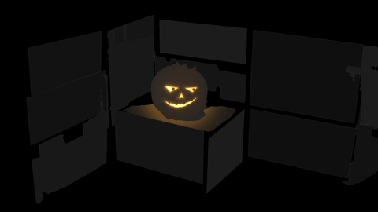

A carved jack-o'-lantern face on a round object, curving with its surface: it ignites, looks
around, blinks, turns from calm to sly to scary, laughs and blows out (one loop of `length`
seconds).

- In: `labels`, `regions` (for the spill round its foot), `photo` (optional: the still of the
  projector the face comes from, to even out its light).
- Params: the sphere it is drawn on, `center`, `size`, `stem` (camera pixels; take them from the
  object's bounding box); `object`, `lid`; `part` (0 skin and spill, 1 the face alone, 2 both: a
  blend seam through a face looks bad, so give the face to the one projector that sees it best,
  unweighted, and the skin to all); `mouth` (bind to an audio level); `yaw`, `drop`, `scale`,
  the eyes; the light's colours; `seek`, `length`, `clock`.

## On faces of a box

### water

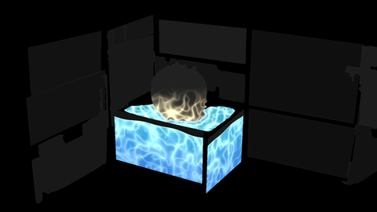

A box seen at a corner (front, side, top) as a tank of water: it fills once, then stays, waves
rolling along the front and round the corner, caustics below; a pond on the top with rings from
the object standing on it, whose lower half catches the water's light.

- In: `regions`, `labels`, `sdf`. Params: `front`, `side`, `lid` (regions), `front_top`,
  `front_bottom`, `side_top`, `side_bottom` (their straight corners from `regions_reply.json`,
  top left and top right, then bottom left and bottom right), `rows` (the object's top and
  bottom row), `size` (the box in centimetres), `fill`, `pond`, `level`, `wave`, `tile`,
  `caustic`, `gain`, the colours, `shimmer`, `texture` (a tiling water picture), `clock`.

### tiles

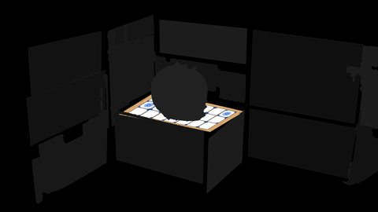

Glazed tiles with grout and a wooden rim on a rectified face, appearing one by one with
`reveal`.

- In: `uv` (`uv_K_camera.exr`), `objects` (`objects_camera.png`). For a projector's own pixels,
  load a second copy with `uv_K_N.exr` and `labels_N.png`: exact even where the camera measured
  nothing (a glossy top).
- Params: `object` (left out, e.g. what stands on the face), `reveal`, `aspect` (the face in
  centimetres, as given to `scan.scene`), `tile`, `grout`, `rim`, `decor` (share of decorated
  tiles), `grout_color`, `wood`, `gain`, `seed`, `atlas` (the decorated tile in the left half, a
  plain one in the right).

## A stage for music

A world that moves with a sound file: a stage (a synthwave floor, a tunnel or a tower to climb),
and elements in it.
They all take the same music bus, the whole output of a `chan.beat_grid`. A project has one
`chan.beat_grid` and wires it into the `bus` input of the stage and of every element:
`node.connect {"from": "/grid", "to": "/stage", "input": "bus"}`. Each component reads the
channels it needs by name. `travelled` moves the world, `drift` puts the lane's turns on
downbeats, `beat` and `beat_length` time the blocks, `energy_low` brightens the sky. [Beats of a
sound file](../docs/audio.md#beats-of-a-sound-file) explains these channels.

- **Floor elements** stand on the stage's grid and move with it. They take `bus` and the stage's
  `lane` output, so they keep the glider's lane free. Their output goes into the stage's `floor`;
  several go through a `geo.merge`.
- **Mid elements** fly in front of the camera, on the lane. They take `bus` and `lane` too. Their
  output goes into the stage's `mid`; several go through a `geo.merge`.
- **Ceiling elements** hang from the ceiling grid, 4 m above the floor. They take `bus` and
  `lane` and give geometry, as floor elements do. Their output goes into the stage's `ceiling`;
  several go through a `geo.merge`. Towards `presence` 0 they draw up into the ceiling. Over the
  lane they stay above 3.2 m, so the glider and the camera pass under them at every preset.
  Anything that hangs lower stays beside the lane.
- **Sky elements** draw a picture over black. Their output goes into the stage's `sky`, screened
  over the nebula. Several go through a `tex.composite` with `op: screen`. The sky lies behind
  everything the stage renders. The solid bodies of floor and mid elements are a plain
  `mat.occluder`: they hide the lines behind them and show the sky, so a body reads as a dark
  shape of nebula with its own edges. Screening only adds light, so a sky element cannot darken
  the nebula. Every sky element
  except `sky_galaxy` also takes the stage's `pose`, so its horizon moves with the camera.
- **Post elements** change the finished picture. Each takes a picture in `in` and `bus`, and
  gives the changed picture in `out`. Chain them after the stage's `out`: stage, then
  `post_scanlines`, then the next one, then the output. At `presence` 0 a post element passes the
  picture on unchanged.
- **`presence`** (0 to 1) brings an element in and takes it out again. A floor element sinks into
  the floor towards 0, a mid element flies away, a sky element dims. To swap two elements, ramp
  one's `presence` down while the other's goes up, for example through the blend between two
  sections.
- **Elements that are out cost nothing** once the slot's `geo.merge` or `tex.composite` knows
  their `presence`. Wire a `chan.select` of the presence channels into its `show` input, in the
  order of its inputs: `blocks mountains pillars` for a merge of `/blocks` in `in0`, `/mountains`
  in `in1` and `/pillars` in `in2`. An input whose channel is 0 then does not cook, nor does
  anything inside its element. A stage of many elements runs about three times faster that way.
  Leave out an element that fades out by itself after its `presence` reaches 0: `mid_glider`
  flies away for a few seconds more. Put it after the inputs the channels name, so it always
  shows.
- **`beats.arrange`** does those swaps for a whole sound file. It writes a table with a row per
  section (the `presence` of each element, `warmth`, `intensity`) and binds the elements to it.
  Edit the table to change a section's picture. [An arrangement from the
  sections](../docs/audio.md#beats-of-a-sound-file) explains the rules. Name the slots `floor`,
  `ceiling`, `mid`, `sky` and `post`. `mid` and `sky` stay on through a break; `floor` and
  `ceiling` empty. In `post` every element is on or off by itself, so several can be on at once:
  they are off in an intro, outro and break and come on at a drop.
- **The camera** takes one of six presets of the stage. The arrangement's `camera` column picks
  one per section, and the stage glides to it.
- **Several stages.** A project can hold several stages side by side: `stage_synthwave`,
  `stage_tunnel` and `stage_ascent` take the same inputs and give the same outputs. Each has its
  own floor, sky and ceiling elements. Wire their `out` into a `tex.switch` with `blend` on and
  that into the post chain. Give `beats.arrange` the stages as a list and the switch's param:
  `stage: ["/stage", "/tunnel", "/ascent"], switch: "/stages.index"`. The `stage` column then
  changes at a strong track start, at most once in 8 minutes. It walks to the next stage in the
  list and back again (0, 1, 2, 1, 0), so every change goes between neighbours. A blending
  switch fades between the two through the row's fade; with `blend` off it cuts half way
  through it. With `inactive: skip` on the switch only the stage on show renders, and both
  stages of a fade while it lasts. For two stages a `tex.cross` (`switch: "/stages.cross"`) fades
  too, but then both stages always render. The mid and sky elements can go into every stage. They
  read one `lane` and one `pose`. Blend the stages' lanes with a second blending `tex.switch` and
  give `switch` both params as a list: `switch: ["/stages.index", "/lanes.index"]`. Blend the
  poses with `chan.math`: take the `stage` channel of the arrangement's `_mix` (a `chan.select`),
  cut it into one share per fade (for three stages: its part up to 1 with `min` 1, and its part
  beyond 1 with `subtract` 1 and `max` 0), and add each neighbour's difference times its share
  to the first stage's pose. So the glider and the horizon move over with the picture.
  `intensity` takes a list too: `intensity: ["/stage.dim", "/tunnel.dim", "/ascent.dim"]`. Floor
  and ceiling elements need a flat floor and a flat ceiling: wire them into `stage_synthwave`
  only. An element that does not suit a stage gets a list of the stages it may show in:
  `{path: "/sun", stages: ["/stage"]}` keeps the sun off the tunnel and the shaft, and its slot
  shows another element there.
- **The stage's shape** is in its `pose` too: `axis` (metres up where the stage's middle lies:
  0.5 over the synthwave floor, the tube's axis, the shaft's middle), `walls` (1 where walls
  stand round the camera), `curve` (1 where the horizon is the round end of a tube), `radius`
  (the tube's or the shaft's radius, 0 on the plane) and `far` (metres ahead where the fade ends:
  the stage's `end`). The lasers start at `axis`, the glider floats up out of the picture where
  `walls` is 1. With `curve` the bars and the city stand round the tube's far end, `far` metres
  ahead: a ring of `radius` round the axis, which the camera sees above the vanishing point. The
  figures stand on that ring's bottom and the planet hangs inside it. Wire the blended pose into
  `mid_lasers` and `mid_glider` as into the sky elements.
- **Rolling the plane up into the tunnel.** `stage_synthwave` and `stage_tunnel` both have
  `roll_up`. Bind both to the share of the fade between them (the `min` 1 part of the `stage`
  channel above). While the switch fades, the plane's floor gives way to lines from right to
  left, and those lines bend up into the tunnel's rings; the ceiling grid fades out. Both
  stages show the same lines through the fade, so the switch's crossfade reads as one floor
  rolling up.
- **Turning the tunnel up into the ascent.** `stage_tunnel` and `stage_ascent` both have
  `turn_up`. Bind both to the share of the fade between them (the part of the `stage` channel
  beyond 1). While the switch fades, the tunnel's wall, long lines and chevrons go, and its
  rings thin out to free hoops, one every `storey_beats` beats. The hoops move apart to the
  storeys' spacing and widen to the tower's radius. Then the tube turns upright in front of the
  camera, and the hoops sink past it as storeys. The ascent draws the same hoops through the
  fade, lying down at first, and builds its posts and floors as it stands. Both stages show the
  same hoops at the same places, so the crossfade reads as one movement. The camera stays
  level: the hoops turn, not the camera. For the cameras to match, bind the tunnel's inner
  `toward` (a `chan.constant`: `height`, `pitch`, `roll`, `fov`, `side`) to the ascent's pose
  through a `chan.select`: the tunnel's camera then glides into the ascent's over the first
  third of the fade. The reverse walk runs the same way back.

### stage_synthwave

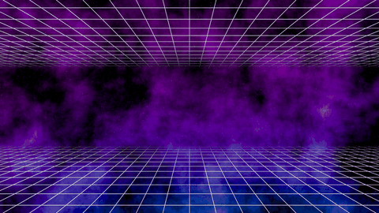

The world: a camera flying over a wireframe floor, under a wireframe ceiling, towards a nebula
in a warm or cold palette. The world moves one grid cell per beat of `travelled`. The lane
zigzags to the other side every two bars, each turn starting on a downbeat. The bass brightens
the nebula. Lines fade out with distance from the camera. The sky (nebula and `sky`) lies behind
the render: what the render draws solid hides it, and far things melt into it as they fade. The
glider is the element `mid_glider`.

- In: `bus`, `floor` (geometry standing on the grid), `mid` (geometry in front of the camera,
  such as the glider), `ceiling` (geometry hanging from the ceiling grid), `sky` (a picture
  screened over the nebula).
- Out: `out` (the picture), `lane` (256 x 1: per texel i, -8 + 0.25 i metres ahead, red the
  lane's x in metres, green its sideways slope per metre, blue `step`, alpha the floor: 1 where
  it stands, 0 in a gap), `pose` (the camera as it glides: channels `height`, `pitch`, `roll`,
  `fov`, `side`, and the stage's shape: `axis` 0.5, `walls` 0, `curve` 0, `radius` 0, `far` the
  fade's `end`; wire it into the
  sky elements and the mid elements that take it).
- Params: `warmth` (0 the warm palette, 1 the cold one), `lift` (added to the bass, e.g. before a
  change), `energy_curve`, `dim` (the nebula's light); the lane's `bars_per_turn`, `swing`, `turn`,
  `beats_per_bar`; `step` (metres per beat); `start`, `end` of the distance fade; `ground` (how
  dark the sky gets below the horizon: 0 not at all, the default, so the nebula shows under the
  floor's lines and in a gap; 1 black, so the floor stands on black), `roll_up` (0 the floor as it is; towards 1
  the floor grid gives way to lines from right to left that bend up into rings round an axis
  4 m up, as `stage_tunnel`'s rings at its own `roll_up`, and the ceiling grid fades out).
- Camera: `camera` (the preset, 0 to 5), `glide` (seconds the camera takes to reach a new preset:
  most of the way after about 3 times this), `presets` (a csv table, one row per preset: `height`
  in metres, `pitch` in degrees up, `roll` in degrees, `fov` in degrees, `side` in degrees to the
  right). The presets: 0 low flight at 1.5 m, 1 higher and looking down for a build, 2 high and
  wide for a drop (2.9 m, 74 degrees), 3 still and level for a break, 4 and 5 two tilted variants
  that the tracks take in turn. `pitch` and `side` stay good to about 30 degrees.
- Gaps: `gap` (the share of the floor grid that breaks off, 0 to 1; 0 keeps it whole),
  `gap_length` (metres a gap runs, rounded to whole bars). A gap begins where a bar begins, so its
  near edge passes the camera on a downbeat. The lane floats on over nothing. Floor elements read
  the gaps from `lane`: a thing whose cell of the floor is in a gap is left out whole, so no stub
  stands at a gap's edge. A change of `gap` reaches only the floor beyond the fade's `end`, out
  of sight: each stretch of the floor keeps the share it had when it was last out there. So a gap
  forms behind the horizon and comes towards the camera with the floor, and the floor comes back
  the same way. `gap_memory` (a `tex.shader` fed back through `gap_loop`, a `tex.feedback`)
  remembers the shares. `beats.arrange` binds `gap` to its `gaps` column: 0.3 in a build, 0.6 in
  a break.

### stage_tunnel

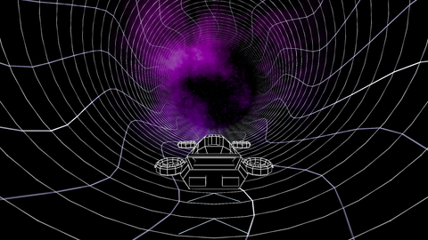

A second world for the same elements: the camera flies through a wireframe tube towards the sky
at its end. The tube has a ring on every beat of `travelled` and long lines along its wall. It
rolls with the lane, so the lane always lies at the tube's bottom, straight ahead, and the long
lines twist as the lane zigzags. The wall is black and hides what lies outside the tube. Far
away the tube fades out, so the sky (nebula and `sky`) shows as a disc at its end. Palette,
nebula, distance fade and camera presets work as on `stage_synthwave`, so the two stages can
swap.

The tube lives with the music. On every beat a pulse of light runs from the camera down the
tube, and the rings it passes narrow a little. Twice a bar a bright dash runs ahead along every
third long line. Chevrons on the tube's bottom point ahead and come towards the camera with the
world; the bass brightens them. Every `roll_bars` bars the whole tube makes a turn round its
axis over `roll_length` bars, the next turn the other way; in a drop the turns come twice as
often. The tube is a sheet rolled up: at `roll_up` 0 it lies open as a flat floor of lines from
right to left, the rings, which roll up into the tube as `roll_up` grows (see the paragraph on
rolling the plane up above).

- In: `bus`, `mid` (geometry in the tube, such as the glider), `sky` (a picture screened over
  the nebula), `floor` and `ceiling` (merged into the scene, but the tube has no flat floor or
  ceiling: floor elements beside the lane stand through the curved wall, and ceiling elements
  hang at their own `ceiling` height in the middle of the tube; leave both unwired).
- Out: `out` (the picture), `lane` (the layout of `stage_synthwave`'s lane: red and green 0,
  since the lane lies straight at the tube's bottom, blue `step`, alpha 0, since nothing can
  stand on the curved bottom), `pose` (the camera as it glides: channels `height`, `pitch`,
  `roll`, `fov`, `side`, and the stage's shape: `axis` the tube's axis, 4 m, `walls` 1, `curve`
  1, `radius` 4 m, `far` the fade's `end`, 20 m).
- Params: `warmth` (0 the warm palette, 1 the cold one), `lift`, `energy_curve`, `dim`; the
  lane's `bars_per_turn`, `swing`, `turn`, `beats_per_bar`; `step` (metres per beat: the
  distance between two rings); `start`, `end` of the distance fade (6 and 20 m: the tube is
  seen further than the synthwave floor); `ceiling` (the tube's height, twice its radius: 8 m);
  `twist` (how far the tube rolls with the lane: 1 turns it by the lane's swing over the
  radius); `lines` (long lines along the wall, up to 24); `line_width`; `roll_up` (1 the tube,
  towards 0 a flat floor of lines); `roll_bars` (bars from one turn of the tube to the next, 8;
  0 never turns); `roll_length` (bars a turn takes, 2); `pulse` (the light of the pulses and
  dashes, 1; 0 none); `marks` (the chevrons' light, 1; 0 none); `turn_up` (0 the tube, towards 1
  hoops that turn upright into a tower; see the paragraph on turning up above); `storey`,
  `storey_beats` and `tower_radius` (where the hoops end up: 3 m apart, one every 4 beats, 6 m
  wide, as on `stage_ascent`). `curve` in the pose falls to 0 as the tube turns up.
- Camera: `camera`, `glide` and `presets` as on `stage_synthwave`, with presets of the same
  meaning for the tube: 0 low flight at 1.8 m, 1 higher and looking down for a build, 2 high and
  wide for a drop (3.4 m, 76 degrees), 3 still and nearly level for a break, 4 and 5 two tilted
  variants.
- Gaps: `gap` and `gap_length` as on `stage_synthwave`: stretches of the tube run out, and the
  sky shows through them. A gap starts on a bar, and a change of `gap` comes in from the far end,
  as on `stage_synthwave`. Over its first and last metres (at most 4 m) the
  rings thin out: every second ring stays, then every fourth, on the downbeats. The long lines
  and chevrons fade, and the wall opens from the top down in narrowing slats. In the middle of
  the gap nothing is left, and the tube comes back the same way.

### stage_ascent

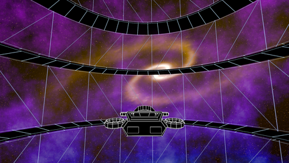

A third world for the same elements: the camera climbs inside a wireframe tower. Each storey is
a black floor along the tower's wall with glowing edges, open in the middle where the camera
rises. A storey passes downwards every `storey_beats` beats of `travelled`. Posts and braces of
lines join the storeys. The tower turns slowly around its axis, once in `orbit` beats, and sways
with the lane, so the camera seems to circle inside the shaft. The walls are open: the sky
(nebula and `sky`) shows through them, and the storeys high above fade into it. The mid elements
fly ahead of the camera as on the other stages, straight through the middle of the shaft.
Palette, nebula, distance fade and camera presets work as on `stage_synthwave`, so the stages can
swap.

- In: `bus`, `mid` (geometry in the shaft, such as the glider), `sky` (a picture screened over the
  nebula), `floor` and `ceiling` (merged into the scene, but the shaft has no floor: floor
  elements sink away, since the lane's alpha is 0, and ceiling elements hang at their own height
  in the middle of the shaft; leave both unwired).
- Out: `out` (the picture), `lane` (the layout of `stage_synthwave`'s lane: red and green 0,
  since the lane runs straight ahead, blue `step`, alpha 0, since there is no floor to stand
  on), `pose` (the camera as it glides: channels `height`, `pitch`, `roll`, `fov`, `side`;
  `height` is the camera's height above the floor it would stand on, the same on every storey;
  and the stage's shape: `axis` 1.5, `walls` 1, `curve` 0, `radius` the shaft's, `far` the
  fade's `end`).
- Params: `warmth` (0 the warm palette, 1 the cold one), `lift`, `energy_curve`, `dim`; the
  lane's `bars_per_turn`, `swing`, `turn`, `beats_per_bar` (they set the sway); `step` (metres per
  beat, for the mid elements); `start`, `end` of the distance fade (8 and 24 m); `ceiling` (metres
  from one storey to the next: 3); `storey_beats` (beats to climb one storey: 4); `orbit` (beats
  for one turn of the tower: 128); `radius` (the tower's radius: 6 m; the camera rises halfway
  between its axis and its wall); `twist` (how far the tower sways with the lane: 1 turns it by
  the lane's swing over the radius); `lines` (posts around the tower, up to 24); `line_width`;
  `turn_up` (1 the tower stands; towards 0 it lies down along the view as a tube of hoops, the
  way `stage_tunnel` turns up); `tube_radius` (the lying tube's radius: 4 m, as the tunnel's).
  `curve` in the pose rises to 1 as the tower lies down.
- Camera: `camera`, `glide` and `presets` as on `stage_synthwave`, with presets of the same
  meaning for the shaft, all looking up a little: 0 at 1.5 m and 8 degrees up, 1 lower and looking
  up more for a build, 2 wide for a drop (80 degrees), 3 still and nearly level for a break, 4 and
  5 two tilted variants. The heights stay near the glider's, so the glider stays in view.
- Gaps: `gap` (the share of the storeys that break off, 0 to 1) and `gap_length` (metres a gap
  runs up the tower, rounded to whole storeys). In a gap only the posts and braces stand, and
  the sky shows between them.

### floor_blocks

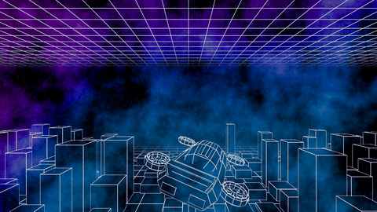

A city of wireframe blocks. Each block lies flat until it passes `rise_at` and shoots up on the
next beat, so a new row stands up on every beat. Blocks on the lane stay low.

- In: `bus`, `lane`. Out: `out`.
- Params: `presence` (towards 0 the blocks sink back into the floor one after another), `rise`
  (beats a block takes to stand up), `rise_at`, `lane` (half the low lane's width), `fill` (share
  of places with a block), `spread` (the city's width), `near`, `far`, `extent`.

### floor_mountains

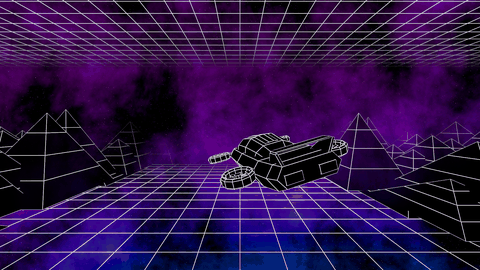

Wireframe mountain ranges beside the lane: square pyramids with contour lines, overlapping into
jagged ridges. They rise from the lane's edge to full height over `foot` metres; no foot reaches
into the lane. The heights come from noise fixed to the floor, so a ridge keeps its shape as it
comes nearer. Another `seed` gives another range.

- In: `bus`, `lane`. Out: `out`.
Peaks lower than 0.9 m, or lower than half their width, are left out. Near that height a peak
shrinks whole instead of flattening, so no flat plates appear. Just below it a peak shrinks
away over 20 cm instead of vanishing at once, so a peak right at the limit does not blink. On
each beat the peaks nod: they grow taller by `nod` and settle back over the beat.

- Params: `presence` (towards 0 the peaks shrink away one after another), `seed`,
  `height` (the tallest peaks, metres; the camera is 2 m up, the ceiling 4 m), `width` (a peak's
  foot across), `length` (along the lane, as a multiple of `width`), `spacing` (between peaks),
  `peaks` (metres between summits: smaller is more jagged), `valleys` (peaks lower than this share
  of `height` are left out, so the floor shows between ridges), `foot`, `lane` (as on
  `floor_blocks`, 1.6), `spread` (the range's width, both sides), `near`, `far`, `nod` (how much
  taller the peaks grow on each beat, as a share of their height, 0.2; 0 keeps them still),
  `color`, `extent`.

### floor_pillars

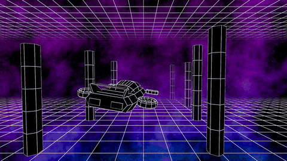

Tall wireframe pillars in lines on both sides of the lane, like an avenue. A pillar stands every
`spacing` bars of travel, so the pillars pass the camera on downbeats. The second line on a side
stands half a gap later, so the two lines interleave. The lines follow the lane's zigzag at a
fixed distance from its edge. On each beat the pillars stretch a little. No pillar is lower than
1.2 m: between so many upright lines a stump looks wrong.

- In: `bus`, `lane`. Out: `out`.
- Params: `presence` (towards 0 the pillars shrink away whole, one after another; at a steady
  presence a pillar stands at full size or not at all), `spacing` (bars between two pillars),
  `height` (metres, at least 1.2; the camera is 2 m up, the ceiling 4 m), `width`, `rows` (lines
  on each side, 1 to 3, default 2), `gap` (metres between lines), `pulse` (how far they stretch on
  a beat), `lane` (as on `floor_blocks`, 1.6), `near`, `far`, `beats_per_bar`, `color`, `extent`.

### floor_hexfield

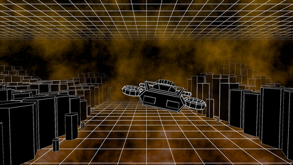

A dense field of hexagonal wireframe prisms side by side on both sides of the lane, like basalt
columns. The prisms stand in a honeycomb fixed to the floor, so the field comes nearer with the
floor. Their heights come from noise fixed to the floor, from 0.4 to 3.2 m, so hills and valleys
of prisms keep their shape as they come nearer. On each beat the prisms rise a little. The lane
stays free: prisms at its edge shrink whole. The bodies hide the lines behind them.
`hexfield.py` in the folder writes the model.

- In: `bus`, `lane`. Out: `out`.
- Params: `presence` (towards 0 the prisms sink into the floor one after another), `seed`,
  `radius` (metres from a prism's middle to a corner), `fill` (how much of its cell a prism
  fills; 1 without a gap), `lowest`, `tallest` (metres), `hills` (metres between two hills: smaller
  is more broken), `pulse` (how far they rise on a beat), `lane` (1.6), `near`, `far`, `color`,
  `line_width`, `extent`.

### floor_hexgap

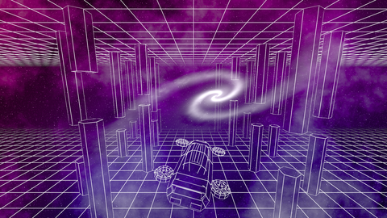

Split hexagonal pillars beside the lane. Each pillar is a base standing on the floor and a
counterpart hanging from the ceiling, with open air between them. The pillars stand where
`floor_pillars` puts its pillars: in lines on both sides of the lane, one every `spacing` bars
of travel. Every pillar has a gap of its own: its middle lies between 1.2 and 3 m up, and it is
0.3 to 1 m tall. On each beat the gaps open a little. The bodies hide the lines behind them.
`hexgap.py` in the folder writes the model.

- In: `bus`, `lane`. Out: `out`.
- Params: `presence` (towards 0 the bases sink into the floor and the counterparts into the
  ceiling, one pillar after another; at a steady presence a pillar stands whole or not at all),
  `ceiling` (the ceiling's height the counterparts hang from, 4 m), `seed` (other gaps), `low`,
  `high` (the lowest and highest middle of a gap, 1.2 and 3 m), `narrow`, `wide` (the smallest
  and largest gap, 0.3 and 1 m), `pulse` (how far a gap opens on a beat, as a share of its
  height), `spacing`, `width`, `rows`, `gap` (metres between lines), `lane` (1.6), `near`, `far`,
  `beats_per_bar`, `color`, `line_width`, `extent`. A pillar over a gap in the floor is left out
  whole, both parts.

### floor_waves

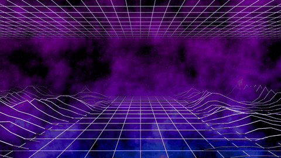

Waves beside the lane: 48 lines across the floor, each a height field of ridged noise. The lines
move with the floor, and the waves roll towards the camera a little faster still. Each wave hides
the lines and floor behind it, like a range of hills. The bass raises the waves. The lane stays
flat, so the glider never flies through a wave.

- In: `bus`, `lane`. Out: `out`.
- Params: `presence` (towards 0 the lines flatten into the floor one after another), `source`
  (`noise`: the waves rise with the bass; `levels`: bass beside the lane, mids further out,
  treble at the edges), `seed`, `height` (the highest crests, metres), `bass` (share of the height
  that follows the bass), `crests` (metres between crests), `flow` (metres per beat the waves roll
  on), `spacing` (metres between lines), `spread` (the field's width), `lane` (half the flat
  lane's width, 1.6), `foot` (metres beside the lane over which the waves rise), `near`, `far`,
  `smooth` (seconds the levels take to fall), `color`, `line_width`, `extent`.

### floor_cracks

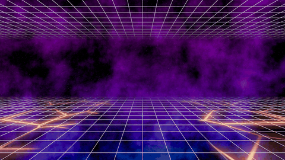

Glowing cracks in the floor, like lava under a crust: the edges of a cell pattern fixed to the
floor. Waves of light run along the cracks towards the camera. The cracks glow brighter with the
bass, and their cores turn yellow-white on a strong bass. The lane stays dark. The cracks lie on a
sheet 1.2 cm above the grid. Where the sheet is dark it is transparent, so the grid shows through.

- In: `bus`, `lane`. Out: `out`.
- Params: `presence` (towards 0 the cells go dark one after another), `seed`, `bass` (share of
  the glow that follows the bass), `cell` (metres across a cell), `thickness` (metres, the bright
  core), `glow` (metres, the light around it), `flow` (metres per beat the light runs), `pulse`
  (metres between two waves of light), `color`, `hot` (the core at full bass), `brightness`, `lane`
  (half the dark lane's width), `fade` and `gone` (metres ahead where the cracks start to fade and
  where they are gone), `smooth` (seconds the bass takes to fall).

### floor_palms

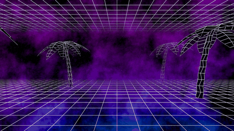

Wireframe palms in a line on each side of the lane, leaning away from it. A palm stands every
`spacing` bars of travel: the left ones pass the camera on a downbeat, the right ones half way
between. Each palm has a trunk of rings and 7 fronds. The fronds swing up and down, one swing
per two beats, wider with the mids. `palm.py` in the folder writes the two models.

- In: `bus`, `lane`. Out: `out`.
- Params: `presence` (towards 0 the palms shrink into the floor one after another), `spacing`
  (bars between two palms of a line), `size` (1 is 2.6 m to the crown), `fronds` (3 to 8),
  `sway` (degrees the fronds swing at full mids), `calm` (share of the swing left in quiet mids),
  `droop` (degrees the fronds hang), `lane` (1.6), `clear` (metres between the lane's edge and a
  trunk, room for the fronds), `near`, `far`, `beats_per_bar`, `smooth` (seconds the mids take to
  fall), `color`, `line_width`, `extent`.

### floor_animal

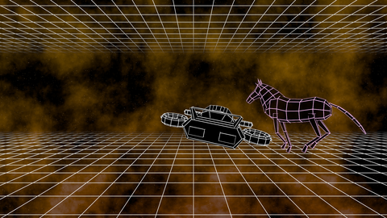

A wireframe horse galloping beside the lane. It runs a little faster than the flight for a while,
then a little slower, so it gains on the camera and falls back again, 3.5 to 6.5 m ahead. One
cycle takes 16 to 32 bars; `seed` sets its length. The legs follow the horse's way over the
floor: one stride per 1.155 m along its body, so a hoof on the ground stands still on the floor.
At the stage's 0.5 m per beat that is a stride every 2 beats, a little faster while the horse
gains on the camera. The stride is a slow gallop in the order Muybridge photographed: the hind
legs land, then the forelegs, then all four leave the ground. The body rocks, the neck swings, the
tail streams back. The horse faces 30 degrees in towards the lane, so the camera sees its flank.
Its body hides the lines behind it. `animal.py` in the folder writes the 24 poses.

- In: `bus`, `lane`. Out: `out`.
- Params: `presence` (towards 0 the horse runs off ahead and shrinks, 0 none), `at` (metres
  ahead on average), `range` (metres it gains and falls back), `cycle_min` and `cycle_max` (bars
  of one cycle), `seed`, `side` (1 right of
  the lane, -1 left), `lane` (1.6), `clear` (metres from the lane's edge to the horse's middle),
  `turn` (degrees it faces in towards the lane), `size` (1 is 1.6 m to the withers),
  `beats_per_bar`, `color`, `line_width`.

### floor_title

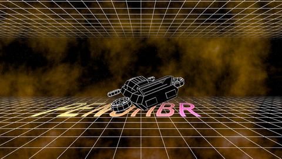

The track's title in huge letters lying across the lane, for the camera to fly over. At the
start of a track the first copy lies 4 m ahead, and one letter appears with each beat. The copy
keeps its distance until the last letter is there. Then it stays behind on the floor, and the
camera flies over it. Another copy follows every 8 bars of travel, all its letters there. The letters
follow the lane's bends, run through the palette from the first to the last, and sink into gaps
in the floor. `text` is the title. With `source: track` the letters say `TRACK` and the track's
number instead; the grid's sections know a track's number but no name. The bus channel
`track_bars` times the letters.

- In: `bus`, `lane`. Out: `out`.
- Params: `presence` (from 0.4 every letter, below it the letters go out one after another),
  `text`, `source` (`text` or `track`), `warmth`, `ahead` (metres to the first copy while
  its letters appear), `every` (bars between copies), `long` (metres a letter reaches along the
  floor), `wide` (metres from one letter to the next), `span` (metres the whole title takes at
  most), `brightness`, `rim` (how bright the outline is), `beats_per_bar`, `fade` and `gone`
  (metres where the letters fade out). The font is monospaced, so each letter has a place of its
  own: `JetBrains Mono` inside.

### mid_glider

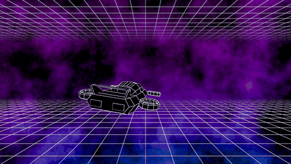

The glider: a wireframe hover craft flying ahead of the camera along the lane. It turns with the
lane, leans into each turn and bobs slowly. Towards `presence` 0 it climbs away ahead, up to 6 m
further and 1 m higher, and shrinks over the last quarter; at 0 it is gone. On a stage with walls
(`walls` 1 in the stage's `pose`) it would fly through the wall that way: there it floats
straight up out of the picture instead, and comes back down from above. The glider smooths
`presence` itself, so it glides in and out over about 4 seconds even when the arrangement fades
faster. In a break `beats.arrange` keeps it at 0.6: about 2 m further ahead and 0.35 m higher.

- In: `bus`, `lane`, `pose` (the stage's, for `walls`; unwired, it climbs away ahead). Out:
  `out` (into the stage's `mid`).
- Params: `presence`, `at` (metres ahead of the camera), `arrive` (seconds to cover 63 % of a
  change of `presence`, default 2), `bank` (how far it leans into a turn),
  `bob` (metres up and down), `scale` (0.16 makes it 2.4 m long), `hover` (metres above the
  floor).

### mid_particles

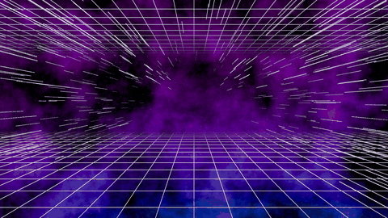

A warp stream: short white streaks fly at the camera, much faster than the floor, and pass it on
all sides. Busy music sends more of them; faster music draws them longer. They keep out of the
camera's line of sight and out of the glider's space, low in the middle.

- In: `bus`, `lane`. Out: `out` (into the stage's `mid`).
- Params: `presence` (towards 0 the stream thins out), `density` (the share of streaks in quiet
  music; onsets raise it to all), `busy` (seconds the onsets take to settle), `speed` (times the
  floor's speed), `length` (metres at 120 BPM), `spread` (half the stream's width), `near`, `far`,
  `thickness`, `color`, `line_width`.

### mid_debris

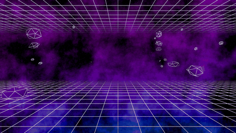

Low-poly wireframe rocks come at the camera, tumbling, and pass it on both sides. No rock comes
nearer than `clear` metres to the lane's middle or to the camera. In a drop, a kick bursts the
rock nearest 5 m ahead into shards, at most once every 2 bars. The shards fly out and shrink away
within a bar.

- In: `bus`, `lane`. Out: `out` (into the stage's `mid`).
- Params: `presence` (towards 0 the rocks shrink away one after another), `count` (up to 64),
  `seed` (other places), `size` (a rock's mean size, metres), `speed` (times the floor's speed),
  `spread`, `clear`, `low`, `high` (the band of heights, metres), `near`, `far`, `spin` (turns per
  beat); the burst's `burst` (on or off), `every` (bars between bursts), `beats_per_bar`,
  `shard_beats` (how long the shards fly), `reach` (metres they fly out); `color`, `extent`.

### mid_fog

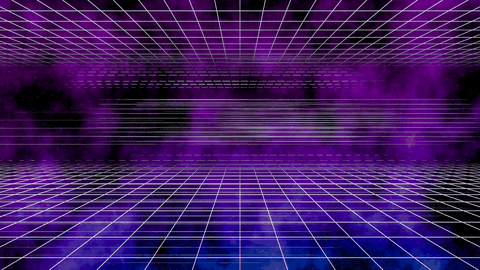

Banks of fog ahead on the lane, drawn as glowing horizontal lines. The banks stand still over the
floor, so the camera flies through them. Drifting noise lights the lines, brighter with the bass.
A bank fades out shortly before the camera reaches it. The light is faint and adds to the picture,
so the banks need no sorting.

- In: `bus`, `lane`. Out: `out` (into the stage's `mid`).
- Params: `presence` (towards 0 the banks fade one after another), `count` (up to 12), `seed`,
  `spread` (metres beside the lane), `low`, `high` (heights of the banks' middles), `sway`
  (sideways drift), `near`, `far`, `width`, `height` (a bank's size, metres), `brightness`,
  `quiet` (the light left without bass), `fade` (metres before the camera where a bank is gone),
  `start`, `end` (the distance fade; keep them at the stage's), `detail`, `thickness` (how much of
  a bank the fog fills), `cover` (how much it hides), `line_width`, `color`.
- The stage's distance fade goes by the render's data pass, which leaves out a surface under 5 %
  alpha. Keep `cover` under 0.05, or the fog takes the place of the lines behind it there. So the
  banks fade with distance by themselves, through `start` and `end` (2.5 and 7 m, nearer than the
  stage's fade: the banks shine brighter than a line, and far banks stood out as stripes over the
  horizon).

### mid_swarm

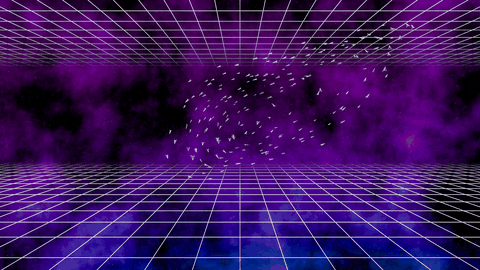

A swarm of up to 256 wireframe darts flying ahead of the glider. Each dart is a boid: it keeps its
distance from its neighbours, matches their heading and keeps to their middle. The swarm follows a
leader that wanders along the lane. Through the build before a boundary the swarm draws together.
A drop scatters it. The darts stay above the floor, under the ceiling and 4.5 to 9 m ahead.

- In: `bus`, `lane`. Out: `out` (into the stage's `mid`).
- Params: `presence` (towards 0 the darts shrink away one after another), `agents`, `at` (metres
  ahead), `hover` (metres up), `size` (a dart's length), `wander` (how far the leader strays
  sideways), `speed` (metres per second), `scatter` (how hard a drop throws them apart), `color`,
  `extent`.
- The swarm's state lives in a `tex.feedback`, so the flight carries on from frame to frame. After
  a seek the swarm flies on from where it was.

### mid_shapes

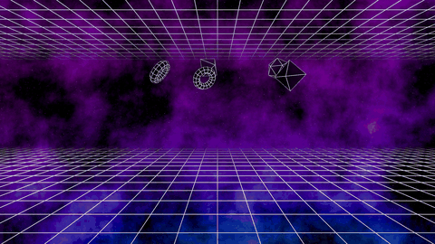

Wireframe solids fly in a ring ahead of the camera, above the glider: octahedra, tori and
icosahedra. The ring turns on at every bar. Each solid makes a quick turn on every beat. Through
the build before a boundary the ring draws together. A drop throws the solids apart, and they
gather again within a few seconds. Towards `presence` 0 the solids shrink away one after
another, and the ring flies off ahead.

- In: `bus`, `lane`. Out: `out` (into the stage's `mid`).
- Params: `presence`, `count` (3 to 7 solids), `seed` (which solid takes which shape), `size`
  (metres across), `at` (metres ahead), `hover` (metres up), `radius` (the ring's half width),
  `depth` (its half depth along the flight), `tilt` (how much higher its far side flies),
  `tight` (how much a build draws it together), `scatter` (how far a drop throws the solids),
  `turn` (the share of a step the ring turns on per bar), `spin` (turns per beat), `color`,
  `line_width`.
- The shapes come from `shapes.py` in the folder.

### mid_lasers

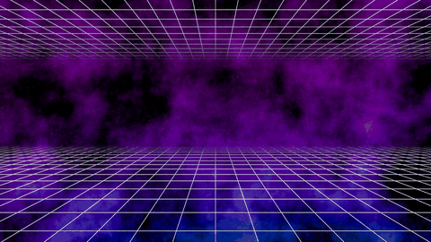

A fan of laser beams. The beams start at one point low over the lane, where the floor fades
into the distance, and pass the camera above and on both sides. The fan swings from side to side
once every two bars. Every kick takes the beams out for one frame, so they flicker with the
beat. The fan suits a drop; `beats.arrange` decides when it shows. Towards `presence` 0 the
outer beams draw back into their point first. With the stage's `pose` wired, the point lies at
the stage's `axis`, and where the stage is a tube (`curve` 1) the fan opens all round the point:
the beams leave the tube's axis far ahead and pass the camera on every side.

- In: `bus`, `lane`, `pose` (the stage's; unwired, the point is `low` over the floor and the
  fan opens upwards). Out: `out` (into the stage's `mid`).
- Params: `presence`, `count` (5 to 15 beams), `origin` (metres ahead where the beams start),
  `low` (their height there), `reach` (metres ahead where they end; below 0 behind the camera),
  `across` (how far out the outer beams end), `up` (how high the middle beam ends), `open`
  (degrees from the middle to the outer beams), `sweep` (degrees the middle swings), `strobe`
  (on or off), `thickness`, `color`, `line_width`.

### mid_scope

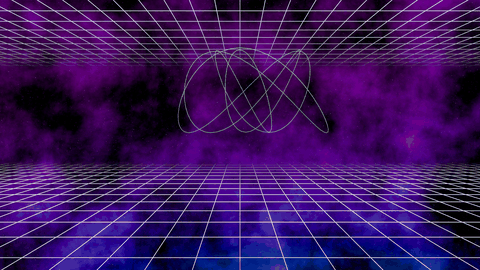

A green line in the air over the lane, like an oscilloscope. It is a Lissajous figure of the
music's levels, not its waveform. The bus carries levels only. Two sine waves draw the figure, one
across and one up and down. The mids set the frequency across and the treble the one up and
down. The bass makes the figure larger. Each beat turns the figure on by a step. The line is
closed and made of 192 short segments. Towards `presence` 0 the line shortens until it is gone.

- In: `bus`, `lane`. Out: `out` (into the stage's `mid`).
- Params: `presence`, `segments` (16 to 256), `at` (metres ahead), `hover` (metres up),
  `across`, `tall` (half the figure's width and height, metres), `depth` (how far the line bends
  towards the camera), `grow` (how much the bass enlarges it), `kick` (turns per beat),
  `smooth` (seconds the levels take to fall), `thickness`, `color`, `line_width`.

### ceiling_curtains

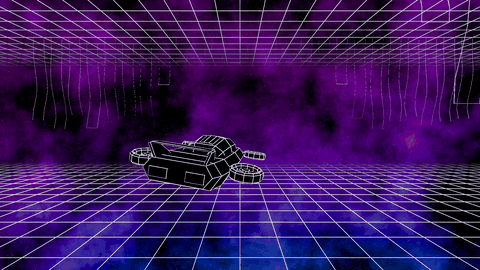

Curtains of wireframe cloth hanging from the ceiling across the lane. A curtain hangs every 2
bars of travel, so one passes the camera on every second downbeat. Each curtain is a row of 25
strips, and a wave runs down each strip. The mids make the cloth swing wider. Over the lane the
strips hang 0.7 m, so the camera flies under them. Beside the lane they hang 2.4 m. The strips
are lines only, so flying through them hides nothing.

- In: `bus`, `lane`. Out: `out` (into the stage's `ceiling`).
- Params: `presence` (towards 0 the strips draw up into the ceiling one after another),
  `spacing` (bars between two curtains), `strips` (3 to 32), `pitch` (metres from strip to
  strip), `fill` (share of the pitch a strip covers), `short` (metres a strip hangs over the
  lane, at most 0.8), `long` (metres beside the lane), `open` (metres from the lane's middle
  where the strips grow longer), `foot` (metres over which they grow), `wave` (degrees the hem
  swings at full mids), `calm` (share of the swing left in quiet mids), `waves` (waves from top
  to hem), `flow` (waves per beat), `ceiling` (its height, 4 m), `near`, `far`, `beats_per_bar`,
  `smooth` (seconds the mids take to fall), `color`, `line_width`, `extent`.

### ceiling_shafts

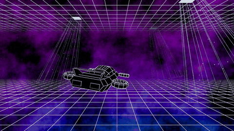

Shafts of light falling slanted from openings in the ceiling, beside the lane. A shaft stands
every bar of travel, by turns left and right of the lane, so one passes the camera on each
downbeat. Each shaft is a bright square in the ceiling and a cone of 16 rays, leaning outwards
and towards the camera. The rays grow dimmer towards the floor, and a ring marks where the light
meets it. Dust drifts down inside each cone and glints. The treble brightens the light. The
palette's warmth turns the light from warm white to cold blue. `shafts.py` in the folder writes
the models.

- In: `bus`, `lane`. Out: `out` (into the stage's `ceiling`).
- Params: `presence` (towards 0 the shafts draw up into the ceiling one after another),
  `spacing` (bars between two shafts), `size` (the cone's radius at the floor, metres), `narrow`
  (its radius at the ceiling, as a share of `size`), `slant` (degrees from straight down),
  `outwards` (degrees the lean turns from towards the camera to away from the lane), `lane` (1.6),
  `clear` (metres between the lane's edge and the nearest ray), `base` (the light without
  treble), `gain` (the light the full treble adds), `warmth`, `dust` (motes per shaft, 0 to 32),
  `mote` (a mote's size, metres), `fall` (how fast the dust sinks), `fade` and `gone` (metres
  ahead where the light starts to fade and where it is gone), `ceiling`, `near`, `far`,
  `beats_per_bar`, `smooth` (seconds the treble takes to fall), `line_width`, `extent`.

### ceiling_lights

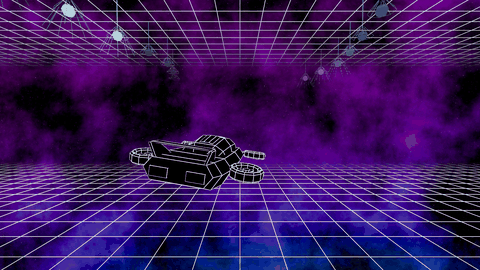

Two rows of paper lanterns under the ceiling, one on each side of the lane. Each lantern hangs on
a short string: a body of paper round an ellipsoid, filled in the lantern's colour, with 6 ribs
and 2 rings on it as darker lines, and a tassel. The lanterns swing
a little to and fro, more with the mids. A running light switches along each row: on every beat
the next lantern ahead lights up. The lanterns behind it glow on dimmer for a few beats. The light
runs away from the camera, faster than the floor comes towards it. The pattern repeats every 8
lanterns, and the right row runs half a pattern behind the left one. Each lantern of a pattern has
its own colour from the warm or cold palette; between warm and cold, each lantern takes one
palette whole, so the paper stays coloured. A dark lantern's paper glows dimly, a lit one's
shines bright and a little whiter. In a drop every lantern is on, and the
drop's flash lights them all up. `lantern.py` in the folder writes the models.

- In: `bus` (it reads `beat_index`, `section_role` and `drop`), `lane`. Out: `out` (into the
  stage's `ceiling`).
- Params: `presence` (towards 0 the lanterns draw up into the ceiling one after another),
  `spacing` (beats of travel between two lanterns), `period` (lanterns from one running light to
  the next), `trail` (dimmer lanterns behind it, 0 to 4), `apart` (metres from the lane's middle to
  each row), `size` (1 reaches 0.98 m down with its tassel; at most 1.2), `idle` (a dark lantern's
  paper), `full` (every lantern's light in a drop), `glow` (how bright a lit lantern's paper shines), `swing`
  (degrees at full mids, 7), `calm` (the share of the swing left without mids), `warmth`,
  `ceiling`, `near`, `far`, `line_width`, `extent`.

### sky_galaxy

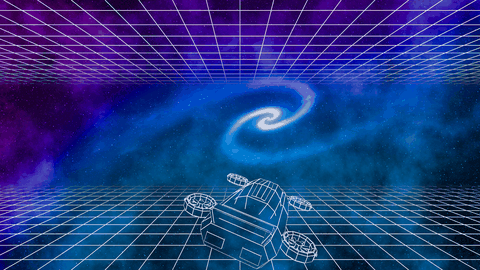

A spiral galaxy seen at a slant, over black, in the stage's palette: a warm core, arms of stars
with knots of glowing gas, dust lanes. It turns with `travelled` and brightens with the bass.

- In: `bus`. Out: `out`.
- Params: `presence` (towards 0 the galaxy dims to a dark sky), `brightness`, `warmth` (the
  palette, as on the stage), `spin` (degrees per beat), `lift`, `energy_curve`; its shape: `tilt`, `angle`, `size`,
  `twist`, `arms`, `bulge`, `dust`, `center`.

### sky_sun

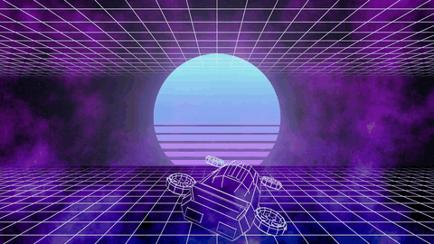

The synthwave sun: a big disc standing on the floor's far edge, with dark lines across its lower
half that widen towards the bottom and drift slowly down. Below the horizon it shines through
the floor. A glow lies around it. The bass
brightens it and swells it a little, a drop makes it flash.

- In: `bus`, `pose` (the stage's: the horizon moves with the camera). Out: `out`.
- Params: `presence` (towards 0 the sun dims to a dark sky), `brightness`, `warmth` (0 yellow to
  magenta, 1 cyan to violet, as on the stage), `size` (radius, in picture heights of a 60 degree
  view), `height` (its centre over the horizon, in the same unit), `lines`, `glow`, `reach`
  (metres ahead where the floor ends: the stage's `end`, 10), `through` (how much of the sun
  shines through the floor below the horizon: 1 all of it, the default; 0 cuts it at the
  horizon).

### sky_aurora

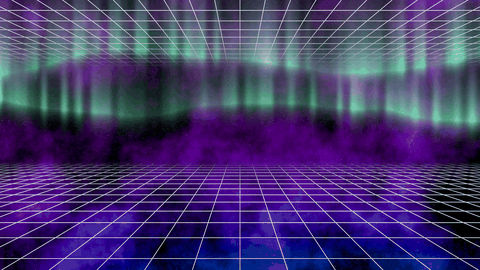

Curtains of light over the horizon: bands hang one above the other, each a bright wavy hem with
rays rising from it. They drift sideways and fold slowly as the world travels. The treble
brightens them.

- In: `bus`, `pose` (the stage's). Out: `out`.
- Params: `presence` (towards 0 the curtains dim to a dark sky), `brightness`, `warmth` (0 orange
  to magenta, 1 green to violet, as on the stage), `bands` (1 to 5), `height` (the lowest hem over
  the horizon, in picture heights of a 60 degree view), `speed` (per beat travelled), `glow`,
  `reach` (as on `sky_sun`).

### sky_planet

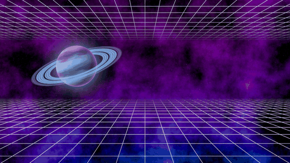

A planet with a tilted ring over the horizon. Bands of cloud in the palette run around it and
drift as it turns. The planet grows over each track: small at the track's start, twice the size
and a little higher at its end. It turns slowly and holds still against the beat (`breathe` lets the bass swell it). The ring's near half passes in front
of the disc, its far half behind it.

- In: `bus` (it reads `track_phase`), `pose` (the stage's). Out: `out`.
- Params: `presence` (towards 0 the planet dims to a dark sky), `brightness`, `warmth`, `size`
  (radius at a track's start, in picture heights), `growth` (how much larger at a track's end: 1
  twice), `place` (across the sky), `height` (its centre over the horizon), `rise` (how much
  higher at a track's end), `tilt`, `open` (how far the ring opens towards the viewer), `bands`,
  `spin` (turns per beat), `breathe`, `reach` (metres ahead where the floor fades out: the
  stage's `end`, where the horizon lies), `bend` (bound to the pose's `curve`: in a tube the
  planet hangs smaller in the middle of its far end, inside the ring), `axis`, `radius`, `far` as
  on `sky_bars`.

### sky_bars

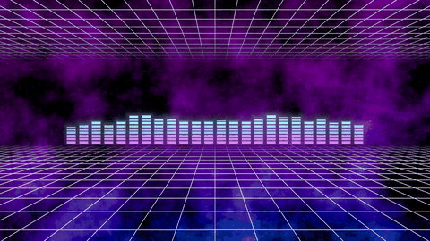

A row of glowing bars on the horizon, like an equaliser: the bass in the middle, the mids beside
it, the treble at both ends. Each bar is a stack of cells and moves a little by itself. The bus
has three levels, not a spectrum, so the bars between the bands blend them. An onset lifts
every bar for a moment.

- In: `bus`, `pose`. Out: `out`.
- Params: `presence`, `brightness`, `warmth`, `count` (bars), `span` (half the row's width, in
  picture heights), `tall` (a bar at full level), `gap` (dark share between bars), `cells` (0
  draws solid bars), `jitter` (how much each bar moves by itself), `kick` (the lift on an onset),
  `glow`, `reach`, `bend` (0 a straight row; 1 the row wraps round the view's vanishing point as
  a ring, the bars pointing to its middle: bind it to the pose's `curve`, so in a tube the bars
  stand on the wall of its far end), `axis`, `radius`, `far` (where the tube's far end lies;
  bound to the pose's channels of the same names).

### sky_city

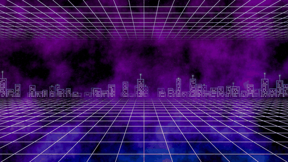

A skyline on the horizon: two rows of towers, the far one lower and dimmer, some with a mast and a
blinking light. The outlines glow in the palette. Windows light up and go out, and the louder the
mids, the more are lit. The skyline slides slowly sideways as the world travels, the far row at
half the pace. The towers' bodies only glow faintly, so the nebula shows through them a little.

- In: `bus`, `pose`. Out: `out`.
- Params: `presence`, `brightness`, `warmth`, `seed` (another number, another skyline), `tall`
  (the tallest towers, in picture heights), `slide` (picture heights per beat), `windows` (share
  lit in quiet passages), `flicker` (how much the mids light more and how often windows change),
  `edge` (the outlines' light), `reach`, `bend`, `axis`, `radius` and `far` as on `sky_bars` (the skyline wraps
  round the tube's far end, the towers pointing to its middle).

### sky_figure

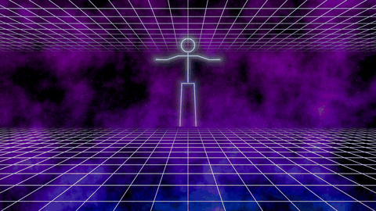

A huge figure of lines standing on the horizon. It stands still, and on every second bar it
sways with one arm out. Its arms rise through a build and are up through a drop, and the drop's
flash makes it jump. It bobs on the beats.

- In: `bus`, `pose`. Out: `out`.
- Params: `presence`, `brightness`, `warmth`, `tall` (its height standing, in picture heights;
  arms up reach a fifth higher), `place` (across the sky), `thickness` (pixels), `glow`, `reach`
  (as on `sky_planet`).

The six figures below are variants of `sky_figure`. Each takes the same poses on the same channels, so any of them can stand in its place in the sky slot. Each also stands in the tunnel: bind `bend` to the pose's `curve` (the component does) and the figure stands smaller on the bottom of the tube's far end (from the pose's `axis`, `radius` and `far`).

### sky_figure_solid

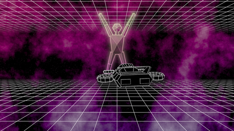

A variant of `sky_figure`: a filled low-poly silhouette. Each limb and the trunk are a few flat facets of dark fill, lit from the upper left, inside a bright edge.

- In: `bus`, `pose`. Out: `out`.
- Params: `presence`, `brightness`, `warmth`, `tall`, `place`, `tube` (its height in the tunnel, as a share of the tube's far end), `thickness` (the edge, pixels), `fill` (the facets' light), `seams` (the lines between facets), `glow`, `reach`.

### sky_figure_robot

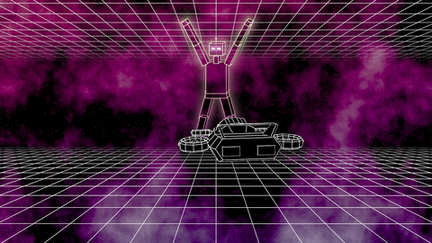

A variant of `sky_figure`: a robot of boxes. Every part is a wireframe box with a black inside, so a box in front hides the lines behind it. Two eyes glow in the head, and the antenna's tip flashes on each beat. It moves in steps: the arms in quarters, the sway at once with the bar, a drop of the body on each beat.

- In: `bus`, `pose`. Out: `out`.
- Params: `presence`, `brightness`, `warmth`, `tall`, `place`, `tube` (its height in the tunnel, as a share of the tube's far end), `thickness`, `depth` (how far the back faces lie), `eyes`, `glow`, `reach`.

### sky_figure_dancer

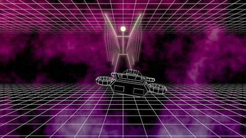

A variant of `sky_figure`: a slim dancer with a cloak of lines. The lines hang from the shoulders, the arms and the wrists. They swing with the mids, the outer ones a little later, so the cloak trails the arms. With the arms up the cloak opens like wings.

- In: `bus`, `pose`. Out: `out`.
- Params: `presence`, `brightness`, `warmth`, `tall`, `place`, `tube` (its height in the tunnel, as a share of the tube's far end), `thickness`, `strands` (lines per side), `cloak` (their light), `hem` (the cloak's lower edge), `swing`, `glow`, `reach`.

### sky_figure_joints

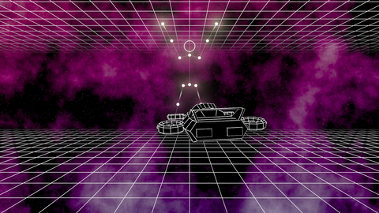

A variant of `sky_figure`: glowing joints and thin faint bones, like a figure in Tron. On each beat a pulse runs from the neck along the bones to the hands and feet, and each joint flashes as it passes.

- In: `bus`, `pose`. Out: `out`.
- Params: `presence`, `brightness`, `warmth`, `tall`, `place`, `tube` (its height in the tunnel, as a share of the tube's far end), `thickness` (the bones), `dots` (a joint's radius), `bones` (their light), `pulse`, `glow`, `reach`.

### sky_figure_giant

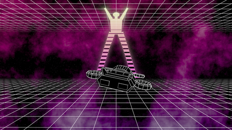

A variant of `sky_figure`: a giant seen from below. The legs are huge, and the body narrows upwards to a small head. The silhouette is filled, with dark bands across its lower part like the sun's, rolling slowly down.

- In: `bus`, `pose`. Out: `out`.
- Params: `presence`, `brightness`, `warmth`, `tall`, `place`, `tube` (its height in the tunnel, as a share of the tube's far end), `thickness`, `depth` (how much narrower the top is), `spread` (the feet's width), `lines` (bands), `glow`, `reach`.

### sky_figure_bust

A variant of `sky_figure`: only head and shoulders, huge over the horizon, as a wireframe of latitude and longitude lines with glowing eyes and a mouth. The poses become the head's: it tilts to the side on the sway, lifts through a build, tilts far back in a drop and nods on each beat. The drop's flash makes the whole bust jump.

- In: `bus`, `pose`. Out: `out`.
- Params: `presence`, `brightness`, `warmth`, `tall`, `place`, `tube` (its height in the tunnel, as a share of the tube's far end), `thickness`, `rim` (the light where a surface turns away), `fill`, `eyes`, `reach`.

### sky_eyes

Pairs of eyes in the dark sky. Each eye is a glowing almond with an iris in the palette. The
pupils follow the lane and look the way it turns. Now and then a pair blinks: shut for about four
frames, on a bar that its own number picks. The eyes suit breaks and intros, but the arrangement
treats them like any sky element.

- In: `bus`, `pose`, `lane` (the stage's; without it the pupils swing with `drift`). Out: `out`.
- Params: `presence`, `brightness`, `warmth`, `pairs` (1 to 6), `seed` (where the pairs sit and
  when they blink), `size` (an eye's half width, in picture heights), `look` (how far the pupils
  move), `blinks` (share of bars with a blink), `reach`.

### post_scanlines

Dark lines across the picture, like an old monitor. The lines roll slowly down as the world
travels. On every onset of the music they darken for a moment, so they flicker with the beat.
The preview is a piece of the picture at full size; scaled down, the lines vanish.

- In: `in` (the picture, e.g. the stage's `out`), `bus`. Out: `out`.
- Params: `presence` (0 passes the picture on unchanged), `pitch` (pixels from one line to the
  next), `strength` (how dark a line is: 0 none, 1 black), `thickness` (share of the pitch a line
  covers), `roll` (lines the pattern moves per beat travelled), `flicker` (how much darker lines
  and picture get on an onset), `decay` (seconds the flicker takes to fade).

### post_hud

A head-up display over the picture, in thin lines of the palette's colour. A crosshair sits in
the middle. The horizon and a pitch ladder lie where the stage's floor ends, and tilt with the
camera. A tape on the right reads the camera's height. Top left the bar count and a box per
beat. Bottom left a radar: the sweep turns once per bar, each section of the track is a blip,
and the rim fills as the track goes on. The lines dim and drop out for a moment on an onset and
flash on a drop. They add light to the picture and cover nothing. Chain it last, after
`post_scanlines`, so the lines stay sharp.

- In: `in` (the picture), `bus`, `pose` (the stage's `pose`; unwired, the horizon stands where
  the first camera has it). Out: `out`.
- Params: `presence` (0 passes the picture on unchanged), `warmth`, `brightness`, `thickness`
  (line width in pixels of a 1080 line picture), `flicker` (how much an onset dims the lines),
  `decay` (seconds the flicker takes to fade), `reach` (metres to the floor's end, as the stage's
  fade), `scale` (picture heights of the tape per metre), `beats_per_bar`.

